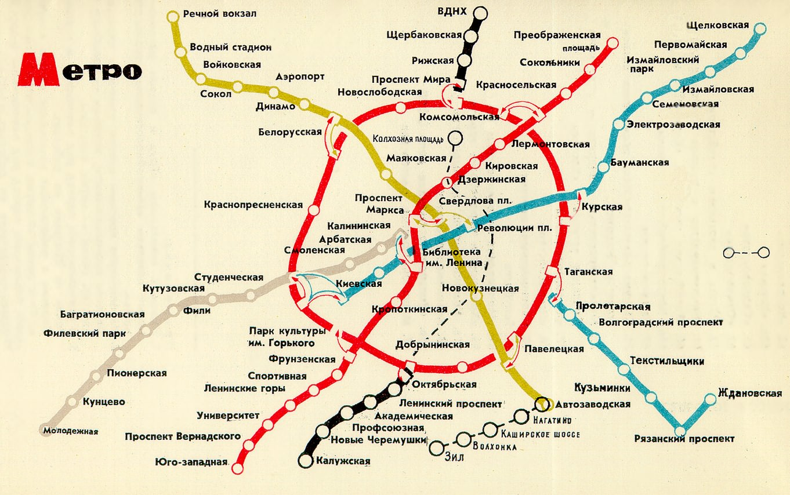

## Описание задания

Со списанного учебного стенда уцелели инвентаризация сегментов и лог диагностики.
Имена узлов утрачены. Собиравший стенд «перерисовал то, что видел каждый день
по дороге на работу». Найти имя узла 19.67.7.7.

Формат флага: flag{}

---

## Что за сеть?


Выписать из topology.map размеры сегментов и связи между ними.

```text
сегмент      узлов   тип     шлюзы ведут в
19.67.1.0/24   17    chain   2, 3, 4, 5
19.67.2.0/24   12    chain   1, 3, 5
19.67.3.0/24   12    chain   1, 2, 4, 5
19.67.4.0/24   12    chain   1, 3, 5
19.67.5.0/24   12    cycle   1, 2, 3, 4, 6, 7
19.67.6.0/24   10    chain   5          (разрыв между .4 и .5)
19.67.7.0/24    7    chain   5
```

Бросается в глаза сегмент 5. Он единственный кольцевой и единственный, с кем
связаны все остальные. Сегменты 6 и 7 подключены только к нему. Это не типовая
сетевая архитектура — это радиально-кольцевая схема транспорта.

Нарисовать граф по этим данным: получается кольцо с расходящимися от него
лучами. Схема метрополитена.


## Какого года и какого города?

Первые два октета нетипичные для сети, слитно как раз образуют год - 1967.

Город определяется по самой топологии: семь линий, из них одна
кольцевая, шесть радиальных, причём два луча подключены к кольцу одной точкой.
Такому описанию на 1967 год отвечает Москва.

Проверить по историческим схемам: metro.ru/map, https://metro.mwmoskva.ru/karta-shema-metro-moskvy-po-godam.html. Взять схему 1967 года.



## Сопоставить сегменты с линиями

Номера сегментов совпадают с номерами линий Московского метрополитена —
они с тех пор не менялись. Сопоставлять по трассе, а не по цвету: в 1967 году
Кольцевая рисовалась красной, Калужский радиус чёрным, Ждановский голубым.

Сверить по количеству станций.

```text
1  Кировско-Фрунзенская          17
2  Горьковско-Замоскверецкая     12
3  Арбатско-Покровская           12
4  Филевская                     12
5  Кольцевая                     12
6  Рижский + Калужский радиусы   10   не соединены -> разрыв .4/.5
7  Ждановский радиус              7
```

Разрыв в сегменте 6 сходится: в 1967 году Рижский и Калужский радиусы
существовали отдельно, сомкнули их только в 1971 году. На схеме это два
разных отрезка с одним номером.

Считать только действующие станции. Строящиеся на схеме обозначены
незакрашенными кружками и номеров не занимают.

## С какого конца нумеровать?

Направление задавать не нужно, оно определяется само — по положению шлюзов.

В сегменте 7 шлюз один, на адресе 19.67.7.1. Единственная станция Ждановского
радиуса с пересадкой — Таганская, она примыкает к кольцу. Значит .1 это
Таганская, и нумерация идёт от кольца наружу. 


## Разобрать лог

```text
19.67.6.10  сегмент 6, узел 10  -> Калужская          источник
19.67.6.5   сегмент 6, узел 5   -> Октябрьская        шлюз
19.67.5.4   сегмент 5, узел 4   -> Павелецкая         шлюз   
19.67.5.5   сегмент 5, узел 5   -> Таганская          шлюз
19.67.7.7   сегмент 7, узел 7   -> Ждановская         цель
```

Маршрут читается: с Калужской по радиусу до Октябрьской, переход на Кольцевую,
по кольцу до Таганской, переход на Ждановский радиус, дальше до конечной.
Оба промежуточных узла действительно пересадочные — маршрут возможен.

Вторая трассировка в логе идёт на 19.67.2.12 через 19.67.5.4, то есть
Калужская — Октябрьская — Павелецкая — Автозаводская. Тоже сходится, годится
для самопроверки.


## Собрать ответ

```text
19.67.7.7 -> Ждановская -> Zhdanovskaya (т.к. пароль задаётся латиницей)
```

---

# Ввести пароль Zhdanovskaya к архиву, открыть файл .txt

```text
flag{1935_g0_d33p3r_th3_n3tw0rk_1s_4l1v3}

```

# Финальный ответ

```text
flag{1935_g0_d33p3r_th3_n3tw0rk_1s_4l1v3}

```
