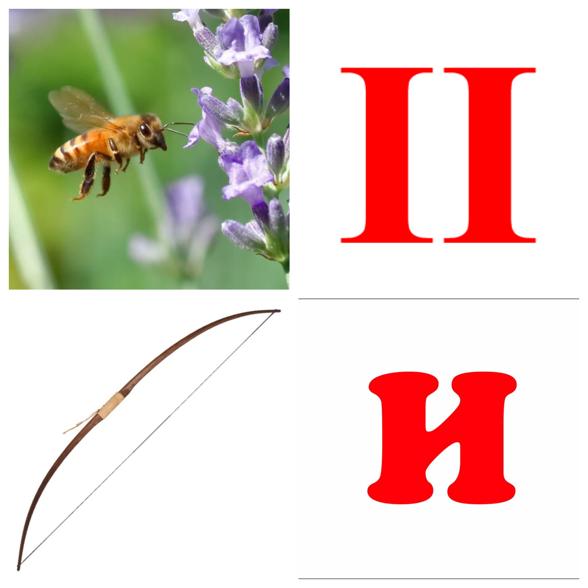
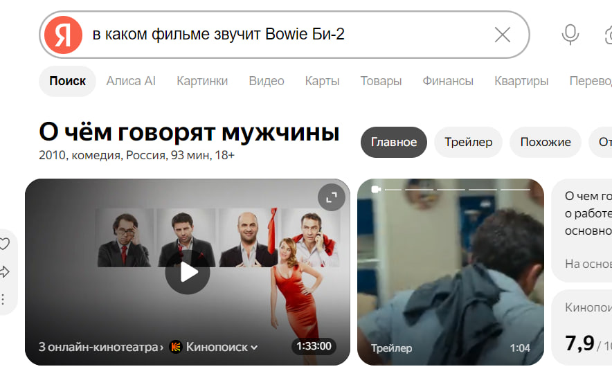
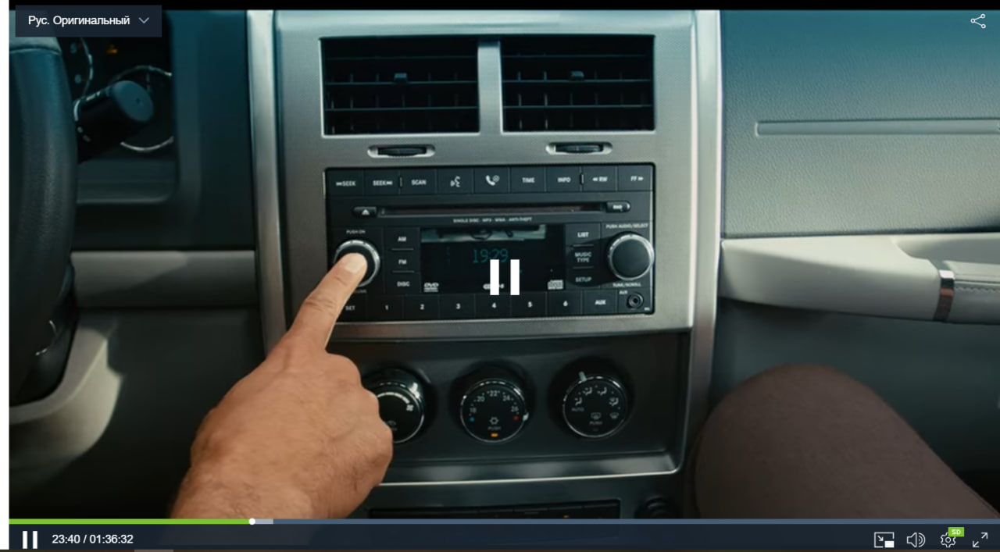
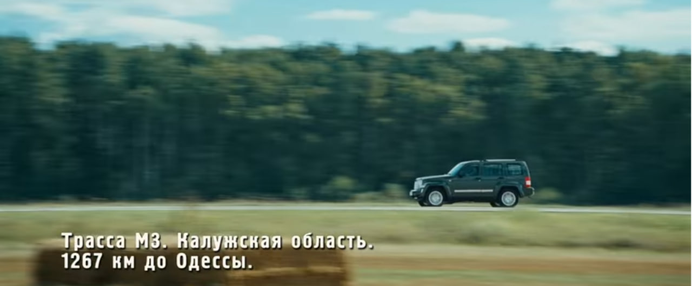
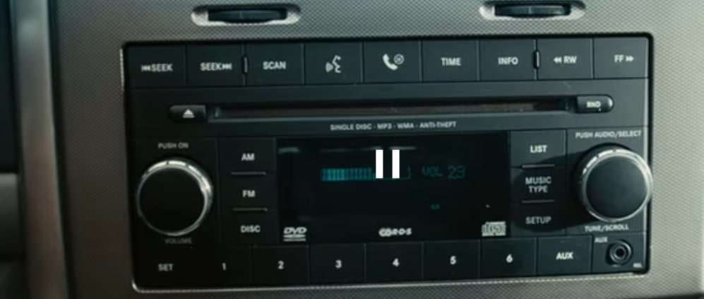

## Описание задания

Четверо друзей уехали на отдых. Где-то на трассе в приёмнике поймалось это.
Песня звучит в одном фильме, кажется после двадцать третьей минуты.

Формат флага: flag{Трасса_время_число}

---

## Что за картинка?

К заданию приложен коллаж из четырёх панелей. Текста нет, подписей нет, значит это ребус и панели надо прочитать словами.



Читаю по строкам, слева направо и сверху вниз, и получаю пчелу, двойку, лук и букву И. Складываю в лоб: «пчела два лук и». Ничего не значит.

Пробую иначе. Две панели это фотографии предметов, две другие это просто нарисованные знаки. Похоже, что читать их надо по-разному: знаки буквально, а предметы как-то ещё. Единственный «как-то ещё», который тут напрашивается, это английский.

```text
пчела -> bee   -> би
знак  ->          2
лук   -> bow   -> боу
знак  ->          и
```

Склеиваю: `би2боуи`.

## Что за песня?

Строка распадается на две части сама: «Би-2» это группа, а «Боуи» тогда название трека.

```text
запрос: Би-2 Bowie
```

Песня есть, она с альбома «Лунапарк». Легенда говорит, что трек звучит в каком-то фильме, а сам фильм не назван. Ищу связку.

```text
запрос: в каком фильме звучит Bowie Би-2
```

Выхожу на «О чём говорят мужчины». Сходится с первой строкой описания: четверо друзей, машина, дорога. Приёмник из легенды тоже на месте, герои едут и слушают радио.



## Где именно в фильме?

Фильм длинный, но описание сузило поиск до отрезка после двадцать третьей минуты. Открываю по ссылке из задания и мотаю туда, слушая, что идёт фоном.

На отметке 23:40 в машине из приёмника начинает играть Bowie. Это и есть нужный момент.



## Что собирать?

Пока песня звучит, останавливаю кадры и снимаю три значения, которые просит описание.

```text
номер трассы с указателя  -> М3
время на часах            -> 19:29
громкость на плеере       -> 23
```





Собираю в формате из задания.

---

# Финальный ответ

```text
flag{М3_19:29_23}
```
