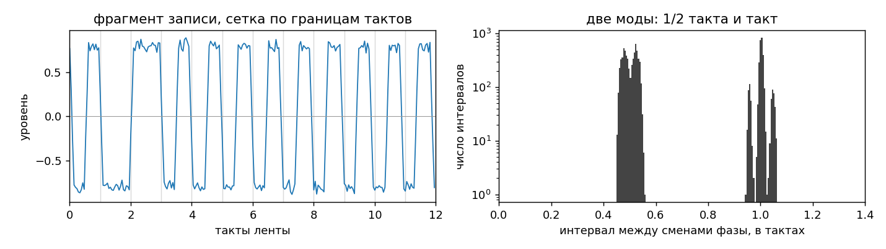
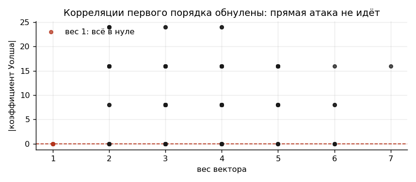
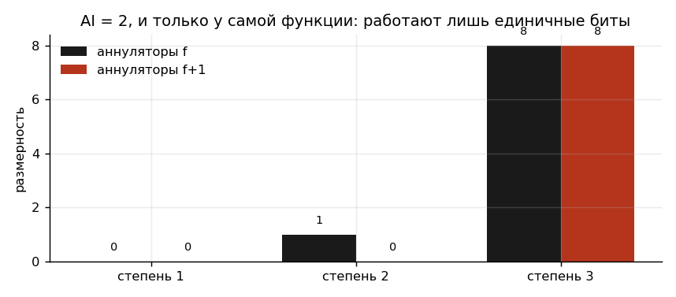
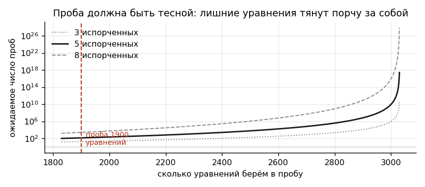
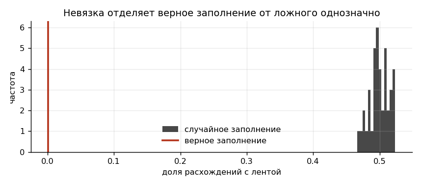

# Криптоанализ фильтрующего генератора при неполных и искажённых наблюдениях гаммы

## 1. Постановка задачи

Объектом анализа является поточный шифратор, реализованный по схеме фильтрующего генератора. Согласно восстановленной документации, устройство содержит регистр сдвига длины $L = 60$ в конфигурации Галуа с обратной связью, задаваемой многочленом

$$P(x) = x^{60} + x + 1,$$

и нелинейный узел подстановки, реализованный постоянным запоминающим устройством ёмкостью $2^7$ бит. На адресные входы ПЗУ поданы разряды регистра с номерами $T = \{3, 11, 19, 29, 37, 47, 58\}$; выход ПЗУ реализует булеву функцию $f : \mathbb{F}_2^7 \to \mathbb{F}_2$ и суммируется по модулю два с открытым текстом.

Обозначим через $s^{(t)} \in \mathbb{F}_2^{60}$ состояние регистра в такте $t$, через $s = s^{(0)}$ начальное заполнение. Гамма определяется соотношением

$$z_t = f\left(s^{(t)}_{\tau_1}, \ldots, s^{(t)}_{\tau_7}\right), \qquad \tau_i \in T.$$

В распоряжении аналитика находятся две фонограммы, содержащие фрагменты гаммы $\tilde{z}^{A}, \tilde{z}^{B} \in \mathbb{F}_2^{6000}$, снятые с разных участков одного носителя, а также криптографический контейнер формата AES-256-GCM. Постановка осложнена двумя обстоятельствами. Во-первых, фрагменты разделены интервалом неизвестной длины $\Delta$, причём априорная верхняя оценка отсутствует и ограничена лишь периодом регистра $2^{60} - 1$. Во-вторых, оцифровка носителя выполнена с ошибками: наблюдаемые последовательности отличаются от истинных в неизвестном числе позиций. Ключ контейнера выводится функцией $\mathrm{KDF}(s, \Delta)$, что делает определение обеих величин обязательным условием решения.

Прямой перебор начального заполнения имеет трудоёмкость $2^{60}$ и практически неосуществим.

## 2. Съём гаммы с магнитного носителя

Гамма выдана не в виде готовой последовательности, а фонограммами исходной записи, вследствие чего восстановлению битовой последовательности предшествует демодуляция. Способ записи, скорость протяжки и границы полезных данных в сопроводительной документации не указаны и подлежат определению непосредственно из сигнала.

Гистограмма интервалов между сменами фазы содержит ровно две моды, отношение которых равно двум. Такая структура отвечает фазоразностному коду (biphase-mark), применявшемуся для записи цифровых данных на магнитную ленту: смена фазы происходит на границе каждого такта, причём единичное значение добавляет дополнительную смену в середине такта. Код является самосинхронизирующимся, поскольку тактовая частота извлекается из самого сигнала.

*Рис. 1. Слева фрагмент фонограммы с наложенной сеткой границ тактов; справа распределение интервалов между сменами фазы. Наличие двух мод с отношением 1:2 и отсутствие промежуточных значений однозначно указывают на фазоразностный код.*

Номинальная длительность такта составляет 21 отсчёт при частоте оцифровки 22050 Гц. Существенным обстоятельством является непостоянство скорости лентопротяжного механизма: детонация достигает полутора процентов, вследствие чего фиксированная разметка приводит к накоплению ошибки и потере счёта тактов на длине в несколько тысяч символов. Демодулятор должен отслеживать текущую длительность такта, корректируя её по наблюдаемым интервалам.

Демодуляция реализуется как автомат с положением, измеряемым в тактах, где целые значения отвечают границам, а половинные серединам. Измеренный интервал округляется до половины такта, после чего целый интервал интерпретируется как нулевое значение, а пара половинных как единичное. Началу данных предшествует ракорд из нулевых тактов, задающий опорную частоту, и маркер из серии единиц, отделяющий служебную часть от полезной.

Следует подчеркнуть, что демодуляция восстанавливает последовательность лишь с точностью до ошибок носителя: часть импульсов перемагничена, и соответствующие такты читаются неверно. Число и положение таких тактов неизвестны, что учитывается на последующих этапах.

## 3. Криптографические характеристики фильтрующей функции

Анализ таблицы истинности $f$, извлечённой из дампа ПЗУ, даёт следующие значения. Вес Хэмминга равен 64, то есть функция сбалансирована. Алгебраическая степень $\deg f = 5$. Нелинейность $\mathrm{nl}(f) = 52$ при верхней оценке 56 для семи переменных.

Преобразование Уолша-Адамара

$$W_f(a) = \sum_{x \in \mathbb{F}_2^7} (-1)^{f(x) \oplus \langle a, x\rangle}$$

обращается в нуль на всех векторах $a$ единичного веса и принимает ненулевые значения на векторах веса два. Следовательно, порядок корреляционной иммунности равен единице.

*Рис. 2. Модули коэффициентов Уолша-Адамара, сгруппированные по весу аргумента. Обращение спектра в нуль на векторах единичного веса исключает применение корреляционной атаки Зигенталера-Мейера, поскольку статистическая связь гаммы с отдельным отводом регистра отсутствует.*

Полученные параметры удовлетворяют границе Зигенталера $\deg f \le n - 1 - \mathrm{CI}(f)$ с обращением в равенство, что свидетельствует о целенаправленном выборе функции по классическому набору критериев стойкости.

## 4. Алгебраическая иммунность и построение системы уравнений

Корреляционная и алгебраическая иммунность являются независимыми характеристиками булевой функции. Алгебраическая иммунность $\mathrm{AI}(f)$ определяется как минимальная степень ненулевой функции $g$, удовлетворяющей условию $f \cdot g \equiv 0$ либо $(f \oplus 1) \cdot g \equiv 0$. Пространство аннуляторов заданной степени вычисляется как ядро матрицы над $\mathbb{F}_2$, строки которой отвечают точкам носителя функции, а столбцы мономам ограниченной степени.

*Рис. 3. Размерности пространств аннуляторов степеней 1, 2 и 3 для функции $f$ и её дополнения. Аннулятор степени два существует исключительно у самой функции.*

Установлено, что $\mathrm{AI}(f) = 2$ при максимально достижимом значении 4 для семи переменных. Данное обстоятельство и составляет уязвимость исследуемой схемы: набор критериев, по которому функция оптимизирована, не включает алгебраическую иммунность.

Асимметрия результата имеет самостоятельное значение. Поскольку аннулятор степени два обнаружен только у $f$, уравнения порождаются исключительно тактами с $z_t = 1$; такты с нулевым значением гаммы информации не несут, вследствие чего эффективный объём наблюдений сокращается вдвое.

Пусть $g$ есть найденный квадратичный аннулятор. Для каждого такта $t$ с $z_t = 1$ справедливо

$$g\left(s^{(t)}_{\tau_1}, \ldots, s^{(t)}_{\tau_7}\right) = 0.$$

Разряды регистра в произвольный момент времени суть линейные формы от координат начального заполнения, что позволяет привести каждое такое соотношение к квадратичному уравнению относительно $s$. Применяя линеаризацию, при которой каждое произведение $s_i s_j$ трактуется как независимая переменная, получаем линейную систему над $\mathbb{F}_2$ с числом неизвестных

$$N = L + \binom{L}{2} = 60 + 1770 = 1830.$$

Свободный член в алгебраической нормальной форме $g$ отсутствует, вследствие чего система однородна.

## 5. Несовместность полной системы и метод отбраковки наблюдений

Фрагмент $\tilde{z}^{A}$ содержит 3031 единичный отсчёт, что превосходит $N$ более чем на тысячу уравнений. Тем не менее вычисление ядра построенной системы даёт нулевую размерность.

Данный результат противоречив по существу. Однородность системы гарантирует, что нулевой вектор мономов удовлетворяет ей тождественно, а истинное решение образует второй элемент ядра; следовательно, размерность ядра не может быть меньше единицы. Нулевое значение означает наличие взаимно противоречивых уравнений.

Источником противоречия являются ошибки оцифровки. Искажение вида $0 \to 1$ порождает уравнение, отвечающее такту, в котором условие $z_t = 1$ в действительности не выполнялось; такое уравнение не удовлетворяется истинным заполнением, и одного искажения достаточно для схлопывания ядра. Искажения вида $1 \to 0$ безвредны и приводят лишь к потере одного уравнения.

Поскольку локализация искажённых отсчётов априори неизвестна, применяется процедура, аналогичная декодированию по информационным совокупностям. Из полного множества уравнений мощности $M$ извлекается случайная подвыборка мощности $m$, для которой вычисляется ядро. Вероятность того, что подвыборка не содержит ни одного из $k$ ложных уравнений, приближённо равна

$$p(m) \approx \left(1 - \frac{m}{M}\right)^{k},$$

а математическое ожидание числа проб составляет $1/p(m)$.

*Рис. 4. Ожидаемое число проб как функция мощности подвыборки при различном числе искажённых отсчётов; шкала ординат логарифмическая. Значения $m < N$ не обеспечивают достаточного ранга, тогда как избыточные уравнения экспоненциально снижают вероятность успеха.*

Выбрано $m = 1900$, что даёт порядка $10^2$ проб на фрагмент. Критерием успешной пробы служит единичная размерность ядра. Извлечение решения требует выбора нетривиального элемента ядра: обратная подстановка в однородной системе возвращает тождественно нулевой вектор, формально корректный, но не несущий информации.

Верификация кандидата производится по невязке, то есть по числу расхождений между гаммой, порождённой кандидатом, и наблюдаемой последовательностью.

*Рис. 5. Распределение доли расхождений для случайных заполнений в сопоставлении с истинным. Для истинного заполнения невязка равна числу искажённых отсчётов, для произвольного близка к 1/2, что обеспечивает надёжное разделение гипотез.*

Процедура применяется независимо к обоим фрагментам, в результате чего определяются заполнения $s_A$ и $s_B$, отвечающие началу каждого из них.

## 6. Определение длины утраченного интервала

Установление величины $\Delta$ перебором невозможно ввиду отсутствия априорной верхней оценки: область поиска совпадает с периодом регистра и имеет мощность $2^{60} - 1$.

Решение основано на алгебраической структуре регистра. В конфигурации Галуа выдвигаемый разряд заводится сложением по модулю два внутрь регистра, вследствие чего состояние допускает интерпретацию как элемент поля $\mathbb{F}_{2^{60}} = \mathbb{F}_2[x]/(P(x))$, а такт сдвига в точности соответствует умножению на образующую $x$. Тогда

$$s_B = x^{T} \cdot s_A, \qquad T = \Delta + \ell,$$

где $\ell = 6000$ есть длина первого фрагмента. Определение $T$ сводится к вычислению дискретного логарифма

$$T \equiv \log_x s_B - \log_x s_A \pmod{2^{60} - 1}.$$

Определяющим обстоятельством является гладкость порядка мультипликативной группы:

$$2^{60} - 1 = 3^2 \cdot 5^2 \cdot 7 \cdot 11 \cdot 13 \cdot 31 \cdot 41 \cdot 61 \cdot 151 \cdot 331 \cdot 1321,$$

где наибольший простой делитель равен 1321. Алгоритм Похлига-Хеллмана редуцирует задачу к дискретным логарифмам в подгруппах простого порядка, каждый из которых вычисляется методом больших и малых шагов с трудоёмкостью $O(\sqrt{p})$. Суммарная трудоёмкость составляет порядка $\sum_i e_i \sqrt{p_i}$ операций в поле, чему отвечает время вычисления около 60 мс.

Полученное значение $\Delta = 811\,438\,920\,037\,451$ такта верифицируется прямой проверкой равенства $x^{T} s_A = s_B$.

Следует отметить, что выбор длины регистра $L = 60$ является определяющим для применимости изложенного подхода. При $L = 61$ величина $2^{61} - 1$ есть простое число Мерсенна, порядок группы факторизации не допускает, и трудоёмкость дискретного логарифма возрастает до $O(2^{30.5})$.

## 7. Восстановление ключа и заключение

Ключ контейнера вычисляется как SHA-256 от конкатенации служебного префикса, начального заполнения $s_A$ и величины $\Delta$ в восьмибайтовом представлении. Расшифрование в режиме GCM с проверкой имитовставки даёт содержимое конверта.

Полное время реализации атаки составляет около 80 с, из которых основная доля приходится на процедуру отбраковки искажённых наблюдений, тогда как вычисление дискретного логарифма занимает доли секунды.

Полное время включает демодуляцию обеих фонограмм, занимающую доли секунды и не влияющую на итоговую оценку трудоёмкости.

Проведённый анализ выявляет три независимых источника уязвимости исследуемой схемы. Первый состоит в игнорировании алгебраической иммунности при проектировании фильтрующей функции, оптимизированной по неполному набору критериев. Второй заключается в применимости вероятностных методов отбраковки к системам, несовместным вследствие ошибок измерения. Третий определяется выбором длины регистра, при котором порядок мультипликативной группы поля оказывается гладким, что сводит определение временного сдвига между наблюдениями к вычислительно тривиальной задаче.

Отдельно отмечается, что выдача гаммы фонограммой, а не готовой последовательностью, не изменяет криптографической сути задачи, однако смещает начальный этап анализа в область обработки сигналов: параметры кода и тактовая частота не сообщаются и определяются по наблюдаемому сигналу.

Итоговый результат: `flag{n0_dr1v3r_st1ll_0n_r0ut3_2025}`
