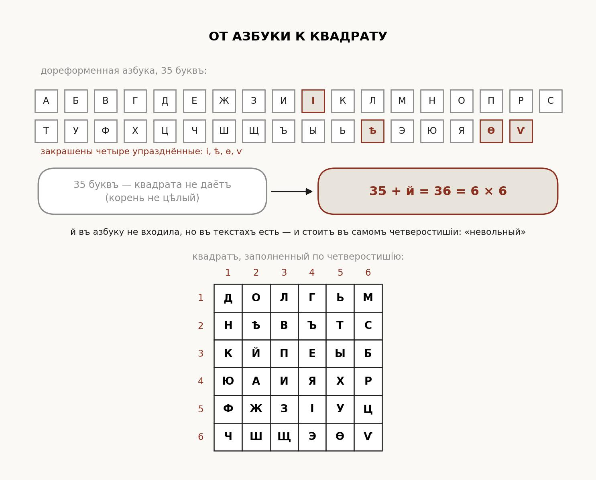
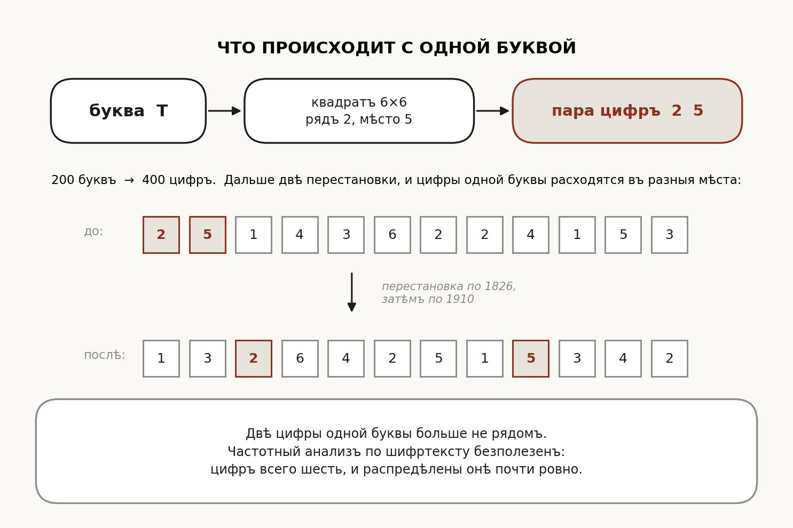

## Описание задания

Депеша из бумаг ресторации на Кузнецком Мосту — четыреста цифр. При ней счёт
из Пушкинского кабинета от 10 октября 1910 года, карточка из того же кабинета
и запертый пакет. Депеша несёт сообщение; пароль к пакету выводится из самого
расшифрованного сообщения; в пакете флаг.

---

## Что за заведение

По цитате из «Московских ведомостей» в описании.

```text
запрос: ресторация Кузнецкий мост Неглинная обеденным и ужинным столом
```

Ресторан «Яръ», открыт в канун 1826 года Транкилем Яром в доме сенатского
канцеляриста Людвига Шавана. Год подтверждается карточкой и номером счёта:
№ 1826/II.

## Что говорит приписка

Приписка на обороте счёта — единственное описание способа. Разбирать по фразам.

```text
«азбуку брать нашу, нынѣшнюю, всю какъ есть»
        -> азбука та, что действовала в году счёта, то есть в 1910

«разложить по ней квадратъ, а начало квадрата взять
 съ карточки, съ первыхъ строкъ»
        -> квадрат Полибия, заполняемый по стихам с карточки

«мѣсто каждой буквы означать двумя числами: которымъ рядомъ
 и которымъ мѣстомъ въ ряду»
        -> каждая буква заменяется парой координат

«столы переставлять дважды: первый разъ по нумеру счёта,
 второй разъ по году его»
        -> две колоночные перестановки, ключи 1826 и 1910

«гостей звать по числу лѣтъ... разсадить поровну»
        -> двести лет к юбилею; 400 цифр на 4 столбца -> 100 строк
```

## Какая азбука

Счёт помечен 1910 годом, значит азбука дореформенная. Состав и порядок —
в статье о русской дореформенной орфографии:

```text
https://ru.wikipedia.org/wiki/Русская_дореформенная_орфография
```

Тридцать пять букв: к нынешним добавлены і (и десятеричное), ѣ (ять),
ѳ (фита), ѵ (ижица). Ё и й отдельными буквами не считались.

Отсюда размер квадрата. Тридцать пять в квадрат не укладываются, но й
в текстах употребляется и стоит в самом четверостишии — «невольный».
С нею тридцать шесть.

```text
35 + й = 36 = 6 x 6
```



## Собрать квадрат

«Начало квадрата взять съ карточки» — заполнение по ключевому слову.
Выписать различные буквы четверостишия в порядке появления, затем дописать
оставшиеся буквы азбуки по порядку. Из четверостишия выходит 25 букв,
остальные 11 добавляются следом.

```text
Д О Л Г Ь М
Н Ѣ В Ъ Т С
К Й П Е Ы Б
Ю А И Я Х Р
Ф Ж З І У Ц
Ч Ш Щ Э Ѳ Ѵ
```

## Снять слои

Три слоя, снимать в обратном порядке: перестановка по 1910, перестановка
по 1826, потом развернуть координаты.

```python
AZ = "АБВГДЕЖЗИІКЛМНОПРСТУФХЦЧШЩЪЫЬѢЭЮЯѲѴ"

def col_order(key):
    return [p for p, _ in sorted(enumerate(key), key=lambda t: (t[1], t[0]))]

def untranspose(t, key):
    ncol, nrow = len(key), len(t) // len(key)
    cols = {c: t[n*nrow:(n+1)*nrow] for n, c in enumerate(col_order(key))}
    return "".join("".join(cols[c][r] for c in range(ncol)) for r in range(nrow))

d = untranspose(untranspose(cipher, "1910"), "1826")
plain = "".join(SQ[(int(d[i])-1)*6 + int(d[i+1])-1] for i in range(0, len(d), 2))
```

Цифры 1826 по возрастанию дают порядок столбцов 1, 3, 4, 2. В 1910 цифра 1
повторяется — при равных цифрах столбцы берутся слева направо, порядок
выходит 4, 1, 3, 2.



## Что вышло

```text
ЮБИЛЕЙНЫЙ УЖИН НАЗНАЧЕН НА ДЕСЯТОЕ ОКТЯБРЯ ДВЕ ТЫСЯЧИ ДВАДЦАТЬ ШЕСТОГО ГОДА
ДВЕСТИ ЛЕТ ОТ ОТКРЫТИЯ РЕСТОРАЦИИ В ДОМЕ ШАВАНА НА КУЗНЕЦКОМ МОСТУ
ЖДЕМ ВАС НА ЛЕНИНГРАДСКОМ ПРОСПЕКТЕ ДОМ ТРИДЦАТЬ ДВА
КЛЮЧ К ПАКЕТУ ЕСТЬ ОТПЕЧАТОК ВСЕЙ ДЕПЕШИ
```

Ужин назначен на 10 октября — тот же календарный день, каким помечен счёт
1910 года. А последняя строка прямо говорит, где взять пароль: он не в тексте
как слово, он — «отпечаток» самого текста.

## Отпереть пакет

Пароль не написан в депеше готовой строкой и не лежит на карточке. Он
вычисляется из полного восстановленного текста. Берётся ровно та строка,
что выдал разбор координат: 200 заглавных букв подряд, без пробелов. Её
SHA-256 в UTF-8, строчным hex, и есть пароль к архиву.

```python
import hashlib
pwd = hashlib.sha256(plain.encode("utf-8")).hexdigest()
# ff52ed6bb19dba5dfcc43c5a29699b3f382908880e09ce40b05d518c005c4f5d
```

```bash
7z x flag.zip -p$pwd
```

Внутри один файл с флагом.

Почему так, а не «слово из депеши»: открытый текст получается только после
снятия всех слоёв и с правильным квадратом. В карточке и счёте его нет,
списать неоткуда, угадать нельзя. Одна неверная буква меняет весь хэш —
пароль либо целиком верный, либо не подходит.

## На чём можно ошибиться

Взять современную азбуку. Тридцать три буквы не дают квадрата — это первый
признак, что азбука нужна другая.

Взять текст четверостишия из сети. Перепечатки расходятся: встречаются
«И с телятиной холодной» и «Трюфли Яра вспоминать». Лишняя буква меняет
порядок заполнения квадрата, и всё съезжает.

Написать «телятиной» через ять по аналогии с «тѣло». Ять там не пишется:
корень тел- чередуется с ё — телёнокъ, тёлка.

Переставить ключи местами. Снимать надо сначала 1910, потом 1826.

Забыть, что при равных цифрах в ключе 1910 столбцы берутся слева направо.

Взять хэш не от той строки: с пробелами между словами, в нижнем регистре,
с Ё вместо Е, или записать hex заглавными. Строка для хэша — ровно вывод
разбора координат: 200 заглавных букв без пробелов, hex — строчный.

---

# Финальный ответ

```text
flag{1826_s3ss10n_st1ll_4l1v3}
```
