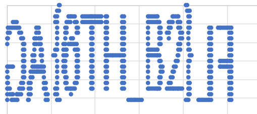

#### **Что нам вообще дано в задании?**

Файл Arbat.pcap с описанием "Арбат любит кликать". Открываем через Wireshark и видим, что это перехваченный трафик Bluetooth LE, то есть отчеты о состоянии беспроводной мышки (куда двигалась, когда были клики).

#### **Шаг 1.  Анализируем пакеты трафика**

По пакетам становится понятно, что мы имеем дело с протоколом ATT (Bluetooth Attribute Protocol). Смотрим, из чего состоит протокол в этом таске: в начале есть два пакета, благодаря которым устройство сообщает хосту, какая у него раскладка данных. Читаем и видим, что внутри каждый отчёт мыши состоит из 3-х байт: кнопка, X, Y. Также замечаем, что X и Y - это не «на сколько сдвинулась мышь», а абсолютные координаты от 0 до 255, из чего делаем вывод, что курсор живёт на площади размером 256×256. Дальше идёт 1168 одинаковых пакетов-уведомлений.

#### **Шаг 2. Работаем с пакетами**

Фильтруем, чтоб работали только с нужными нам отчётами состоящими из 3-х байт: кнопка, X, Y:

`btatt.opcode == 0x1b`

Если просмотреть все пакеты, то можно заметить, что не все отчеты одинаковые. В пакете первый байт отвечает за клик кнопки и имеет только 2 значения: 1 - левая кнопка мыши нажата, 0 - ничего не нажато. 
Также, Y координата ведёт себя странно при нажатой кнопке (1-ый байт пакета = 1), она принимает всего несколько разных значений, когда при не нажатой кнопке ведёт себя обычно и двигается плавно.
Из этого получаем вывод, что клики не случайны, а они "рисуют" что-то в пиксельном шрифте.

#### **Шаг 3. Восстанавливаем рисунок**

Выгружаем все пакеты текстом в формате "кнопка, X, Y": 

`tshark -r Arbat.pcap -Y "btatt.opcode == 0x1b" -T fields -e btatt.value | sed -E 's/(..)(..)(..)/\1,\2,\3/'`

Переводим вручную строчки из hex в числа (десятичную систему)
Либо добавляем в команду перевод из hex, чтоб получить готовые числа

`tshark -r Arbat.pcap -Y "btatt.opcode == 0x1b" -T fields -e btatt.value | sed -E 's/(..)(..)(..)/\1,\2,\3/' | awk -F, '{printf "%d,%d,%d\n", strtonum("0x"$1), strtonum("0x"$2), strtonum("0x"$3)}'`
  
Загружаем в Excel получившиеся строчки и фильтруем, чтоб строчки остались только с нажатой кнопкой. По получившимся строчкам, используя координаты X и Y,  строим точечную диаграмму, после чего получаем читаемый рисунок

Читаем целиком: `AG{6TH_B2}LF`, только AGLF ещё отзеркалены.

#### **Шаг 4. Думаем над получившейся строкой `6TH_B2`**

Разбираем строчку по частям:
- 6TH - оно же the sixth - оно же *шестой*, следовательно нам нужна каждая 6-ая строка
- B2 - оно же Byte - оно же Байт 2, то есть байт под номером 2, а он же является координатой X

Собираем всё вместе и получаем, что нам нужен 2-ой байт каждой 6-ой строки

#### **Шаг 5. Применяем инструкцию**

Так как все пакеты с нажатой кнопкой мы использовали, будем работать с "шумом", а именно с пакетами, где кнопка не нажата (первый байт = 0).

Выводим X координату всех пакетов с не нажатой кнопкой

`tshark -r Arbat.pcap -Y "btatt.opcode == 0x1b" -T fields -e btatt.value | sed -E 's/(..)(..)(..)/\1,\2,\3/' | awk -F, '$1 == "00" {print $2}'`

Сохраняем получившиеся каждые hex символы в a.txt.
Выбираем каждый 6-ой hex символ из получившихся

`awk 'NR % 6 == 0' a.txt`

Сохраняем в b.txt и декодируем из hex в текст

`awk '{printf "%c", strtonum("0x"$1)}' b.txt`

Также, можно вывести всё одной командой

`tshark -r Arbat.pcap -Y "btatt.opcode == 0x1b" -T fields -e btatt.value | sed -E 's/(..)(..)(..)/\1,\2,\3/' | awk -F, '$1 == "00" {print $2}' | awk 'NR % 6 == 0 {printf "%c", strtonum("0x"$1)}'`

Получаем строку 
`flag{0ld_4rb4t_l34v3s_d1g1t4l_tr4c3s}/5,.MTj{¡k¸ªÃ°¯ãÝÿïõüèôÿÿÒßÿ÷÷Ôª|w°«`, 
из который берем флаг: 
flag{0ld_4rb4t_l34v3s_d1g1t4l_tr4c3s}

#### **Итог**

Флаг: flag{0ld_4rb4t_l34v3s_d1g1t4l_tr4c3s}

