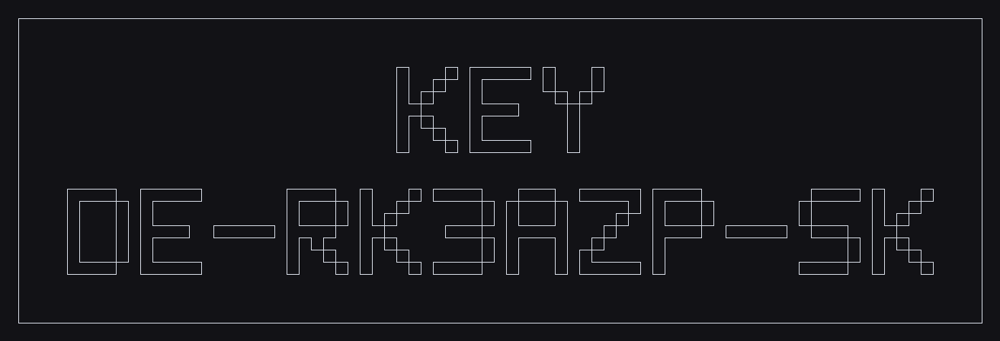
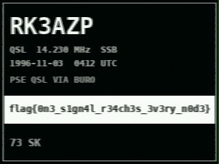

# Восстановление повреждённого контейнера уровней и декодирование медленной телевизионной развёртки

## 1. Постановка задачи

Выданы два объекта. Файл `no_name` не имеет расширения, не открывается известными приложениями и не опознаётся утилитой `file`. Архив `qsl.zip` содержит единственный элемент и защищён паролем.

Поскольку иных источников пароля не предоставлено, анализу подлежит первый файл, тогда как архив выполняет функцию контрольного механизма, подтверждающего корректность извлечённого значения.

## 2. Определение формата

Утилита `binwalk` вложенных структур не обнаруживает, `exiftool` формат не распознаёт. Первые байты файла нулевые, что указывает на удаление сигнатуры.

Извлечение печатных последовательностей даёт следующее:

```
$ strings no_name | head
MAP01
THINGS
LINEDEFS
SIDEDEFS
VERTEXES
SEGS
SSECTORS
NODES
SECTORS
REJECT
BLOCKMAP
```

Полученный перечень представляет собой незашифрованный каталог. Совокупность идентификаторов `LINEDEFS`, `SIDEDEFS` и `VERTEXES` однозначно соответствует формату WAD, служащему контейнером игровых уровней.

Структура заголовка формата:

```
0x00  4 байта   "IWAD" или "PWAD"
0x04  int32 LE  число лампов
0x08  int32 LE  смещение каталога
```

Проверка подтверждает гипотезу: число элементов равно 11, смещение каталога указывает точно на область, в которой обнаружены идентификаторы, а размер записи в 16 байт согласуется с общей длиной каталога без остатка. Повреждённой является исключительно сигнатура.

Восстановление выполняется дописыванием сигнатуры:

```python
raw = bytearray(open("no_name", "rb").read())
raw[0:4] = b"PWAD"
open("qsl.wad", "wb").write(bytes(raw))
```

## 3. Извлечение данных из геометрии уровня

Восстановленный контейнер содержит единственный уровень `MAP01`.



*Рис. 1. Планировка уровня в редакторе. Расположенные внутри помещения колонны при рассмотрении сверху образуют текстовую надпись, содержащую пароль к архиву.*

Извлечённое значение:

```
KEY
DE-RK3AZP-SK
```

Применение специализированного редактора не является обязательным. Геометрия хранится в двух лампах и допускает непосредственный разбор. Ламп `VERTEXES` содержит последовательность пар шестнадцатиразрядных знаковых величин по четыре байта на вершину; ламп `LINEDEFS` содержит записи по четырнадцать байт, первые два поля которых суть индексы начальной и конечной вершины.

```python
import struct
v = lumps["VERTEXES"]
verts = [struct.unpack("<hh", v[i:i+4]) for i in range(0, len(v), 4)]

l = lumps["LINEDEFS"]
lines = [struct.unpack("<7H", l[i:i+14])[:2] for i in range(0, len(l), 14)]
```

Отрисовка полученного множества отрезков произвольными средствами воспроизводит то же изображение. Альтернативный способ состоит в запуске уровня в совместимом движке с активацией полного отображения карты.

## 4. Извлечение содержимого архива

Полученное значение открывает `qsl.zip`. Архив использует шифрование AES, вследствие чего штатная утилита `unzip` завершается с сообщением о неподдерживаемом методе сжатия 99, и требуется реализация с поддержкой соответствующего расширения формата.

```
$ 7z x qsl.zip -pDE-RK3AZP-SK
```

Извлекается файл `recording.wav` продолжительностью сорок две секунды, монофонический.

## 5. Идентификация и декодирование сигнала

Слуховой анализ обнаруживает трёхсекундный шумовой участок, за которым следует протяжённый тональный сигнал равномерного характера, завершающийся повторным шумовым участком. Речевая либо музыкальная составляющая отсутствует.

Спектральный анализ выявляет в средней части записи плотную структуру, повторяющуюся построчно, с вертикальными синхронизирующими отметками через равные интервалы. Указанная картина характерна для построчной передачи изображения звуковым сигналом, то есть для медленной телевизионной развёртки.

Декодирование выполняется непосредственно из файла без применения виртуального звукового тракта:

```
$ pip install https://github.com/colaclanth/sstv/archive/refs/heads/master.zip
$ python -m sstv -d recording.wav -o frame.png
[sstv] Searching for calibration header... Found!
[sstv] Detected SSTV mode Robot 36
[sstv] Decoding image...  [####################################]  100%
[sstv] Drawing image data...
[sstv] ...Done!
```

Установлен режим Robot 36, разрешение кадра 320 на 240.

Следует учитывать особенность реализации декодера. Вызов производится из терминала, в каталоге расположения обрабатываемого файла: при отрисовке индикатора выполнения запрашивается ширина окна, вследствие чего запуск из интегрированной среды либо с перенаправлением вывода завершается ошибкой `OSError: Inappropriate ioctl for device`. Ширина окна терминала должна составлять не менее тридцати колонок.

Ограничение устраняется обращением к программному интерфейсу декодера с подавлением вывода:

```python
import sstv.decode as D
D.log_message = lambda *a, **k: None
D.progress_bar = lambda *a, **k: None

with open("recording.wav", "rb") as fh:      # передаётся файловый объект, не путь
    with D.SSTVDecoder(fh) as d:
        d.decode().save("frame.png")
```



*Рис. 2. Декодированный кадр: карточка подтверждения радиосвязи, содержащая позывной, частоту, дату, время и искомое значение.*

## 6. Интерпретация вспомогательных элементов

Ретроспективно раскрывается семантика наименования задания и структуры пароля. Сокращение `DE` в радиообмене означает указание на отправителя, сокращение `SK` обозначает завершение связи, а в среде радиолюбителей дополнительно используется для обозначения ушедшего из жизни оператора.

## 7. Заключение

Решение опирается на три этапа. Первый состоит в определении формата по незашифрованному каталогу при удалённой сигнатуре, причём согласованность полей заголовка позволяет верифицировать гипотезу до восстановления файла. Второй заключается в извлечении данных из геометрии уровня, которая допускает как визуальный, так и непосредственный программный разбор. Третий состоит в идентификации сигнала по спектральной картине и его декодировании с обходом ограничения, накладываемого реализацией декодера на среду выполнения.

Итоговый результат: `flag{0n3_s1gn4l_r34ch3s_3v3ry_n0d3}`
