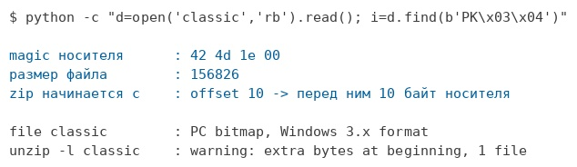
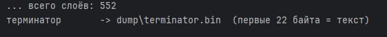
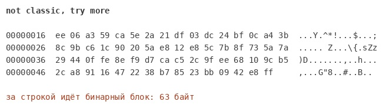
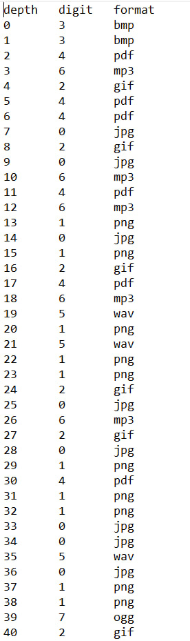
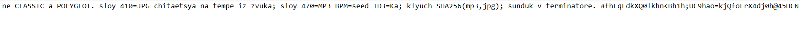
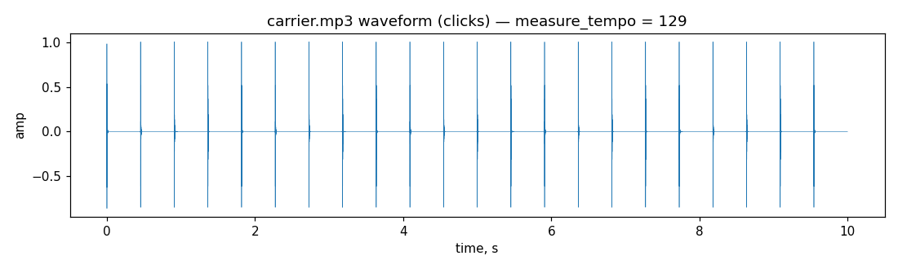
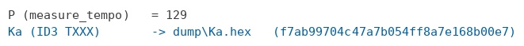
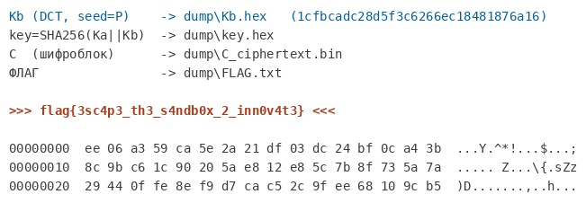

# Восьмеричное кодирование сигнатурами носителей в цепочке полиглотов с многоканальной сборкой ключа

## 1. Постановка задачи

Выдан единственный файл `classic` без расширения. Наименование задания указывает на классическую вложенную структуру типа «архив в архиве», предполагающую последовательное извлечение до достижения внутреннего слоя.

Первичная идентификация даёт противоречивый результат:

```bash
file classic
# classic: BMP image data
```

Утилита `file` определяет файл как растровое изображение, тогда как наименование указывает на архивную структуру. Проверка на архив:

```bash
unzip -l classic
# warning: ... extra bytes at beginning or within zipfile
# ... 1 file
```

Файл одновременно является корректным изображением и корректным архивом. Данная структура представляет собой полиглот: в начале расположен носитель с соответствующей сигнатурой, в конце — архив, поскольку формат ZIP считывается от завершающей записи каталога. Каждый слой содержит носитель некоторого формата с присоединённым архивом, содержащим следующий слой.



*Рис. 1. Структура полиглота: носитель с сигнатурой в начале файла и архив в его завершающей части.*

## 2. Разворачивание вложенной структуры

Извлечение первого слоя обнаруживает носитель иного формата, также содержащий присоединённый архив.

```bash
mkdir x && cd x && unzip ../classic
file _
# _: PC bitmap, Windows 3.x format
```

Ввиду большого числа слоёв ручное извлечение нецелесообразно. Существенным обстоятельством является смещение внутренних оффсетов архива вследствие присоединения носителя перед ним; библиотека `zipfile` корректирует это смещение автоматически.

```python
import io, zipfile

def unwrap_once(data: bytes) -> bytes:
    z = zipfile.ZipFile(io.BytesIO(data))   # prepend-оффсеты правятся автоматически
    return z.read(z.namelist()[0])          # на каждом слое ровно одна запись

data = open("classic", "rb").read()
depth = 0
while True:
    try:
        data = unwrap_once(data)
        depth += 1
    except zipfile.BadZipFile:
        break
```

Процедура завершается на глубине 552, причём внутренний слой содержит не искомое значение, а текстовую строку `not classic, try more`.



*Рис. 2. Процесс автоматического разворачивания вложенных слоёв.*



*Рис. 3. Достижение внутреннего слоя, содержащего строку-указание вместо ответа.*

## 3. Переинтерпретация структуры

Внутренний слой содержит указание на то, что классический подход, ориентированный на извлечение единственного вложенного элемента, неверен. Проверка носителей на наличие скрытых данных методами анализа печатных строк, младших битов и присоединённых после завершения данных результата не даёт: носители по отдельности не содержат посторонней информации.

Следовательно, значимой является не содержимое отдельного слоя, а структура последовательности слоёв в целом: формат носителя на каждом уровне и порядок их следования.

## 4. Восьмеричное кодирование форматами

Перечень форматов носителей по глубине содержит ровно восемь различных типов:

```
jpg  png  gif  bmp  pdf  wav  mp3  ogg
```

Число различных форматов в сочетании с указанием на неклассический характер задачи определяет систему счисления: каждый слой кодирует одну восьмеричную цифру, задаваемую форматом носителя. Цифра определяется по сигнатуре в начале файла, а не по маркеру архива, присутствующему одинаково на всех слоях.

```python
SIG = {
    b"\xFF\xD8\xFF":       0,
    b"\x89PNG\r\n\x1a\n":  1,
    b"GIF89a":             2,
    b"BM":                 3,
    b"%PDF-":              4,
    b"RIFF":               5,
    b"ID3":                6,
    b"OggS":               7,
}
def digit(head: bytes):
    for sig, d in sorted(SIG.items(), key=lambda kv: -len(kv[0])):
        if head.startswith(sig):
            return d
    return None
```

Проход по структуре с извлечением цифры на каждом слое даёт последовательность из 552 восьмеричных цифр; внутренний текстовый слой служит терминатором.



*Рис. 4. Извлечение последовательности восьмеричных цифр из форматов носителей.*

## 5. Преобразование последовательности в текст

Последовательность из 552 восьмеричных цифр соответствует 1656 битам, то есть 207 байтам. Целочисленность результата подтверждает гипотезу об осмысленном содержании.

```python
bits = "".join(f"{d:03b}" for d in digits)
text = bytes(int(bits[i:i+8], 2) for i in range(0, len(bits), 8))
```

Результат содержит осмысленное начало и заполняющий остаток:

```
ne CLASSIC a POLYGLOT. sloy 410=JPG chitaetsya na tempe iz zvuka;
sloy 470=MP3 BPM=seed ID3=Ka; klyuch SHA256(mp3,jpg); sunduk v terminatore. #<набивка>
```

Размещение инструкции внутри канала, образованного форматами, исключает её непосредственное извлечение поиском по файлу: прочтение возможно лишь после полного прохода канала. Заполняющая часть после разделителя служит выравниванием до требуемой длины.



*Рис. 5. Извлечённая инструкция, определяющая схему сборки ключа.*

## 6. Интерпретация инструкции

Инструкция называет два слоя по их номерам и описывает схему сборки. Слой 410 формата JPEG считывается с использованием темпа, извлекаемого из звука. Слой 470 формата MP3 содержит темп в качестве инициализирующего значения и половину ключа в теге ID3. Ключ вычисляется как SHA-256 от конкатенации данных из обоих слоёв. Контейнер размещён в терминаторе, ранее принятом за тупиковый элемент.

Проход по структуре модифицируется с сохранением слоёв для доступа по номеру; вводится функция отделения носителя от присоединённого архива.

```python
def collect(path):
    data, layers, depth = open(path, "rb").read(), {}, 0
    while digit(data[:8]) is not None:
        layers[depth] = data
        data = unwrap_once(data)
        depth += 1
    return layers, data              # data на выходе это терминатор

def carrier(layer: bytes) -> bytes:  # носитель без хвостового zip
    return layer[:layer.find(b"PK\x03\x04")]
```

## 7. Извлечение данных из аудионосителя

Носитель слоя 470 представляет собой короткий метрономический сигнал. Половина ключа извлекается из тега:

```python
from mutagen.id3 import ID3
open("s470.mp3", "wb").write(carrier(layers[470]))
Ka = bytes.fromhex(ID3("s470.mp3").getall("TXXX")[0].text[0])
```

Инструкция подчёркивает, что темп извлекается из звукового сигнала, а не из метаданных. Применение стандартного детектора темпа даёт дробное и нестабильное значение вследствие встроенного байесовского приора, смещающего оценку к типичным значениям. Для использования в качестве инициализирующего значения требуется целое и воспроизводимое число, вследствие чего темп измеряется непосредственно по геометрии импульсов: определяются моменты их начала, вычисляется медиана межимпульсных интервалов и выполняется перевод в удары в минуту.

```python
import numpy as np, librosa
def measure_tempo(path, sr=22050):
    y, _ = librosa.load(path, sr=sr)
    onsets = librosa.onset.onset_detect(y=y, sr=sr, units="time", backtrack=False)
    return int(round(60.0 / np.median(np.diff(onsets))))
P = measure_tempo("s470.mp3")
```



*Рис. 6. Метрономический характер аудионосителя, обеспечивающий устойчивое измерение темпа.*



*Рис. 7. Извлечение половины ключа из тега и измеренного темпа.*

## 8. Извлечение данных из изображения

Измеренный темп служит инициализирующим значением для стеганографического извлечения из изображения слоя 410.

Существенным обстоятельством является размещение данных в квантованных коэффициентах дискретного косинусного преобразования, а не в отсчётах изображения: декодирование в пиксели с последующим перекодированием изменяет коэффициенты и разрушает вложение. Обработка ведётся на уровне коэффициентов. Данные размещены в младшем бите одного среднечастотного коэффициента, а порядок обхода блоков задаётся генератором псевдослучайных чисел с инициализирующим значением, равным темпу.

```python
import jpeglib
def dct_extract(path, P, nbytes):
    Y = jpeglib.read_dct(path).Y
    bh, bw = Y.shape[0], Y.shape[1]
    nb = nbytes * 8
    order = np.random.RandomState(P).permutation(bh * bw)[:nb]
    bits = "".join(str(int(Y[by, bx, 2, 3]) & 1)
                   for by, bx in (divmod(o, bw) for o in order))
    return bytes(int(bits[k:k+8], 2) for k in range(0, nb, 8))

open("s410.jpg", "wb").write(carrier(layers[410]))
Kb = dct_extract("s410.jpg", P, 16)
```

## 9. Сборка ключа и извлечение содержимого

Обе половины ключа определены. Ключ вычисляется как SHA-256 от их конкатенации; контейнер размещён в терминаторе, за видимой текстовой строкой которого следует бинарный блок.

```python
import hashlib
from Crypto.Cipher import AES

key = hashlib.sha256(Ka + Kb).digest()
C = terminator.split(b"not classic, try more\n", 1)[1]
nonce, tag, ct = C[:12], C[12:28], C[28:]
flag = AES.new(key, AES.MODE_GCM, nonce=nonce).decrypt_and_verify(ct, tag)
```

Успешная проверка имитовставки в режиме GCM подтверждает корректность собранного ключа.



*Рис. 8. Расшифрование контейнера, размещённого в элементе, изначально принятом за тупиковый.*

## 10. Заключение

Решение опирается на четыре обстоятельства. Первое состоит в распознавании структуры как цепочки полиглотов, а не простой вложенности архивов. Второе заключается в переинтерпретации, при которой значимой оказывается последовательность форматов, а не содержимое отдельных слоёв, причём число различных форматов задаёт систему счисления. Третье состоит в извлечении инструкции через восьмеричный канал, что исключает её обнаружение прямым поиском. Четвёртое определяется многоканальной сборкой ключа с измерением темпа по геометрии сигнала вместо метаданных и извлечением из коэффициентов преобразования вместо отсчётов изображения.

Итоговый результат: `flag{3sc4p3_th3_s4ndb0x_2_inn0v4t3}`
