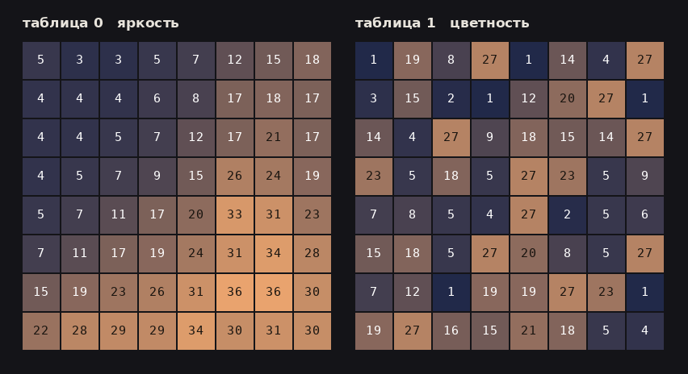
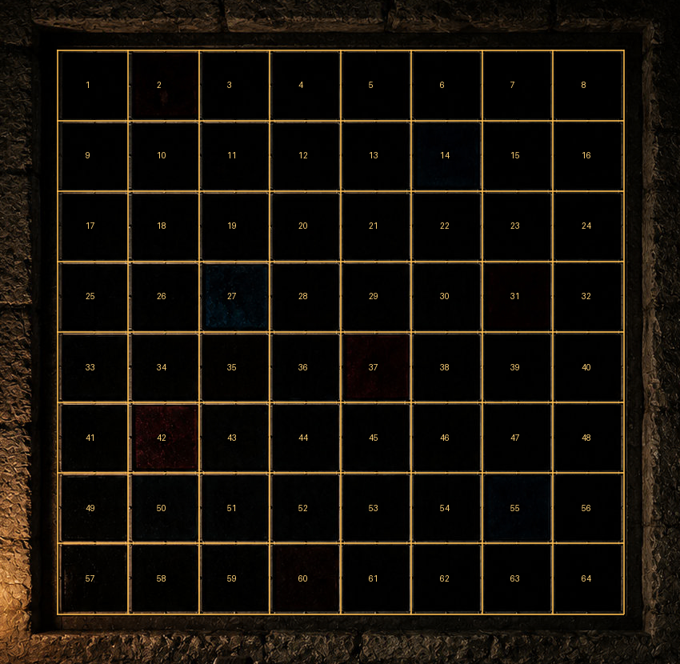

# Сокрытие данных в таблице квантования цветностной компоненты JPEG

## 1. Постановка задачи

Выданы два объекта. Файл `task.jpg` содержит изображение интерьера капеллы: каменная стена, свеча на выступе, скамья и оконный проём, разделённый свинцовым переплётом. Архив `reliquary.zip` содержит единственный файл `flag.txt` и защищён паролем.

Поскольку иные источники пароля отсутствуют, анализу подлежит изображение, тогда как архив выполняет функцию контрольного механизма.

Формулировка легенды указывает на состав материала, а не на изображаемое им, что задаёт направление поиска.

## 2. Результаты стандартных процедур

Извлечение метаданных не обнаруживает ни комментариев, ни посторонних сегментов. Поиск печатных последовательностей осмысленных цепочек не даёт. Сканирование на вложенные структуры результата не приносит, данные за пределами области изображения отсутствуют. Проверка на наличие контейнера steghide без пароля отрицательна.

Анализ младших значащих битов в данном случае лишён смысла принципиально: JPEG использует сжатие с потерями, вследствие чего значения отсчётов после декодирования не совпадают со значениями, имевшимися при кодировании, и любая информация, внесённая в младшие биты, разрушается.

Установлено, что данные размещены не в отсчётах изображения.

## 3. Аномалия объёма файла

Параметры файла:

```
Geometry: 1254x1254+0+0
Filesize: 473765B
jpeg:sampling-factor: 1x1,1x1,1x1
Quality: 90
```

Объём приближается к половине мегабайта при том, что изображение преимущественно состоит из областей низкой яркости с малым числом деталей. Контрольное перекодирование с качеством 85 даёт 273152 байта при визуально неотличимом результате, то есть почти двукратное сокращение.

Следовательно, кодирующая сторона сохраняла некоторую компоненту с точностью, не обусловленной содержанием изображения. В формате JPEG точность представления задаётся единственным механизмом — таблицами квантования.

## 4. Анализ таблиц квантования

Обе таблицы извлекаются из сегментов `FFDB` и сопоставляются.



*Рис. 1. Сопоставление таблиц квантования яркостной и цветностной компонент. Яркостная таблица демонстрирует характерный монотонный рост значений от низких частот к высоким; цветностная таблица упорядоченности не обнаруживает, что несовместимо с работой штатного кодировщика.*

Яркостная таблица соответствует норме: значения возрастают от левого верхнего угла к правому нижнему, низкочастотные коэффициенты сохраняются точно, высокочастотные грубо.

Цветностная таблица монотонности не обнаруживает; значения распределены без выраженной структуры и ни одно из них не превышает 27.

Указанное состояние недостижимо при штатном кодировании. Обе таблицы масштабируются от общей настройки качества и расходиться не могут. В рассматриваемом файле яркостная таблица соответствует качеству около 85, тогда как цветностная отвечает значению выше 95, что свидетельствует об их независимом формировании.

```
таблица 1 (цветность)
     1  19   8  27   1  14   4  27
     3  15   2   1  12  20  27   1
    14   4  27   9  18  15  14  27
    23   5  18   5  27  23   5   9
     7   8   5   4  27   2   5   6
    15  18   5  27  20   8   5  27
     7  12   1  19  19  27  23   1
    19  27  16  15  21  18   5   4
```

## 5. Интерпретация числовых значений

Таблица содержит шестьдесят четыре значения в диапазоне от 1 до 27. Мощность диапазона на единицу превышает мощность латинского алфавита, что указывает на подстановку вида A1Z26, в которой значение 27 выполняет роль разделителя слов.



*Рис. 2. Оконный проём, разделённый свинцовым переплётом на восемь вертикальных и восемь горизонтальных секций. Общее число ячеек совпадает с размерностью таблицы квантования, что подтверждает выбор носителя.*

Выбор цветностной компоненты в качестве носителя согласуется с сюжетом: витражное стекло не является источником излучения и лишь модифицирует спектральный состав проходящего света. При отсутствии внешнего освещения изображение не воспроизводится, тогда как состав материала сохраняется.

## 6. Восстановление порядка следования

Непосредственная подстановка байтов в порядке их следования в сегменте `FFDB` даёт:

```
ASCNOH BDWGE AANLIRHOGREERTD  O DELS A  WNA EBTSPOSHEIFE URW AED
```

Алфавит распознаётся как латинский, распределение разделителей соответствует словесной структуре, однако текст не читается, что указывает на неверный порядок элементов.

В пределах блока размерностью восемь на восемь формат JPEG хранит коэффициенты не построчно, а в порядке диагонального обхода от низких частот к высоким; таблица квантования размещается в том же порядке. Обратное преобразование потока в построчную сетку даёт:

```
ASH AND COBALT AND IRON WERE WEIGHED BEFORE THE GLASS WAS POURED
```

Длина строки составляет ровно 64 символа. Содержание перечисляет компоненты стекольной шихты, что согласуется с формулировкой легенды.

## 7. Извлечение содержимого

Полученная строка целиком, включая разделители, применяется в качестве пароля.

```python
from PIL import Image
import pyzipper

q = Image.open("task.jpg").quantization[1]
pw = "".join(" " if v == 27 else chr(v + 64) for v in q)

with pyzipper.AESZipFile("reliquary.zip") as z:
    z.setpassword(pw.encode())
    print(z.read("flag.txt").decode())
```

Следует учитывать, что библиотека Pillow возвращает таблицу уже приведённой к построчной сетке, вследствие чего обратное диагональное преобразование не требуется. При непосредственном разборе файла оно обязательно.

## 8. Заключение

Решение опирается на три наблюдения. Первое состоит в том, что несоответствие объёма файла содержанию изображения указывает на аномалию представления, а не на наличие вложенных данных. Второе заключается в диагностическом признаке: расхождение яркостной и цветностной таблиц квантования по эффективному качеству недостижимо при штатном кодировании и однозначно свидетельствует о постороннем вмешательстве. Третье состоит в необходимости учёта порядка хранения коэффициентов, при игнорировании которого извлекаемая последовательность сохраняет статистические признаки осмысленного текста, оставаясь нечитаемой.

Итоговый результат: `flag{m4ny_r3g10ns_0n3_n3tw0rk}`
