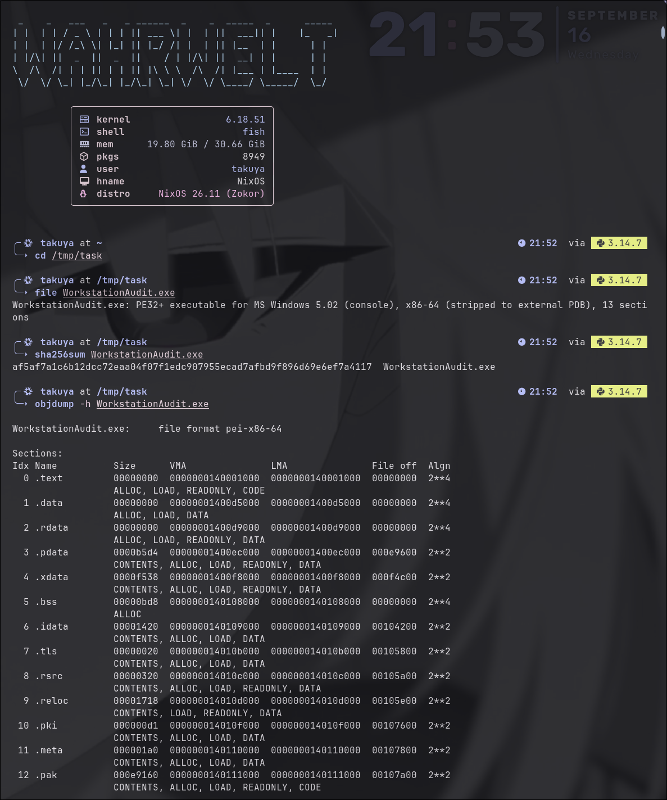
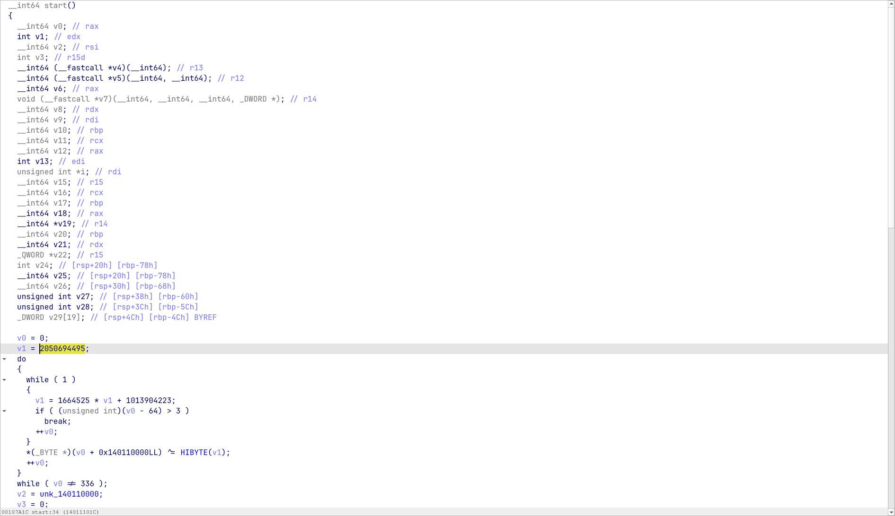
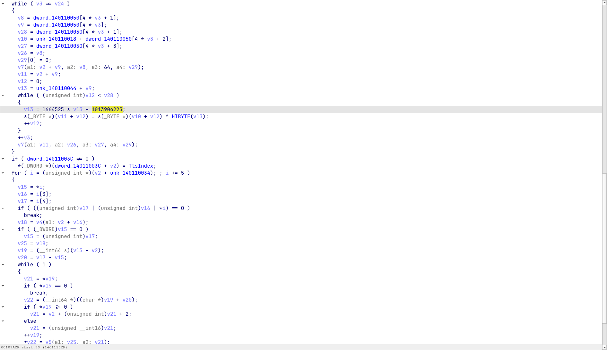
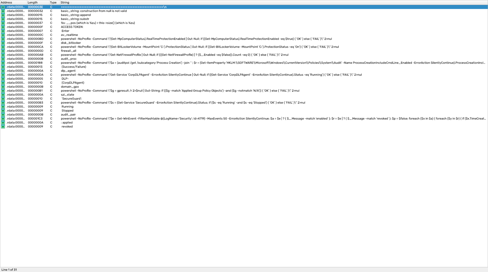
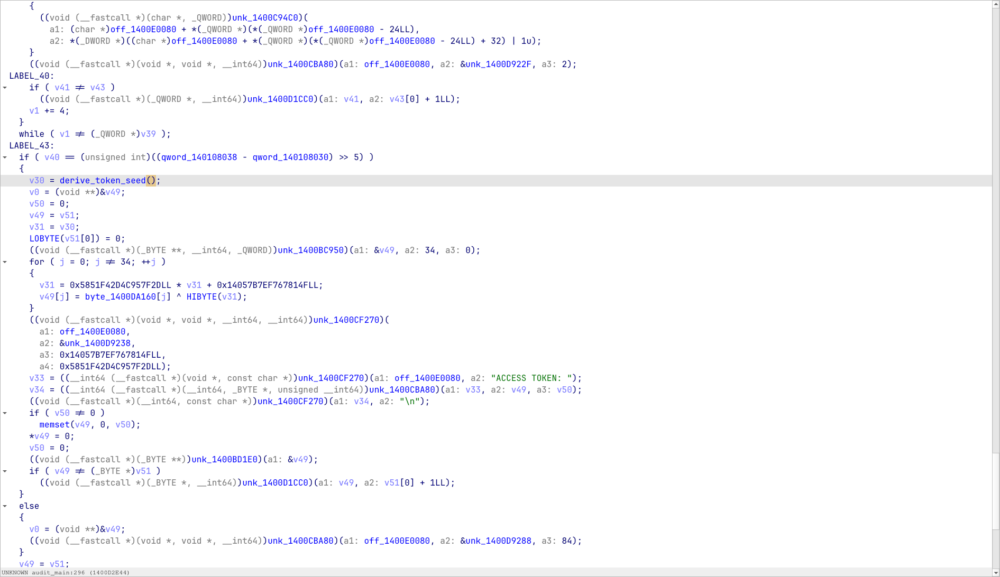
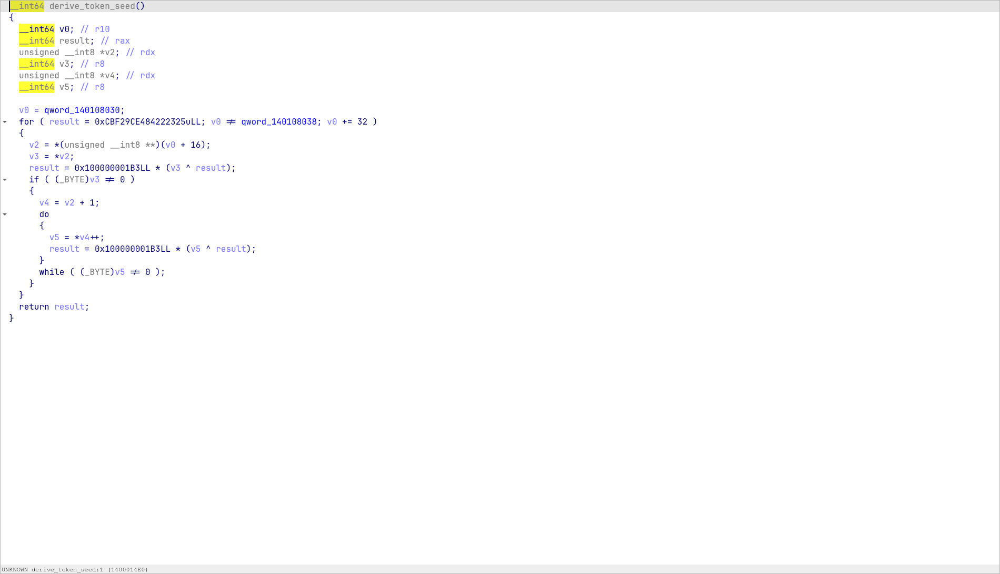
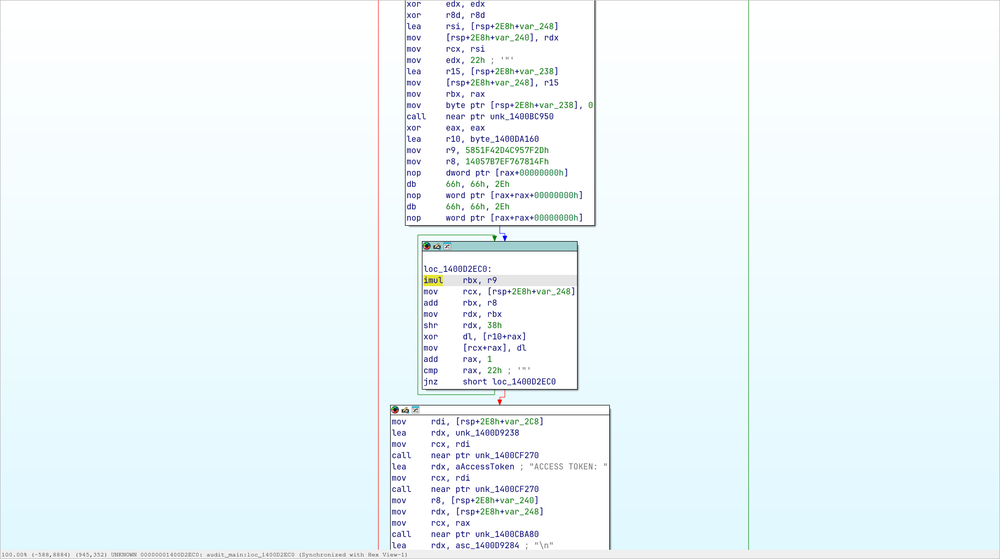

# Аудит

Категория: Reverse

Флаг: `flag{h1st0ry_s4v3d_c0d3_r3wr1tt3n}`

## 0. Что дали

В задании лежит один 64-битный Windows-бинарь `WorkstationAudit.exe`. По легенде это корпоративный чекер: он проверяет настройку рабочей станции и при успешном прохождении всех пунктов печатает отчетный токен.

Сразу фиксирую файл, с которым работаю:

```text
WorkstationAudit.exe
sha256: af5af7a1c6b12dcc72eaa04f07f1edc907955ecad7afbd9f896d69e6ef7a4117
format: PE32+ executable, x86-64, console
```

Запускать неизвестный PE на основной машине не требуется. Весь разбор ниже статический.

## 1. Первичный осмотр

Начинаю с обычных `file`, `strings` и таблицы секций:

```bash
file files/WorkstationAudit.exe
sha256sum files/WorkstationAudit.exe
objdump -h files/WorkstationAudit.exe
strings -a -n 5 files/WorkstationAudit.exe | less
```



У файла странная раскладка:

```text
.text   virtual 0x000d4000, raw 0
.data   virtual 0x00004000, raw 0
.rdata  virtual 0x00013000, raw 0
.meta   raw 0x000001a0
.pak    raw 0x000e9160
```

Точка входа находится по RVA `0x111000`, то есть прямо в `.pak`. Нормальные `.text`, `.data` и `.rdata` занимают место в памяти, но их содержимого в обычных raw-секциях нет. В строках исходного файла остаются в основном импорты маленького загрузчика и случайный шум.

Значит передо мной не основной код чекера, а упаковщик. Его задача - восстановить исходные секции в памяти и передать управление настоящему entry point.

## 2. Разбираем загрузчик

Открываю файл в IDA и начинаю с `start` по адресу `0x140111000`. В начале функция расшифровывает 336 байт из `.meta`. Используется обычный 32-битный LCG:

```text
state = state * 1664525 + 1013904223 mod 2^32
byte ^= state >> 24
```

Начальное состояние равно `2050694495`. Байты метаданных `0x40-0x43` загрузчик специально пропускает.



После расшифровки структура `.meta` становится читаемой:

```text
image base       0x140000000
payload source   0x1401111d0
original OEP RVA 0x1480
import RVA       0x109000
global seed      0x9e3779b9
chunk count      3
```

Сразу после заголовка лежат три дескриптора по 16 байт:

| Target RVA |      Size | Offset в payload | Protection |
| ---------: | --------: | ---------------: | ---------: |
|   `0x1000` | `0xd3340` |            `0x0` |     `0x20` |
|  `0xd5000` |  `0x3170` |        `0xd3340` |      `0x4` |
|  `0xd9000` | `0x12ae0` |        `0xd64b0` |      `0x2` |

Это ровно диапазоны с кодом, изменяемыми данными и строками. Для каждого дескриптора упаковщик вызывает `VirtualProtect`, берет начальное состояние `0x9e3779b9 + target_rva` и расшифровывает payload тем же LCG.



После этого загрузчик восстанавливает импорты, вызывает TLS callback и переходит на исходный entry point `0x140001480`.

## 3. Восстанавливаем memory image

Чтобы не копировать байты вручную из отладчика, я написал [unpack.py](unpack.py). Скрипт:

1. Разбирает PE-заголовок и отображает raw-секции по их RVA.
2. Расшифровывает `.meta`.
3. Читает из метаданных адрес payload, seed и таблицу диапазонов.
4. Восстанавливает три исходных диапазона в memory image.

Запуск дает ожидаемую карту:

```bash
python3 unpack.py
```

```text
image_base=0x140000000
entry=0x140001480
chunk rva=0x1000 size=0xd3340 source=0x0 protection=0x20
chunk rva=0xd5000 size=0x3170 source=0xd3340 protection=0x4
chunk rva=0xd9000 size=0x12ae0 source=0xd64b0 protection=0x2
wrote files/WorkstationAudit.mem (2076672 bytes)
```

Получившийся `WorkstationAudit.mem` - это memory image для анализа, а не файл для запуска. Исходный exe скрипт не меняет.

После загрузки восстановленных диапазонов в IDA появляются строки настоящего чекера. Среди них сразу видны `ACCESS TOKEN`, названия восьми проверок и PowerShell-команды.



Одна проверка особенно хорошо показывает, что честно получить токен на обычной машине не предполагается:

```powershell
$s = (Get-Service 'SecureGuard').Status
if ($s -eq 'Running' -and $s -eq 'Stopped') { 'OK' } else { 'FAIL' }
```

Одна и та же служба должна одновременно иметь состояния `Running` и `Stopped`. Значит задача действительно про восстановление генератора токена, а не про настройку Windows.

## 4. Находим место печати токена

Строка `ACCESS TOKEN: ` находится по адресу `0x1400d9275`. RIP-relative ссылка на нее приводит в функцию `0x1400d2740-0x1400d3054`, которую я назвал `audit_main`.

Сначала `audit_main` проходит по глобальному вектору проверок. Для каждой записи он запускает команду через `popen`, читает вывод и ищет строку `OK`. В псевдокоде сравнение выглядит как:

```c
if (line.size() == 2 && *(uint16_t *)line.data() == 0x4b4f)
    ++passed;
```

`0x4b4f` в little endian - это ASCII `OK`.

Токен строится только если `passed` равен числу элементов вектора. В успешной ветке код вызывает функцию `0x1400014e0`, выделяет строку на 34 байта и запускает второй LCG:



В этой точке задача разделяется на две части:

- восстановить seed из `derive_token_seed`;
- повторить 34 итерации финального LCG.

## 5. Восстанавливаем seed

Функция `0x1400014e0` короткая. Я назвал ее `derive_token_seed`.



Константы сразу выдают FNV-1a 64-bit:

```text
offset basis = 0xcbf29ce484222325
prime        = 0x100000001b3
```

Глобальный вектор лежит между `qword_140108030` и `qword_140108038`. Размер одной записи равен `0x20`, а поле по смещению `+0x10` содержит указатель на PowerShell-команду.

Статическая таблица по RVA `0xda060` содержит восемь записей:

|   N | ID               | Назначение команды                    |
| --: | ---------------- | ------------------------------------- |
|   0 | `av_realtime`    | Проверка realtime-защиты Defender     |
|   1 | `disk_bitlocker` | Проверка BitLocker для `C:`           |
|   2 | `firewall_all`   | Проверка всех профилей firewall       |
|   3 | `audit_proc`     | Проверка аудита Process Creation      |
|   4 | `dlp_agent`      | Проверка службы `CorpDLPAgent`        |
|   5 | `domain_gpo`     | Проверка примененных GPO              |
|   6 | `szi_state`      | Противоречивая проверка `SecureGuard` |
|   7 | `audit_pair`     | Поиск пары событий аудита 4719        |

Функция хеширует команды именно в этом порядке. В хеш каждой строки входит и завершающий нулевой байт. Эквивалентный код:

```python
state = 0xCBF29CE484222325
prime = 0x100000001B3

for command in commands:
    for value in command + b"\0":
        state = ((state ^ value) * prime) & 0xFFFFFFFFFFFFFFFF
```

Для таблицы из бинаря получается:

```text
seed = 0x24c281c32b2bbbe0
```

## 6. Расшифровываем токен

Зашифрованный массив начинается по адресу `0x1400da160` и имеет длину 34 байта. Финальный генератор использует другие 64-битные константы:

```text
A = 0x5851f42d4c957f2d
B = 0x14057b7ef767814f
```

На каждой итерации:

```python
state = (A * state + B) & 0xFFFFFFFFFFFFFFFF
plain[i] = encrypted[i] ^ (state >> 56)
```

Здесь есть маленькая ловушка. Hex-Rays показывает `HIBYTE(v31)`, что без проверки легко принять за байт `8-15`. В дизассемблере явно стоит `shr rdx, 38h`, поэтому нужен именно старший байт 64-битного состояния.



Полная логика вынесена в [solve.py](solve.py). Скрипт читает указатели на команды прямо из восстановленного образа, вычисляет FNV-1a и расшифровывает массив токена.

## 7. Получаем флаг

Финальный запуск:

```bash
python3 unpack.py
python3 solve.py
```

Результат:

```text
flag{h1st0ry_s4v3d_c0d3_r3wr1tt3n}
```

В итоге чекер не пришлось запускать и не пришлось воспроизводить невозможную конфигурацию рабочей станции. Достаточно было снять первый слой упаковки, восстановить таблицу проверок и повторить два небольших алгоритма из успешной ветки.
